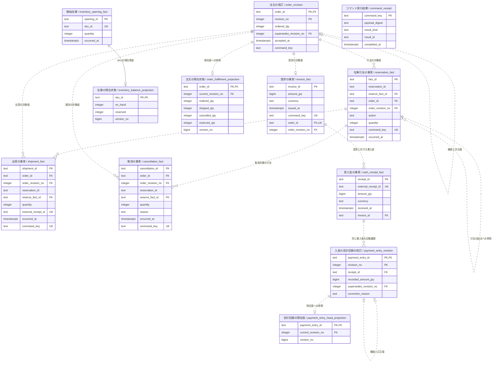

# 統合業務モデルの参照資料

この資料は、第7章のPostgreSQL実証で用いる表の責務、全属性ER図、SQLに基づく業務処理とテーブル操作を参照するための資料です。目的に応じて各節へ移動できます。

- [固定ケースと12表の責務](#table-roles)
- [全属性ER図](#full-er)
- [CRUDとトランザクション](#business-processes)
- [再送・失敗時の処理](#retry-and-failure)
- [状態照会・照合・再構築](#queries-and-rebuild)

[詳細版の第7章](report-detailed.md#ch7)では、数量・金額の推移と実証の範囲を説明しています。

## 固定ケースと12表の責務

このケースは単一SKU・一注文行・一つの実入金を扱います。在庫10個に対し、注文を10個から8個へ改訂し、8個を引き当てます。3個を出荷して残り5個を取り消すため、最終的な在庫は7個、引当残は0個です。出荷分3,000円を請求・受領し、誤って3,300円と記帳した会計記録を3,000円へ訂正します。この訂正で実入金や返金は増えません。

表の所有者・役割と、表定義および所有者操作で担う主な条件を一覧にします。条件の詳細と実証SQL上の操作は後続の対応表を参照してください。
### 表ごとの責務と主な制約

| 表 | 所有者・役割 | 主な制約と責任 |
|---|---|---|
| `inventory_opening_fact` | Inventory。SKUごとの開始在庫という正本事実です。 | `opening_id`を主キーとし、`sku_id`はNOT NULLかつ一意です。数量は非負整数で、時刻を保持します。この例はSKUごとに開始事実一件という限定です。 |
| `order_revision` | OrderFulfillment。注文数量への合意を版として記録します。 | `(order_id,revision_no)`主キー、注文ごとの`command_key`一意、親版への自己外部キーと一つの子しか持たない一意制約を使います。ルートは版1、子は親版+1とし、注文の現在状態テーブルの行ロックを保持した状態で現行版を進めます。履行・引当の事実ができた後の改訂は拒否します。 |
| `reservation_fact` | Inventory。`RESERVE`、`CONSUME`、`RELEASE`の在庫引当事実です。 | 数量正値、注文版参照、`command_key`一意です。引当ごとに`RESERVE`根を一つだけ許し、後続行は根を参照します。消費+解放は引当量を超えられません。この集計条件と根の意味は表の所有者が実行するトランザクションで検査します。FKは参照行の存在しか保証しないため、根が正しい`RESERVE`で同じ注文・版・引当かも検査します。 |
| `shipment_fact` | OrderFulfillment。出荷成立を記録します。 | 主キー、注文版外部キー、出荷証憑`external_receipt_id`一意、`command_key`一意、正数量です。`reserve_fact_id`が存在するだけで同じ引当への正当な参照とは限らず、所有者操作で識別子と根の属性を照合します。対応する`CONSUME`と一取引で確定します。 |
| `cancellation_fact` | OrderFulfillment。業務上の未出荷分取消です。 | 主キー、注文版参照、取消理由必須、正数量、`command_key`一意です。引当根との一致を検査し、対応する`RELEASE`と同じ取引で確定します。 |
| `invoice_fact` | Receivables。請求の成立を記録します。 | 主キー、円通貨、非負金額、注文ごと一件、注文版への複合外部キーを持ちます。この例の一注文一請求は本番の一般規則ではありません。金額は確定済出荷合計と単価1,000円に照らして注文の現在状態テーブルの行ロックを保持した状態で検査し、破棄可能な現在状態テーブルではなく保持した注文版を参照します。 |
| `cash_receipt_fact` | Receivables。実際に受領した現金の事実です。 | 受領IDを主キー、外部受領IDを一意、金額を正数、通貨を円にし、請求へ外部キーで結びます。外部受領IDは異なるコマンドキーから同じ受領証憑を二重登録することも防ぐ業務上の重複識別子です。 |
| `payment_entry_revision` | Receivables。入金の帳簿記録の版と訂正理由です。 | `(payment_entry_id,revision_no)`主キー、親版自己外部キー、親ごとの部分一意制約、受領への外部キーを持ちます。一つの受領にルート記録は一つで、全改訂が同じ受領を参照します。所有者は親をロックし、現在の系譜末端からのみ版を追加します。時刻の最大値で現行版を選びません。訂正版には理由を要求します。 |
| `command_receipt` | コマンド所有コンテキスト。コマンドの実行結果を記録するテーブルです。 | `command_key`主キー、正規化ペイロードのハッシュ値、結果種別・結果ID・完了時刻を持ちます。業務事実と現在状態テーブルを同じ取引で更新するときに記録し、同じキーと同じハッシュ値なら既存結果、同じキーで異なるハッシュ値なら競合として返します。保存期間は再送が来る期間を覆う必要があります。これはコマンド結果の記録であり、`cash_receipt_fact`の入金そのものではありません。 |
| `inventory_balance_projection` | Inventory。現在庫と引当を保持するロック対象・現在状態テーブルです。 | SKUを主キーかつ開始事実へ外部キーで結び、`on_hand>=0`、`0<=reserved<=on_hand`とversionを持ちます。在庫事実と同じ取引で更新します。ロック対象行またはversion比較を設計候補にできますが、既存の実証で確認した競合経路は行ロックです。CASによる再構築世代管理は未検証です。 |
| `order_fulfillment_projection` | OrderFulfillment。現行注文版と履行進捗の現在状態テーブルです。 | 注文主キー、現行版への複合外部キー、出荷・取消・引当数量とversionを持ちます。`shipped_qty+cancelled_qty<=ordered_qty`および、将来の使用枠を含めた`shipped_qty+cancelled_qty+reserved_qty<=ordered_qty`を表の所有者が実行するトランザクションで守ります。注文改訂・出荷・取消・引当事実から再構築します。 |
| `payment_entry_head_projection` | Receivables。入金の会計記録の明示的な現行版を保持します。 | 入金の会計記録IDを主キー、選択版への外部キー、versionを持ちます。改訂追加と同じ取引で更新し、timestampの最大値ではなく、正本の親子連鎖末端が選ばれていることを再構築で検証します。 |

表内のCHECKや外部キーだけで守れるものと、複数行集計を伴い所有者操作で守るものを区別します。例えば各数量が正であっても、消費合計が引当合計以下という条件は複数行をまたぎます。CHECKはNULLに対するUNKNOWNを許すこともあるため、必須値にはNOT NULLが必要です。[R08-S01](<https://www.postgresql.org/docs/18/ddl-constraints.html>)（§5.5.1）外部キーは参照先の存在を守りますが、参照先の種別や他の識別子との一致まで自動的には証明しません。

## 全属性ER図

実証SQLで定義した全属性を、型・主キー・外部キーとともに記載しています。記録時刻、理由、コマンドキーなども省略していません。

<!-- generated-er:start -->

<!-- generated-er:end -->

## 図の読み方

- `PK`は主キー、`FK`は外部キー、`UK`は一意制約です。複合主キー・複合外部キーは、同じ参照を構成する列の組として読みます。例えば、引当の`order_id`と`order_revision_no`は、組で注文の一つの版を参照します。
- 線の端の`||`は必ず1件、`o|`または`|o`は0件か1件、`o{`または`}o`は0件以上を表します。実線は識別関係、破線は非識別関係です。在庫の現在状態は、開始在庫の一意な`sku_id`をそのまま主キーとして使うため実線で示しています。記法は[MermaidのER図の説明](https://mermaid.js.org/syntax/entityRelationshipDiagram.html)に従っています。
- 図の多重度は、実証SQLの外部キーと一意制約が許す範囲です。現在状態テーブルの行は正本から再生成できるため、正本側から見た件数は0件か1件です。正本が必ず現在状態テーブルを参照する構造にはしていません。
- `command_receipt`には他表への外部キーがありません。そのため線を引いていません。コマンドの実行結果、業務事実、現在状態テーブルを同じトランザクションで確定することは、外部キーの有無とは別の保証です。

この図は全属性を示していますが、すべての制約を属性の記号だけで表しているわけではありません。例えば、注文改訂の`UNIQUE(order_id, command_key)`は列の組に対する一意制約です。`command_key`単独で一意であるとは示していません。NULLの可否や既定値などの定義全体は、実証SQLも併せて参照してください。

## 図だけでは表せない条件

- 注文と会計記録の改訂では、初版だけ親版がありません。親ごとの子は最大1件で、子の版番号は親の版番号に1を加えた値です。会計記録は一つの実入金に対して初版を一つだけ持ち、所有者の操作で改訂先の受領IDも固定します。部分一意索引とCHECK制約、所有者の検査を併用しています。
- `reservation_fact`の`RESERVE`行は、`reserve_fact_id`で自分自身を参照します。`CONSUME`と`RELEASE`は引当の起点となる行を参照します。外部キーだけでは参照先が`RESERVE`であることや同じ注文・引当であることを保証しないため、所有者の操作で検査します。
- 請求は、注文の版ごとではなく注文全体で最大1件です。同様に、現在版への参照は注文IDまたは会計記録IDごとに最大1件です。図に示す版との関連だけで、これらの条件をすべて表しているわけではありません。
- 実入金に複数の会計記録の版が対応しても、実入金が増えるわけではありません。請求に対する入金件数も、SQLの外部キーだけでは1件に限定されません。本文の実証ケースは一つの実入金に限定しています。
- 在庫と引当、出荷と`CONSUME`、取消と`RELEASE`の対応や数量上限は、所有者の操作が検査します。実証SQLにない外部キーの線を追加して表現することはしていません。

## 業務処理とテーブル操作の対応

### この対応表で確認すること

ER図からは、表の構造と参照関係を読み取れます。業務処理を重ねる目的は、どの出来事をどの表に記録し、何を参照して成立を判断し、どの現在状態を一緒に更新するかを確認することです。これにより、書き込み漏れ、責任の曖昧さ、トランザクションの分割による不整合を検討できます。

そこで、**CRUDマトリクス**と、**業務処理ごとのトランザクション・不変条件の対応表**を併用します。CRUDの記号は行への操作を示すため、業務上の変更の意味も併記します。このモデルでは、注文数量の改訂、業務取消、記帳訂正のいずれも、正本には新しい行を追加します。既存行のUPDATEやDELETEと業務上の意味を結び付けるときは、この違いを確認します。

以下は[実証SQLの操作関数](../validation/harness/fixture.sql)に基づく対応です。新たな業務機能を提案した一覧ではありません。単一SKU・一注文明細の固定ケースを対象とし、実証SQLの関数自身はCOMMITせず、呼び出し側のトランザクションに参加します。

### 業務処理と、成立する事実

| ID | 業務処理 | 正本に記録する内容 | SQLの入口 |
|---|---|---|---|
| B01 | 開始在庫の登録 | 在庫10個という開始事実です。検証用の初期化で、一般的な入庫・棚卸調整機能ではありません。 | `seed_sku` |
| B02 | 受注の受付 | 注文数量10個の合意を版1として記録します。 | `accept_order`の初回登録 |
| B03 | 受注数量の改訂 | 数量8個の合意を版2として追加し、版1への参照を残します。 | `accept_order`の改訂 |
| B04 | 在庫引当 | 8個の引当を`RESERVE`として記録します。 | `reserve` |
| B05 | 出荷 | 3個の出荷と、その引当を消費する`CONSUME`を記録します。 | `ship` → `_move`の出荷分岐 |
| B06 | 未出荷残数量の取消 | 残り5個の取消と、引当を解放する`RELEASE`を記録します。 | `cancel_remaining` → `_move`の取消分岐 |
| B07 | 請求 | 出荷3個に対する3,000円の請求を記録します。 | `issue_invoice` |
| B08 | 実入金の登録 | 外部証憑IDを伴う実入金3,000円を記録します。 | `record_cash_receipt` |
| B09 | 入金の初回記帳 | 実入金に対する会計記録の版1です。共通ケースでは誤って3,300円を記帳します。 | `post_payment_entry_revision`の初回登録 |
| B10 | 記帳誤りの訂正 | 同じ実入金に対して、3,000円の版2と訂正理由を追加します。実際の返金ではありません。 | `post_payment_entry_revision`の改訂 |

### 通常の業務処理のCRUDマトリクス

この表は、**新規要求が正常に成立する経路**を表します。再送や失敗時の経路は後の表に分けています。

- `C`はINSERTによる行の追加、`R`は処理中の明示的なSELECT、`U`は既存行のUPDATE、`D`は行のDELETEです。`CR`や`RU`は、同じ処理で両方の操作を行うことを示します。
- `R`には集計やSELECT FOR UPDATEも含めます。外部キー・一意制約の内部検査や、UPDATEの対象探索・式評価に伴う読み取りは、独立した`R`に数えません。したがって`—`でも、ER図に示した参照先の存在検査が行われる場合があります。
- 初回登録時の`R`には、現在状態テーブルに行がまだないことの確認も含めます。行が見つからないSELECT FOR UPDATEでは、その存在しない行を行ロックできるわけではありません。初回登録の競合制御は、後の表に示すアドバイザリロックや一意制約と併せて読みます。

<!-- business-crud-matrix:start -->
| テーブル | B01 | B02 | B03 | B04 | B05 | B06 | B07 | B08 | B09 | B10 |
|---|---|---|---|---|---|---|---|---|---|---|
| `inventory_opening_fact` | C | — | — | R | R | R | — | — | — | — |
| `order_revision` | — | C | C | — | — | — | — | — | — | — |
| `reservation_fact` | — | — | — | C | CR | CR | — | — | — | — |
| `shipment_fact` | — | — | — | — | C | — | R | — | — | — |
| `cancellation_fact` | — | — | — | — | — | C | — | — | — | — |
| `invoice_fact` | — | — | — | — | — | — | C | — | — | — |
| `cash_receipt_fact` | — | — | — | — | — | — | — | C | — | — |
| `payment_entry_revision` | — | — | — | — | — | — | — | — | C | CR |
| `command_receipt` | — | CU | CU | C | C | C | C | C | C | C |
| `inventory_balance_projection` | C | — | — | RU | RU | RU | — | — | — | — |
| `order_fulfillment_projection` | — | CR | RU | RU | RU | RU | R | — | — | — |
| `payment_entry_head_projection` | — | — | — | — | — | — | — | — | CR | RU |
<!-- business-crud-matrix:end -->

このマトリクスから、正本の8表は通常経路で追記され、現在状態の3表は必要に応じて更新されることが分かります。`command_receipt`は共通の実行機構として使います。B02・B03では新規作成後に結果IDをUPDATEするため`CU`です。新規要求に対する他の処理では`C`であり、全処理で一律に`RU`を付けているわけではありません。

`inventory_opening_fact`のB04〜B06の`R`は、固定ケースで対象SKUを特定するSELECTです。引当可能量は`inventory_balance_projection`と`order_fulfillment_projection`から検査します。開始数量を読み直して、それだけで引当可否を判断する処理ではありません。

表の設計上の責任も区別します。Inventoryは開始在庫・引当事実・在庫の現在状態、OrderFulfillmentは注文改訂・出荷・取消・注文の現在状態、Receivablesは請求・実入金・会計記録改訂・会計記録の現在版を所有します。`command_receipt`の記録には各コマンドの実行責任者が責任を持ちます。実証コードは一スキーマの関数群であり、この所有権を本番のDB権限で強制する実装は含みません。

### トランザクションと不変条件の対応

下表は、各処理で一緒に確定すべき書き込みと、その成立条件です。`command_receipt`への記録はB02〜B10すべてに含まれます。処理を呼び出す側は、事実・現在状態・コマンド実行結果を同じトランザクションで確定またはロールバックします。

| 処理 | 一緒に確定する書き込み | 明示的な参照・ロックと、成立条件 |
|---|---|---|
| B01 | 開始在庫と在庫の現在状態を追加します。 | SKUの一意性と数量の非負をDB制約で検査します。再送を識別する共通機構は使っていません。 |
| B02 | 注文の版1と注文の現在状態を追加します。 | 注文IDのトランザクションレベルのアドバイザリロックを取得し、現在状態の未登録と、初版の番号・親版なしを検査します。 |
| B03 | 注文の新しい版を追加し、現在版への参照と合意数量を更新します。 | 注文IDのアドバイザリロックと既存の注文状態行の行ロックを使います。親版の一致、次の版番号、現在の出荷・取消・引当数量がすべて0であることを検査します。 |
| B04 | `RESERVE`を追加し、在庫と注文の引当数量を増やします。 | 注文状態行、SKUの在庫状態行の順にロックします。在庫の利用可能量と、既存引当も控除した注文枠を両方検査します。 |
| B05 | 出荷と`CONSUME`を追加し、実在庫・在庫側引当・注文側引当を減らし、出荷数量を増やします。 | 注文状態行、在庫状態行の順にロックします。引当の起点と対象注文版の一致、未消費・未解放の引当残、注文枠、実在庫を検査します。起点や消費・解放の事実は参照しますが、更新しません。 |
| B06 | 取消と`RELEASE`を追加し、在庫側・注文側の引当を減らし、取消数量を増やします。 | B05と同じ順序で状態行をロックし、引当残と注文の残数量を検査します。実在庫数量は変えません。 |
| B07 | 請求事実を追加します。 | 注文状態行をロックし、現在の注文版と出荷事実の集計を確認します。請求額は出荷数量×1,000円、一注文一請求は一意制約で守ります。 |
| B08 | 実入金事実を追加します。 | 外部入金IDの一意性、金額の正値、円通貨、参照先請求の存在をDB制約で検査します。請求本体をSELECTして未収残高や過入金を判定する処理はありません。 |
| B09 | 会計記録の版1と現在版への参照を追加します。 | 会計記録IDのアドバイザリロックを使い、現在版の未登録と初版の条件を確認します。実入金の存在は外部キーで検査しますが、実入金額との一致は自動照合していません。 |
| B10 | 訂正版を追加し、現在版への参照を更新します。 | アドバイザリロックと現在版参照行の行ロックを使います。現在の会計記録を参照して受領IDの不変性を検査し、親版・次版番号・訂正理由の条件を守ります。旧版と実入金事実は更新しません。 |

B05とB06が競合するのは、同じ引当残と注文枠を使うためです。別々の事実表へINSERTするだけでは解決しません。共有する現在状態のロックと、ロック後の再検査を含めて一つの処理として確認します。検証結果は[V02](../validation/cases/V02/results.json)と[V04](../validation/cases/V04/results.json)にあります。

### 再送・失敗時は通常経路と分ける

B02〜B10は、共通関数`_command_start`を通ります。出荷と取消では`_move`を経由します。

| 場合 | テーブル操作と結果 |
|---|---|
| 同じキー・同じ内容の再送 | コマンド行のINSERTは競合時に追加を行わず、既存の`command_receipt`をSELECT FOR UPDATEで参照します。保存済みの結果を返し、他の業務表への追加・更新は行いません。確定済みの行に対する操作は`R`です。 |
| 同じキー・異なる内容 | 同じく実行結果の記録を参照し、内容のハッシュ値が一致しなければ拒否します。 |
| 別キーで同じ外部入金IDを再登録 | 要求キーによる再送判定とは別に、実入金表の一意制約で拒否します。その失敗で、新しく作ろうとしたコマンド行もロールバックします。 |
| 条件違反・途中失敗 | 通常経路の表に示す書き込みを途中まで試みても、トランザクションがロールバックされれば確定した`C`・`U`は残りません。失敗した処理を一部成功として扱いません。 |

この違いは[V01](../validation/cases/V01/results.json)と[V03](../validation/cases/V03/results.json)で確認しています。共通機構のSELECTがあることを理由に、新規成功経路のすべてのセルを`R`にしてしまうと、実際の分岐が見えなくなります。

### 状態照会・照合・再構築

正本を読み出す用途と、現在状態を読み出す用途も分けます。

- Q01は、`source_rebuild`ビューによる正本からの状態再計算です。ビュー自体を13番目の表として数えず、参照する基底8表に`R`を記載します。
- Q02は、現在状態と正本からの再計算結果を比較する照合クエリ群です。[V01の手順](../validation/cases/V01/run.ps1)で、正本側と現在状態側の一致を確認しています。アプリケーション向けの新しい照会APIを実装したという意味ではありません。
- M01は、V01で行う現在状態テーブルの削除・再作成です。以下では、正本から再生成する処理を示します。比較用の退避や、古い現在版へ書き換える故障注入は含めていません。

<!-- query-maintenance-matrix:start -->
| テーブル | Q01 正本から再計算 | Q02 現在状態との照合 | M01 現在状態の再構築 |
|---|---|---|---|
| `inventory_opening_fact` | R | R | R |
| `order_revision` | R | R | R |
| `reservation_fact` | R | R | R |
| `shipment_fact` | R | R | R |
| `cancellation_fact` | R | R | R |
| `invoice_fact` | R | R | R |
| `cash_receipt_fact` | R | R | R |
| `payment_entry_revision` | R | R | R |
| `command_receipt` | — | — | — |
| `inventory_balance_projection` | — | R | CD |
| `order_fulfillment_projection` | — | R | CD |
| `payment_entry_head_projection` | — | R | CD |
<!-- query-maintenance-matrix:end -->

M01では対象の現在状態の行をDELETEし、正本の集計・改訂系列の末端からINSERTします。正本の事実や改訂は削除しません。再構築中の本番書き込みとの調整や、再構築後も失効しない世代番号の管理は、この実証の対象外です。検証用のDROP SCHEMAによる環境初期化はDDLであり、上表の業務データの`D`とは分けています。

### 設計レビューでの使い方

業務処理を一つ選び、正本への記録、現在状態への反映、成立条件、再送時の振る舞いを横断して確認します。例えばB06では、取消事実だけでなく引当解放事実と二つの現在状態の更新が必要です。B10では、新しい訂正版と現在版への参照だけが変わり、実入金や旧記帳は変わりません。この確認によって、ER図だけでは分からない処理の一貫性を評価できます。

保存期限による削除、出荷訂正、返品、一般的な入庫・在庫調整などは、この12表の実証SQLに業務操作として実装されていません。実装済みの対応と、今後必要になる業務操作は分けて検討します。
