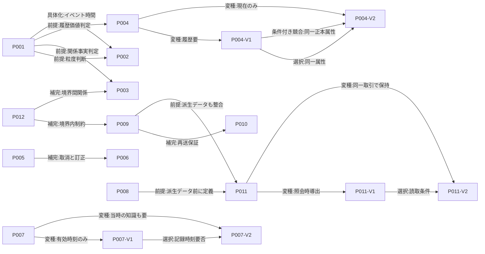

# 業務データモデリングのパターンランゲージ（簡潔版）

事実・イベント・状態遷移を中心とする設計手法の比較と統合

概念・論理モデルから、単一RDBMSでの整合性検証までを扱います。調査日：2026-11-06。改訂日：2026-11-07。

設計判断を短く確認するための簡潔版です。 [詳細版はこちら](report-detailed.md)。二つの版は同じ業務モデル・出典・実証結果に基づいています。

[第1章](#ch1) · [第2章](#ch2) · [第3章](#ch3) · [第4章](#ch4) · [第5章](#ch5) · [第6章](#ch6) · [第7章](#ch7) · [第8章](#ch8) · [第9章](#ch9)

<a id="ch1"></a>

## 第1章 目的と適用範囲

本稿では、通常のRDBを使うモジュラーモノリスで、業務事実の意味を保つデータモデルを設計する際の判断を整理します。提案するのは、全てのUPDATEを禁止する方式ではありません。必要な履歴を記録しながら、更新可能な派生データ、制約、トランザクションを組み合わせます。川島の分類法でも、長期イベントの親状態を更新できるとされています。[R01-S01](<https://scrapbox.io/kawasima/イミュータブルデータモデル>)（§Step2–4）

対象読者は、業務データモデルとRDBの書込み境界を設計する方です。概念モデル・論理モデルに加え、訂正・取消、同時実行、現在状態の派生データを扱います。事実の分類だけで競合時の安全性が決まるわけではなく、個別の制約が必要です。[R08-S04](<https://www.postgresql.org/docs/18/tutorial-transactions.html>)（§3.4）

複数の利用者が扱う受発注・在庫・請求のOLTPを想定します。TPC-C/Eは複雑な業務を考える参考として挙げますが、性能比較の尺度にはしません。特定のORMや言語には依存しません。Reactなどを使う通常のUIでは、サーバーで確定した実行結果を表示します。オフラインでの協調編集は対象外です。

共通のテストデータと操作（テストフィクスチャ）では、SKUと注文行をそれぞれ一つだけ使います。注文数量10を履行前に8へ改訂し、8を引き当て、そのうち3を出荷して、残る5を取り消します。3,000円を受領し、3,300円という記帳誤りを3,000円へ訂正しますが、実際の受領額や返金は変えません。返品、複数SKU、完全な遡及履歴は範囲に含めません。

<a id="ch2"></a>

## 第2章 関連研究と設計思想の比較

各手法は異なる設計水準を扱います。測定のない提案を、性能評価の結果として扱うことはできません。

| 手法・水準 | 主張・モデル | 範囲と留保 |
|---|---|---|
| 川島・概念/論理 | 日時を手掛かりにResource/Eventを分類し、イベントを一業務日時単位に分割します（[R01-S01](<https://scrapbox.io/kawasima/イミュータブルデータモデル>) §§Step2–3）。長期活動の親statusは更新できます（§発展）。 | 著者の公開解説を確認しました。Vol.130の誌面本文は未確認です（[R01-S04](<https://gihyo.jp/dp/ebook/2022/978-4-297-13001-5>)）。 |
| 増田・実践設計 | 同時点の業務事実を分け、INSERTを中心に記録します。状態導出に加え、cache/view表も許容します（[R02-S01](<https://speakerdeck.com/masuda220/she-ji-falsekao-efang-toyarifang>) slides 23–27）。 | 講演での提案であり、比較実験や性能保証はありません。 |
| REA・会計概念モデル | Resource/Event/Agentとstock-flow・dualityを用いて経済事象を表します（[R03-S01](<https://home.business.utah.edu/actme/7410/McCarthy-82.pdf>) pp.562–565）。状態導出とスナップショットの物質化を併記します（pp.563,568）。 | 完全なイベント保持は実務上非現実的とされ、集約は利用者と費用便益に応じて判断します（pp.562,572–573）。これは会計モデルです。 |
| EREN・概念技法 | 非取引も含むData Event網を使い、Transaction/Activity/Occurrence/Historyを区別します（[R04-S02](<https://doi.org/10.4018/jdm.2012100103>) pp.58–65）。同じActivityに開始・終了時刻を置けます（p.67）。 | 川島の一業務日時ごとの分割とは粒度が異なります。技法の有効性は今後の比較課題とされており（p.71）、SQL性能の証拠ではありません。 |
| Event Modeling・設計図 | 時系列にCommands、Events、Viewsと情報の流れを描きます（[R05-S01](<https://eventmodeling.org/posts/what-is-event-modeling/>) §§The Model That Works, Commands）。 | イベントの保存は必須ではなく、通常のDBに直接保存しない例もあります（[R05-S02](<https://eventmodeling.org/posts/event-modeling-traditional-systems/>) §§Events, Tables）。Event Sourcingとは別の手法です。 |
| Datomic・製品モデル | 不変database valueに時点付きの主張を追加・撤回し、as-of/historyで読み取ります（[R06-S01](<https://docs.datomic.com/transactions/model.html>) “It’s All About Information”; [R06-S03](<https://docs.datomic.com/reference/filters.html>) §§as-of, history）。 | retractは業務変化にも誤り訂正にも使われます。製品のtransaction timeを、RDBの格納規則やbusiness-valid timeと同じものとして扱いません。 |

### 補助分野のスクリーニング

| 分野 | この比較での位置 |
|---|---|
| Temporal/Anchor | happening/changing/recording timeを区別し、必要な属性だけに履歴を残します（[R07-S02](<https://www.anchormodeling.com/wp-content/uploads/2010/08/Three_Concepts_of_Time_in_Anchor_Models.pdf>) pp.1,4–6; [R07-S03](<https://www.anchormodeling.com/wp-content/uploads/2012/05/Bitemporal-Anchor-Modeling.pdf>) slide 15）。イベントの抽出法ではありません。 |
| Event Sourcing/CQRS | 状態変更のログ保存（[R08-S05](<https://martinfowler.com/eaaDev/EventSourcing.html>) §How it Works）と、CQRSにおけるクエリ／コマンドおよびリードモデル／ライトモデルの分離（[R08-S06](<https://martinfowler.com/bliki/CQRS.html>)）を扱います。本稿ではCQRSのプロジェクションをリードモデルを組み立てる処理・仕組みとして説明し、リードモデルそのものと区別します。これらは相互にも、概念抽出とも別の設計軸です。 |
| Ledger | Entryから残高を導出する方法、置換・反対記入・差額訂正を比較します（[R07-S04](<https://martinfowler.com/eaaDev/AccountingNarrative.html>) §Making Adjustments）。ここでは草稿の分析パターンとして扱い、会計規範とはみなしません。 |
| ORM/NIAM; Data Vault | ORMは事実型と制約を概念化します（[R12-S01](<https://orm.net/pdf/dppd.pdf>) “What is ORM?”）。Data Vaultは履歴統合を重視する分析基盤です（[R12-S03](<https://datavaultalliance.com/engineering/data-vault-2-0-an-introduction/>)）。 |
| 戦略的DDD | 言語・モデル境界とContext Mapを扱います（[R09-S01](<https://www.domainlanguage.com/wp-content/uploads/2016/05/DDD_Reference_2015-03.pdf>) pp.1–3,28–37）。特定のDB配置は要求しません。 |
| FRP | Functional Relational Programmingは、本質状態と派生状態を分ける分析軸です。FRPの提案は仮説的なものです（[R11-S01](<https://curtclifton.net/papers/MoseleyMarks06a.pdf>) §§7.1,9）。 |

### 統合上の判断

ERENからは、ThingをAgent/Subject/Resource（Product/Service）に、LocationをPlace/Directionに分け、Time/Mannerを検討するテンプレートを採ります。主要イベントから暫定網を作り、詳細化・統合を経て利用者へ確認する流れは、要求の抜けを探す手順として使います。[R04-S02](<https://doi.org/10.4018/jdm.2012100103>)（Fig.5, pp.64–70）

各手法の抽象度は異なるため、RDBの全行を追記専用にする結論は導けません。ERENのActivityは期間単位で表し、川島の方法は一つの業務日時ごとに分けます。必要な照会の粒度に応じて選び、派生データや制約はケースごとに定めます。ERENの実証評価は今後の課題とされています（p.71）。

<a id="ch3"></a>

## 第3章 統合された設計原則

四原則は本研究の統合提案であり、原著の共通主張や普遍的な効果保証ではありません。

本編では、正本から計算できる値を「派生データ」、その値を保存する表を「現在状態テーブル」と呼びます。CQRSの説明ではクエリ／コマンドとリードモデル／ライトモデルを使い、プロジェクションをリードモデルの生成・更新処理として説明します。

| 用語 | 本章での意味と区別 |
|---|---|
| 業務イベント | 業務上意味のある出来事です。ドメインイベントはモデル上で明示する出来事です。イベントエンティティは一回の出来事を識別する要素であり、通知やDBログとは異なります。 |
| 状態遷移／変更履歴 | 状態遷移は確定状態の変化を表します。変更履歴は値の差分を記録します。いずれも業務イベントとは限りません。 |
| リソース／値 | リソースは同一性を保つ対象です。現在属性は変化することがあり、履歴を残す属性は要件に応じて選びます。 |
| 同一性／状態／値 | 同一性は対象を継続して扱う基準です。状態は時点ごとの値のまとまりです。値が一致していても、同じ対象であるとは限りません。[R06-S02](<https://www.datomic.com/rationale.html>)（Immutable database values） |
| 論理的不変性／物理的な追記専用の保存方式 | 成立した事実を意味上書きしない方針と、物理的に追記専用で保存する方式は別です。論理的不変性は、現在状態テーブルの更新を禁じません。 |

### 原則1 業務上の意味から事実を分類する

**問題・定義**: 日時や差分だけでは、それが業務事実か技術ログか決まりません。記録や照会の意図から対象を資源、イベント、関係、派生値に分類します。時間、状態変化、関与する物を手掛かりにしますが、全ての動詞をイベントとして記録するわけではありません。

**理由・範囲**: 業務上の意味と一回性を識別し、概念モデルと論理モデルを作る際に使います。[R01-S01](<https://scrapbox.io/kawasima/イミュータブルデータモデル>)（§Step2, lines 94–113）[R04-S02](<https://doi.org/10.4018/jdm.2012100103>)（誌面pp.58,61）[R12-S01](<https://orm.net/pdf/dppd.pdf>)（pp.2–5）

**徹底しない条件**: 履歴が不要な関係属性、草稿、技術ログは独立した事実として記録しません。要件が変わった場合は分類を見直します。

### 原則2 履歴の粒度と時間の意味を要件に合わせる

**問題・定義**: 発生時刻、期間活動、有効期間、記録・認識時刻を一つのtimestampへ混ぜると、照会不能か過剰な履歴になります。点と期間活動、有効時間と記録時間を分け、必要な軸だけを表します。[R04-S02](<https://doi.org/10.4018/jdm.2012100103>)（誌面pp.62–63）[R07-S01](<https://martinfowler.com/articles/bitemporal-history.html>)（“The Two Dimensions”）[R07-S02](<https://www.anchormodeling.com/wp-content/uploads/2010/08/Three_Concepts_of_Time_in_Anchor_Models.pdf>)（pp.4–6）

**理由・範囲**: 照会の粒度と遡及して回答する範囲を定めます。川島の「一イベント一業務日時」とERENのActivityによる期間表現は、異なる判断として保ちます。

**徹底しない条件**: 履歴や遡及変更が不要であれば、二時制を導入しません。occurred_atとrecorded_atの二列だけでは、bitemporalとは呼びません。

### 原則3 業務事実と派生データを分け、必要な現在状態テーブルは保持する

**問題・定義**: 現在値を正本事実と混ぜると根拠を失い、全てを再集計させると照会負荷が増します。事実・導出式・現在状態テーブルを別責務にします。[R11-S01](<https://curtclifton.net/papers/MoseleyMarks06a.pdf>)（§§7.1–7.3）

**理由**: 根拠を保ちながら派生値を利用できます。派生データは再構築できるようにします。[R08-S04](<https://www.postgresql.org/docs/18/tutorial-transactions.html>)（§3.4）**適用範囲**: 残高・数量・現在状態テーブル。

**徹底しない条件**: 履歴を残す価値が低いプロフィールなどには、通常のCRUDを使えます。再計算に大きな費用がかかる場合は、派生データを保持できます。

### 原則4 正本の所有者が不変条件を原子的に守り、他境界には契約で公開する

**問題・定義**: 追記だけでは競合や上限超過を防げません。所有者が制約やロックを使い、事実と必要な派生データを原子的に確定します。また、境界間で利用する公開契約を定めます。[R08-S01](<https://www.postgresql.org/docs/18/ddl-constraints.html>)（§5.5）[R08-S02](<https://www.postgresql.org/docs/18/transaction-iso.html>)（§13.2）[R08-S03](<https://www.postgresql.org/docs/18/explicit-locking.html>)（§13.3）[R08-S04](<https://www.postgresql.org/docs/18/tutorial-transactions.html>)（§3.4）

**理由**: 単一RDBでも整合性と書込み責任を保てます。境界をテーブルやトランザクションと一対一に対応させる必要はありません。[R09-S01](<https://www.domainlanguage.com/wp-content/uploads/2016/05/DDD_Reference_2015-03.pdf>)（pp.1–3,28–37）**適用範囲**: 一意性、数量上限、排他、境界間の書込み。

**徹底しない条件**: 小さく明示的な共有が妥当であれば許容します。即時整合性が不要など具体的な理由がある場合は、別のトランザクションや非同期の派生データも比較します。

四原則は意味、時間・履歴、派生データ、所有者・整合性の順に関連しますが、固定手順ではありません。要件に応じて前の検討に戻ります。本章は統合提案であり、SQLの競合試験や性能証明ではありません。

<a id="ch4"></a>

## 第4章 パターンランゲージ全体像

本言語では、業務記録の意味から現在値と整合性までを結び付ける検討項目を整理します。名称は本研究で用いる作業名です。パターン間のリンクは条件に応じて参照する道標であり、全ての設計で同じ順に適用する手順ではありません。Alexanderは、問題・解決・文脈の関係と、個別案を超えた全体の一貫性を論じています。[R10-S01](<https://www.patternlanguage.com/archive/timeless.html>)（Part II §§1–3, lines 132–158）[R10-S03](<https://www.patternlanguage.com/archive/ieee.html>)（Part 1, lines 104–120）本稿の関係分類は編集上の定義であり、標準化された分類ではありません。[R10-S04](<https://c2.com/doc/oopsla87.html>)（lines 17–19）

### パターン索引

ここでいうパターン名は、各設計判断を識別するための名称です。特にP003では、多対多の関係を解消するだけの中間表と、一回ごとに成立した関係を識別して履歴を残す交差エンティティを区別します。

[P001](#p001) 業務事実を分類する、[P002](#p002) 点イベントと期間活動を分けて表す、[P003](#p003) 交差エンティティで関係の履歴を記録する、[P004](#p004) 必要な資源属性だけを版管理する、[P005](#p005) 業務上の取消を新しい事実として表す、[P006](#p006) 誤記録を実取引と区別して訂正する、[P007](#p007) 発生・有効・記録の時間軸を分ける、[P008](#p008) 事実から状態を導出する、[P009](#p009) 不変条件を原子的な遷移で守る、[P010](#p010) 再送可能なコマンドを冪等化する、[P011](#p011) 現在状態テーブルを同一トランザクションで更新する、[P012](#p012) 事実の所有者と境界間の公開契約を定める。

### 関係図



「前提」は先行判断、「具体化」は問題の絞り込み、「変種」は条件別の案、「補完」は併用、「選択」は同じ責務を満たす代案、「条件付き競合」は同一対象で両立しない関係を示します。P004-V1/V2は別属性であれば併用できます。同じ属性について履歴が必須である一方、その履歴を残さず上書きする場合に限り競合します。図には台帳で定めた20辺を示しています。

### 適用の道筋

要求を[P001](#p001)で資源・事実・関係・派生値に分け、イベントの粒度[P002](#p002)、交差エンティティによる関係履歴[P003](#p003)、属性の版管理[P004](#p004)を検討します。次に、業務上の取消[P005](#p005)と誤記録の訂正[P006](#p006)、必要な時間軸[P007](#p007)を区別します。そのうえで、事実からの導出[P008](#p008)、現在状態テーブル[P011](#p011)、その整合性[P009](#p009)、再送[P010](#p010)、所有契約[P012](#p012)を決めます。この順序は固定工程ではありません。履歴が不要であれば現在値を使い、現在状態テーブルが不要であれば照会時に導出する案を選べます。設計項目を順序づける例はありますが、RDBでの効果は別途検証が必要です。[R10-S04](<https://c2.com/doc/oopsla87.html>)（Smalltalk windows example, lines 20–27）

<a id="ch5"></a>

## 第5章 個別パターン

<a id="p001"></a>

### P001 / 業務事実を分類する（本研究の作業名）

#### Intent
業務上の記録対象を、リソース、イベント、関係、派生状態へ分類します。

#### Context
画面項目や更新ログをそのまま表にすると、業務上の意味が隠れます。このケースでは、注文版、出荷、取消、受領、記帳訂正を説明・照合できる必要があります。

#### Problem
変更をすべてイベントにすると過剰に細分化し、現在値だけでは成立した事実と関係を失います。

#### Forces
履歴は説明可能性を高める一方で、記録や保守の負担も増やします。過去を確認するために必要な粒度と、現在値だけで足りる範囲を見極めます。

#### Solution
利用者に「何が起きたか」「誰・何が関与したか」「いつの事実か」「後から照会するか」を確認します。継続する対象はリソース、記録する意味のある業務上の出来事はイベント、個別の成立を識別する対象は関係事実、規則から得る値は派生データとして分類します。ERENでは主要イベントを挙げて暫定ネットワークを作り、後続・従属イベントを加え、参加するThing・場所・時間・方法をテンプレートで詳しくします。そのうえで多重度を検討し、利用者に確認します。ここで述べたのは事実の抽出手順です。不変性や追記専用の格納方式をERENの提案として扱いません。[R04-S02](<https://doi.org/10.4018/jdm.2012100103>)（誌面pp.64–70, Fig.5, 12–15）

#### Structure
一回の出来事に識別子を与え、参加者・時刻・数量を結びます。正本事実と現在値・集計用の派生データは、別の責務として扱います。ERENのEvent—Thing—Locationなどは検討用のテンプレートであり、固定スキーマではありません。

#### Example
版1から版2への変更は合意の改訂であり、出荷3と取消5は履行に関する事実です。実受領3,000円と誤記帳3,300円は別の責務で扱います。草稿の編集やAPIの再試行ログは、業務イベントとして記録しません。

#### Consequences
因果関係や照合の根拠を説明しやすくなりますが、誤分類すると履歴が過剰になったり不足したりします。記録の粒度、版、取消・訂正は後続のパターンで扱います。

#### Applicability
監査や顧客への説明に使う事実を抽出するときに適用します。過去の照会が不要な草稿や技術診断情報は、可変状態や運用ログで扱えます。動詞かどうかだけで記録方式を決めません。[R04-S02](<https://doi.org/10.4018/jdm.2012100103>)（誌面pp.61–63, 71）[R01-S01](<https://scrapbox.io/kawasima/イミュータブルデータモデル>)（§Step2, lines 94–113; §Step4, lines 164–194）

#### Resulting Context
分類結果を履歴と時間の設計に引き継ぎます。

#### Related Patterns
[P002](#p002) [P003](#p003) [P004](#p004) [P008](#p008)

#### Sources
R01-S01、R03-S01、R04-S02、R12-S01

<a id="p002"></a>

### P002 / 点イベントと期間活動を分けて表す（本研究の作業名）

#### Intent
時点で起きる出来事と、期間にわたる活動を分けます。

#### Context
業務上必要な時間の粒度に合わせて、日時列の意味を決めます。

#### Problem
期間活動を点イベントに分割すると、活動期間を表せなくなります。独立した事実を一行にまとめると、その理由や再発を区別できません。

#### Forces
川島はイベントを一つの業務日時ごとに分割します（[R01-S01](<https://scrapbox.io/kawasima/イミュータブルデータモデル>) §Step3）。ERENはActivityを継続する活動として扱い、同じActivityに開始・終了時刻を置きます（[R04-S02](<https://doi.org/10.4018/jdm.2012100103>) pp.61–65, 67）。

#### Solution
所要時間や活動中かどうかを確認する場合は、Activityに開始・終了時刻を持たせます。独立した発生・取消は点イベントとして記録します。後から確定する終了時刻は、活動の完了時に更新できます。

#### Structure
点イベントはID・対象FK・数量・occurred_atを持ちます。Activityはactivity_id、対象FK、started_at、ended_atを持ち、CHECKで終了>=開始を確かめます。開始・完了自体が独立した事実であれば、遷移行と状態の条件検査を使います。

#### Example
出荷3と取消5は対象の版と時刻を持つ点事実です。数量上限は所有者の操作で検査します。補助例の`approval_activity(activity_id PK, subject_id FK, started_at, ended_at NULL, CHECK ended_at IS NULL OR ended_at>=started_at)`は、活動の完了時に同じ行を更新します。完了の履歴が必要であれば、遷移行を使います。

#### Consequences
期間を使った照会は明瞭になりますが、完了時の更新には状態の条件検査が必要です。遷移履歴を記録する場合は、集約規則も必要です。技術ログは業務イベントとして扱いません。川島の方法でも、長期イベントの親状態を更新できます（[R01-S01](<https://scrapbox.io/kawasima/イミュータブルデータモデル>) §発展）。

#### Applicability
期間そのものを記録する場合はActivityを使い、発生ごとの事実と理由を記録する場合は点イベントを使います。両方が必要な場合は、両者を関連づけます。

#### Variants
- 活動一行: 開始時に活動の同一性が定まり、終了時刻だけを後から確定します。
- 遷移行: 各時点を監査する場合や状態変化が反復する場合に使います。activity_idに加えて、順序と状態の条件検査を設けます。

#### Resulting Context
時点の出来事と期間活動のどちらを記録するかが定まります。開始・終了列を置くだけでは、二時制や不変台帳にはなりません。

#### Related Patterns
[P001](#p001)で事実を分類した後に適用します。[P007](#p007)では発生・有効・記録時刻を区別します。

#### Sources
R01-S01、R04-S02

<a id="p003"></a>

### P003 / 交差エンティティで関係の履歴を記録する（本研究の作業名）

#### Intent
同じ当事者間の関係が何度も成立して終了する場合は、一回ごとの関係成立を識別して履歴に残し、必要に応じて現在の関係と分けます。

#### Context
外部キーは現在の参照先を示しますが、関係がいつ成立したか、また同じ関係が再び成立したかは表しません。一方で、全ての参照に履歴が必要なわけではありません。

#### Problem
当事者の組合せだけを一意にする行では、同じ当事者間で関係が再成立した事実を複数回記録できません。関係成立の履歴を記録する要件がない参照まで履歴化すると、必要以上に複雑になります。

#### Forces
一回ごとの成立を識別するキー、関係の開始と終了、現在の状態を区別する必要があります。時刻だけを識別子にすると、時刻の精度や同時刻の発生、時計の訂正に依存します。

#### Solution
関係の成立が業務上の意味を持ち、再成立や期間を調べる必要がある場合は、交差エンティティに関係成立の識別子、両当事者への外部キー、成立時刻を持たせ、必要に応じて終了事実も記録します。現在の関係は交差エンティティから導出するか、現在状態テーブルに保持します。履歴が不要な単純な参照は、通常の外部キーで表します。

#### Structure
概念上は当事者、交差エンティティ、成立事実、終了事実を区別します。実装例では`episode_id`を主キー、当事者を外部キーとして保持します。一回の成立に対して終了を一度だけ認める場合は、終了表の`episode_id`にUNIQUE制約を置きます。関係の重複成立を禁ずる条件は[P009](#p009)で、現在の関係は[P011](#p011)で扱います。

#### Example
職員と備品の組だけをPKにすると、返却後の再貸出を表せません。補助ケースではcheckout IDごとに貸出と返却を結びます。ERENでも反復する活動を個別コードで識別します。[R04-S02](<https://doi.org/10.4018/jdm.2012100103>)（pp.55–59）引当では`reservation_id`で一連の記録をまとめ、`fact_id`で各RESERVE/CONSUME/RELEASEを識別します。[R01-S01](<https://scrapbox.io/kawasima/イミュータブルデータモデル>)（§Step5）

#### Consequences
この方法では関係の再成立を履歴に残せますが、終了の扱いと、同時に複数の関係を有効にしてよいかを定める必要があります。現在の関係は交差エンティティから導出するか、正本と同期する派生データとして保持します。

#### Applicability
会員資格、担当割当、貸出のように、同じ当事者間の関係が終了後に再び成立し、各回の経緯を説明・検索する要件で使います。単発の請求と受領の関係まで、一律に交差エンティティとして記録する必要はありません。

#### Variants
成立と終了を別々の事実にする方法のほか、期間を一行で表す方法や、履歴と現在状態テーブルを併用する方法があります。履歴が不要であれば、通常の関係のUPDATEやDELETEで足ります。

#### Resulting Context
関係が一回ごとに識別され、終了の記録方法と、その事実を管理する所有者が明確になります。

#### Related Patterns
[P001](#p001) [P009](#p009) [P011](#p011) [P012](#p012)

#### Sources
R01-S01、R04-S02、R12-S01

<a id="p004"></a>

<a id="p004-v1"></a>

<a id="p004-v2"></a>

### P004 / 必要な資源属性だけを版管理する（本研究の作業名）

#### Intent
過去の値に業務上の価値がある属性だけ、版を残します。

#### Context
属性変更を全て履歴に残すか、現在値を上書きするかを選びます。

#### Problem
全ての属性に履歴を残すと制約が増えます。上書きだけでは、必要な過去の値や当時の合意を再現できません。

#### Forces
注文数量を10から8へ改訂した記録は、合意の経緯を説明するうえで価値があります。過去の照会が不要な表示名は、現在値だけで足ります。Anchorも属性・関係の履歴を任意としています（[R07-S03](<https://www.anchormodeling.com/wp-content/uploads/2012/05/Bitemporal-Anchor-Modeling.pdf>) slide 15）。記録時点での知識を確認するかどうかは、別の要件です（[R07-S01](<https://martinfowler.com/articles/bitemporal-history.html>) §Using Bitemporality）。

#### Solution
属性ごとに、過去・将来の値の照会、説明責任、遡及変更が必要かを確認します。必要な値だけ版管理し、不要であれば通常のUPDATEを認めます。全属性を追記専用にする方式へ一般化しません。

#### Structure
`order_revision`はPK(order_id,revision_no)、ordered_qty>0、親版FKを持ちます。親ごとに子を一つだけ許し、子の版番号は親の版番号+1とします。唯一の系譜末端から現行値を再構築します。改訂は引当・履行前に限り、派生データだけで正本の版を選ばないようにします。

#### Example
O-1では版1に10、版2に8を記録し、版2から版1を参照します。その後は8を現在値とします。共通ケースでは、改訂後に8を引き当て、3を出荷し、5を取り消します。履行後の改訂や遡及する有効日を、別の規則なしに許可しません。

#### Consequences
過去の合意を説明できますが、版参照と履歴保持が必要です。通常の属性まで複製すると、モデルが複雑になります。

#### Applicability
過去の値が照会・監査・訂正に必要な属性に適用します。更新日時を記録するだけでは、版管理の要件を満たしません。

#### Variants
- [P004-V1](#p004-v1) 過去の値が必要な属性には版履歴を残し、対象と変更条件を限定します。
- [P004-V2](#p004-v2) 過去の照会が不要なリソース属性は、現在値だけをCRUDで管理します。
同じ属性について、必須の履歴を残しながらその履歴を捨てる上書きを行うことはできません。異なる属性であれば、両方の変種を併用できます。

#### Resulting Context
履歴を残す属性と、現在値だけを扱う属性が明確になります。版管理だけでは二時制になりません。

#### Related Patterns
[P001](#p001)で分類した後に選びます。[P007](#p007)では時間軸の意味を決めます。

#### Sources
R01-S01、R07-S01、R07-S03

<a id="p005"></a>

### P005 / 業務上の取消を新しい事実として表す（本研究の作業名）

#### Intent
成立した業務を後から取り消す場合は、元の事実を消さずに、取消対象・理由・数量を記録します。

#### Context
顧客が有効な注文を取り消すことは、誤入力された注文を訂正することとは別の業務です。取消後も、元の注文が成立した経緯を説明できるようにします。

#### Problem
注文や履行行を削除・上書きすると、取消の時点・理由・数量や先行処理との関係が失われます。取消を記録するだけでは在庫引当や残数を誤って残すこともあります。

#### Forces
取消の記録を保ちながら、元の上限・出荷・引当との整合性を守ります。すでに出荷した数量や別の訂正を、取消と混同してはいけません。

#### Solution
本研究では新しい取消事実にID、対象注文版、元の引当、取消数量、理由、発生時刻を持たせます。所有者が原子的な遷移を行い、取消数量が出荷済み数量を除いた残数以内であることを確認し、対応する引当数量をRELEASEします。会計記録の訂正と実際の取消・返金も区別します。[R07-S04](<https://martinfowler.com/eaaDev/AccountingNarrative.html>)（“Making Adjustments”からの応用）

#### Structure
取消は元の成立事実を参照しますが、その事実を置き換えません。残数と引当の集計式、同時実行時の条件検査はP009で扱います。取消事実と引当解放の事実は、それぞれの所有者に従って記録します。必要であれば、同じローカルトランザクションで確定します。

#### Example
版2の8個から3個を出荷した後、取消事実に残りの5個を記録し、引当の根を参照するRELEASE 5を追加します。出荷と取消の両方を事実として残し、返金は作りません。同じ5個について出荷と取消が競合する補助V04では、残数の条件検査によって一方だけを確定します。

#### Consequences
業務上の理由と元の事実を追跡できますが、取消可能な時点、部分取消、後続の引当・請求への影響を明示する必要があります。取消を記録しただけで、在庫などが自動的に戻るとは限りません。

#### Applicability
顧客による撤回など、実際に成立した取引を業務ルールに従って後から無効にする場合に使います。発生していない誤記録の訂正は[P006](#p006)で扱います。取消後の返金も別のイベントとして記録します。[R07-S04](<https://martinfowler.com/eaaDev/AccountingNarrative.html>)（“Making Adjustments”）

#### Resulting Context
取消の意味と残数への影響が定まり、訂正、派生データ、同時実行の設計に引き継げます。

#### Related Patterns
[P006](#p006) [P009](#p009) [P011](#p011)

#### Sources
R01-S01、R04-S02、R05-S01、R07-S04

<a id="p006"></a>

### P006 / 誤記録を実取引と区別して訂正する（本研究の作業名）

#### Intent
誤記の訂正と、実際の取消・返金を区別します。

#### Context
履歴を保ちながら、誤記や誤分類を訂正します。

#### Problem
削除、逆記入、差額記入、実際の返金を全て「取消」と呼ぶと、業務上の意味が混ざります。

#### Forces
Fowlerは、誤仕訳の置換・逆仕訳・差額調整を比較しています（[R07-S04](<https://martinfowler.com/eaaDev/AccountingNarrative.html>) §Making Adjustments）。Datomicのretractionは業務変化や誤りの訂正に使われる場合がありますが、excisionは通常の訂正の代わりにはなりません（[R06-S04](<https://docs.datomic.com/operation/excision.html>) §Motivation）。Event Sourcingは別の格納方式です（[R08-S05](<https://martinfowler.com/eaaDev/EventSourcing.html>) §How it Works）。

#### Solution
誤記は対象と理由を示す訂正版で直します。実際の返金は、別の取引事実として記録します。保持要件が異なる場合は、置換などの方法も選べます。

#### Structure
`payment_entry_revision`はPK(payment_entry_id,revision_no)、受領記録へのFK、親版への自己FKを持ちます。受領ごとにrootを一つ、各親に子を一つだけ認め、子の版を親の版+1とし、訂正理由を必須にします。同じ受領記録を維持し、所有者がroot/headをロックして条件を検査します。headの派生データは、一意に定まる未置換の版から再構築します。

#### Example
請求額と実受領額はどちらも3,000円です。誤記帳の版1は3,300円、訂正版の版2は3,000円です。300円は帳簿の訂正差であり、返金ではありません。請求額と一致しないことだけを理由に3,300円の記録を拒まず、照合後に訂正します。時刻のMAX値や派生データだけから現在の版を決めません。

#### Consequences
訂正の根拠を追えますが、系譜・一意性・理由を維持する必要があります。監査要件がなければ、更新方式も選択肢になります。

#### Applicability
誤記と実際の業務取消・返金を照合上区別する記録に適用します。

#### Resulting Context
記録訂正と経済上の変化が別の事実になります。

#### Related Patterns
[P005](#p005)では成立済みの行為を取り消します。[P010](#p010)ではコマンドの再送を防ぎます。

#### Sources
R06-S04、R07-S04、R08-S05

<a id="p007"></a>

<a id="p007-v1"></a>

<a id="p007-v2"></a>

### P007 / 発生・有効・記録の時間軸を分ける（本研究の作業名）

#### Intent
発生、有効期間、記録・認識期間を分けて時点照会します。

#### Context
[P007-V1](#p007-v1) 有効時点だけを確認する場合は、単一の時間軸を使います。[P007-V2](#p007-v2) 遡及訂正後も当時のシステム知識を確認する場合に限り、有効時間と記録時間の二時制を使います。発生時刻は必要に応じて別に記録します。

#### Problem
二timestampだけでは有効期間や遡及訂正前の知識を再現できないことがあります。

#### Forces
複数の時間軸を扱うと遡及した回答を支えられますが、境界や重複期間の整合性を保つ負担が増えます。

#### Solution
どの時点の情報を参照するか定め、「発生」「業務上の有効期間」「当時のシステム知識」を別々の軸として扱います。発生時刻はvalid timeとは異なります。実際の履歴と当時の知識履歴の両方が不要であれば、二時制は導入しません。[R07-S01](<https://martinfowler.com/articles/bitemporal-history.html>)（“Bitemporal History”）

#### Structure
補助モデル`SalaryAssertion(assertion_id PK, employee_id FK, amount, valid_from, valid_to, record_from, record_to)`で両期間を半開区間として表します。行内の開始<終了をCHECKし、同一従業員・同一記録時点で有効期間が重複しない条件は所有者による条件検査等で守ります。これは本研究の論理化であり、時刻列二つだけではありません。[R07-S01](<https://martinfowler.com/articles/bitemporal-history.html>)（“The Two Dimensions”）

#### Example
補助給与例では、4月1日から有効な変更を5月10日に知った場合に、有効期間と記録期間の開始を分けます。これにより、4月20日に有効だった値と、その時点でシステムが認識していた値を別々に確認できます。現在値を一列だけで管理すると、当時システムが認識していた値は失われます。主ケースの`order_revision`は二時制ではありません。

#### Consequences
遡及して回答する内容が明確になりますが、期間の重複や訂正境界の規則が必要です。

#### Applicability
契約・給与など、遡及変更を説明する必要がある場合に適用します。主ケースには二時制を追加しません。Anchorにはlatest、point-in-time、intervalの時間視点がありますが、Anchor自体が全属性に履歴を必須としているわけではありません。[R07-S03](<https://www.anchormodeling.com/wp-content/uploads/2012/05/Bitemporal-Anchor-Modeling.pdf>)（slides 15, 28–29）

#### Variants
[P007-V1](#p007-v1) 有効時点だけを確認する場合は、単一の時間軸を使います。[P007-V2](#p007-v2) 遡及訂正後も当時のシステム知識を確認する場合に限り、有効時間と記録時間の二時制を使います。発生時刻は必要に応じて別に記録します。

#### Resulting Context
必要な時間軸が定まります。

#### Related Patterns
[P004](#p004) [P006](#p006) [P008](#p008)

#### Sources
[P007-V1](#p007-v1) 有効時点だけを確認する場合は、単一の時間軸を使います。[P007-V2](#p007-v2) 遡及訂正後も当時のシステム知識を確認する場合に限り、有効時間と記録時間の二時制を使います。発生時刻は必要に応じて別に記録します。

<a id="p008"></a>

### P008 / 事実から状態を導出する（本研究の作業名）

#### Intent
正本事実と明示規則から現在値を再現します。

#### Context
履歴を保ちながら、在庫・進捗・残額などの現在状態を確認できるようにします。

#### Problem
事実が並んでいるだけでは現在状態は一意ではありません。順序、訂正、取消、対象版の規則が欠けると、集計結果も誤る場合があります。

#### Forces
REAはイベントから資源数量を導ける一方、スナップショットの物質化や整合の程度も認める（[R03-S01](<https://home.business.utah.edu/actme/7410/McCarthy-82.pdf>) pp.562–563, 568）。Datomicのas-ofは製品固有の一時点ビューで、履歴と現実の有効時刻は別（[R06-S03](<https://docs.datomic.com/reference/filters.html>) §§as-of, history）。

#### Solution
各派生データについて入力事実、選択順序、集計式、訂正・取消の意味を定義します。派生データを読取や条件検査に使うために保持する場合も、保存している正本の系譜から再構築できるようにします。順序が重要であれば版番号や明示的な参照を使い、時刻の最大値だけで選びません。

#### Structure
たとえば、`inventory_balance_projection(sku_id PK, on_hand, reserved, version_no)`は開始在庫、出荷、引当、消費、解放の事実から更新します。`order_fulfillment_projection.current_revision_no`には、注文改訂の系譜で後続版に置き換えられていない唯一の末端をキャッシュします。集約制約の検査と派生データの更新は、所有者の管理下で原子的に行います。

#### Example
このケースでは、在庫を`10−3=7`、引当を`8−3−5=0`、注文版2の残数を`8−3−5=0`と計算します。事実の型ごとに合計し、版を使って対象を決めます。日時の最大値だけでは選びません。派生データを同じトランザクション内で更新し、正本から照合・再構築します。

#### Consequences
読取規則を共有できますが、式の版、取消の意味、再構築の範囲を維持する必要があります。高頻度集計を毎回実行する費用が大きければ派生データを保ちます。

#### Applicability
由来事実と解釈順序を定義できる数量・残高・進捗に適用します。履歴を残すだけでは、正しい導出規則の代わりになりません。

#### Resulting Context
現在値の根拠と再構築規則が明示されます。

#### Related Patterns
[P011](#p011)は必要な派生データを原子的に保ちます。[P009](#p009)では集約制約を守る遷移を扱います。

#### Sources
R03-S01、R06-S03、R11-S01

<a id="p009"></a>

### P009 / 不変条件を原子的な遷移で守る（本研究の作業名）

#### Intent
業務制約の確認、成立事実、必要な派生データ、冪等なコマンド実行結果の記録を、一つの原子的な遷移として確定します。

#### Context
INSERT中心の設計でも、同時実行や重複処理による過剰な引当は防げません。RDBの一意性・参照制約を、トランザクション、ロック、分離レベルと組み合わせます。[R08-S01](<https://www.postgresql.org/docs/18/ddl-constraints.html>)（§5.5）[R08-S04](<https://www.postgresql.org/docs/18/tutorial-transactions.html>)（§3.4）

#### Problem
読み取り後に別の取引が同じ残数を使うと、個別には正しい二つの事実によって合計制約が破られる場合があります。FKは参照先が存在することを保証しますが、参照先のactionがRESERVEであることなどの業務条件までは表しません。

#### Forces
不変条件を守りながら再試行できるようにし、競合時に誤った事前の読み取り結果を確定させないようにします。単純な行CHECKでは複数行の集計を保証できません。[R08-S01](<https://www.postgresql.org/docs/18/ddl-constraints.html>)（§5.5）

#### Solution
書込み所有者が対象のロック対象行をロックまたは条件更新し、競合後の値を使って条件を再検査します。必要であればSerializableの失敗を受けて、トランザクション全体を再実行します。複数のロック対象行は、一貫した順序でロックします。[R08-S02](<https://www.postgresql.org/docs/18/transaction-iso.html>)（§13.2）[R08-S03](<https://www.postgresql.org/docs/18/explicit-locking.html>)（§13.3.2, §13.3.4）

#### Structure
適用できる一意制約・FK・行内CHECKをDB制約に置き、数量集計などは条件検査で検証します。失敗時は正本事実、派生データ、コマンド実行結果を記録する`command_receipt`テーブルを同時にロールバックします。DB制約だけで十分とは限りません。

#### Example
V02では在庫10に7個と6個の引当が競合し一方のみ成功します。判定時は既存引当を差し引き、注文改訂は引当・履行前だけ許します。現在版への参照は、別の派生データを根拠にせず、正本となる改訂系列の唯一の末端から再構築します。

#### Consequences
不正状態を防げるが、競合失敗・デッドロック・シリアライゼーション失敗の再試行の扱いが必要です。事実追記だけで制約が自動的に成立するわけではありません。

#### Applicability
数量・一意性・上限など、所有者の境界をまたぐ不変条件がある書き込みに適用します。読み取り専用のデータや競合しないデータに、理由なく強い隔離を課しません。

#### Resulting Context
確定条件と失敗時の全体のロールバックが定まり、冪等性と派生データのパターンを安全に組み合わせられます。

#### Related Patterns
[P008](#p008) [P010](#p010) [P011](#p011) [P012](#p012)

#### Sources
R03-S01、R08-S01、R08-S02、R08-S03、R08-S04

<a id="p010"></a>

### P010 / 再送可能なコマンドを冪等化する（本研究の作業名）

#### Intent
再送によって同じ要求が二重に成立しないようにします。

#### Context
応答が失われると処理結果が分からず、呼出側は再送します。

#### Problem
コマンドキー（`command_key`）にUNIQUE制約を置くだけでは、ペイロードの違いや、別のキーによる同じ業務取引を判定できません（[R08-S01](<https://www.postgresql.org/docs/18/ddl-constraints.html>) §5.5.3）。

#### Forces
同じ要求には元の実行結果を返し、同じキーで内容が異なる要求は拒否します。冪等性の記録を長期間保存すると容量を使い、早期に削除すると遅れて届いた再送を再実行する場合があります。

#### Solution
所有者が操作名と業務引数からペイロードを正規化します。外部から渡されたダイジェストだけを信用しません。事実、派生データ、処理結果を、コマンドの実行結果を記録する`command_receipt`テーブルと同じトランザクションに保存します（[R08-S04](<https://www.postgresql.org/docs/18/tutorial-transactions.html>) §3.4）。

#### Structure
`command_receipt(command_key PK, payload_digest, result_kind, result_id)`を使います。同じキーとペイロードであれば保存済みの実行結果を返し、同じキーでペイロードが異なる場合は競合として拒否します。業務証憑にも別途UNIQUE制約を置き、生成時刻などはペイロードから除きます。

#### Example
受領コマンドは`invoice_id`、`external_receipt_id`、`amount_jpy`、`currency`、`command_key`を受け取ります。同じキーと内容で再送された場合は、保存済みの実行結果IDを返し、内容が異なる場合は拒否します。キーが異なっても、同じ外部受領IDの重複を防ぎます。

#### Consequences
キーの適用範囲、ペイロードの正規化方法、保存期間、競合時の読み戻しを定める必要があります。`command_receipt`テーブルは再送期間を覆うように保持し、外部受領IDは長期間保持します。

#### Applicability
再試行や二重送信が起きる状態変更コマンドに適用します。参照だけの操作には必要ありません。

#### Resulting Context
要求識別と業務取引識別を別々に守ります。

#### Related Patterns
[P009](#p009)では成立条件と原子的な遷移を扱います。

#### Sources
R05-S02、R08-S01、R08-S04

<a id="p011"></a>

<a id="p011-v1"></a>

<a id="p011-v2"></a>

### P011 / 現在状態テーブルを同一トランザクションで更新する（本研究の作業名）

#### Intent
頻繁に参照する残高や現在版は、正本となる事実から導出できるようにします。必要な場合は、その導出結果を安全に保持します。

#### Context
履歴を頻繁に集計すると、処理の負荷が高くなる場合があります。Tar Pitは派生状態を本質状態から分けながら、性能上の理由で派生状態を保存することも認めています。[R11-S01](<https://curtclifton.net/papers/MoseleyMarks06a.pdf>)（§7）

#### Problem
派生データを正本と混同すると、その根拠となる事実が不明瞭になります。また、非同期更新を選ぶと、更新の遅延や再処理によって不一致が生じる場合があります。

#### Forces
照会の速さと、正本から再構築できること、原子的に更新できることを両立させます。派生値を保持すると、更新時の負荷は増えます。

#### Solution
正本となる事実と導出式を定義し、読取量と許容できる遅延に応じて、都度導出するか派生データを保持するかを選びます。保持する場合は、同じローカルトランザクション内で事実と派生データを更新します。実行に失敗した場合は、両方をまとめてロールバックします。[R08-S04](<https://www.postgresql.org/docs/18/tutorial-transactions.html>)（§3.4）

#### Structure
正本と派生データの所有者を定めます。現在状態テーブルに保持した現在版への参照は、不変条件の検査にも使えます。派生データが失われた場合は、完全な事実の系譜と明示した式から復元します。分岐せず末端が一つに定まる系譜では、「後続から置換されていない唯一の版」を選びます。日時のMAX値や派生データだけを、正本を決める根拠にはしません。

#### Example
現在の注文版は、系譜の末端への参照を現在状態テーブルに保持します。実際の受領額と会計記録額は別々に読みます。コミット後に確定した値とバージョンをUIへ返すか、サーバーから確定状態を取得し直します。実行に失敗した場合は、UIに成功と表示しません。

#### Consequences
読取の負荷を軽くできますが、更新式、再構築、照合が必要です。UPDATE可能な派生データを使うことは、論理的不変性と矛盾しません。[R07-S04](<https://martinfowler.com/eaaDev/AccountingNarrative.html>)（“Account Balances”）

#### Applicability
高頻度で参照する現在値や、条件検査に使う値に適用します。分散したプロジェクションの遅延を許容できる場合は、別の構成も選べます。

#### Variants
[P011-V1](#p011-v1) 読取量と頻度が許容範囲なら、照会時に導出します。[P011-V2](#p011-v2) 低遅延が必要な場合や、頻繁な照会・条件検査がある場合は、同じトランザクション内で派生データを更新します。どちらの場合も根拠は正本となる事実です。プロジェクションや派生データを独立して編集しません。

#### Resulting Context
正本と派生データの責務が明確になります。

#### Related Patterns
[P008](#p008) [P009](#p009) [P010](#p010)

#### Sources
R03-S01、R07-S04、R08-S04、R11-S01

<a id="p012"></a>

### P012 / 事実の所有者と境界間の公開契約を定める（本研究の作業名）

#### Intent
業務事実と不変条件の責任者、他境界の利用方法を明示します。

#### Context
複数領域が同じ語・表を更新し、意味や変更責任が曖昧になります。

#### Problem
共用テーブルへの直接DMLは、どのモデルが正本で、誰が整合性を守るかを不明瞭にします。

#### Forces
EvansのBounded Contextは、モデルと言語を定義し適用する範囲です。コードやDBスキーマなど、モデルの物理的な現れも考慮します（[R09-S01](<https://www.domainlanguage.com/wp-content/uploads/2016/05/DDD_Reference_2015-03.pdf>) pp.1–3）。ModulesやAggregateもそれぞれ別の設計単位です（pp.15–16）。Context Mapはモデル間の依存や翻訳を可視化します（p.29）。

#### Solution
各事実と制約に所有者を割り当てます。他の境界には、意味が安定したコマンドや照会の契約を公開します。境界は、使う言葉、業務規則、変更の理由に基づいて定めます。境界、モジュール、テーブル、DBスキーマ、トランザクションは、必ずしも一対一には対応しません。

#### Structure
このケースでは、OrderFulfillment（受注版・出荷・取消上限）、Inventory（物理在庫・引当）、Receivables（請求・実受領・記帳訂正）に責務を分けます。内部表は所有者だけが更新し、他の境界は`reserve`などの契約を呼び出します。

#### Example
出荷は注文残数と在庫の両方を変えるため、両方の所有者操作を呼び出します。単一RDBでは必要な更新を一つのトランザクションに置けます。[R08-S04](<https://www.postgresql.org/docs/18/tutorial-transactions.html>)（§3.4）これは本研究の前提に基づく選択です。Evansが同期連携を要求しているわけではありません。

#### Consequences
所有者が制約を集中管理し、用語変更の影響先を追えます。一方で、契約や複数境界にまたがる操作を調整する必要があります。非同期化やDB分割が境界設計から必然的に生じるわけではありません。

#### Applicability
異なる業務言語、不変条件、変更責任がある場合に境界を明示します。分ける利益が小さければ、一つの所有者にまとめます。

#### Resulting Context
正本と更新APIが明確になり、共有する内部表への依存を減らせます。

#### Related Patterns
[P009](#p009)は、所有者が不変条件を原子的な状態遷移で守る方法を扱います。[P010](#p010)は公開コマンドの再送を扱います。

#### Sources
R08-S04、R09-S01

<a id="ch6"></a>

## 第6章 基本形と変種の選択

全ての表に同じ方式を適用せず、要件に応じて選びます。以下は定性的な比較であり、性能評価ではありません。

| 判断軸 | CRUD中心 | 追記中心 | 実用ハイブリッド |
|---|---|---|---|
| 業務意味 | 現在値 | 成立・訂正事実 | 事実と現在値を分離 |
| 単純さ | 履歴不要なら最小 | 系譜・集計が必要 | 派生データ更新も必要 |
| 不変性 | 対象外は更新 | 正本事実を保持 | 正本保持、派生データ更新可 |
| 整合性 | 条件・制約 | 追記だけでは競合する | 原子的遷移・条件検査 |
| 照会 | 現在値が簡潔 | 再集計・末端選択 | 派生データと再構築式 |
| 変更容易性 | 過去理由を失いやすい | 根拠明瞭、規則変更に注意 | 差異検知・修復が必要 |
| 実装 | 可変値に適合 | 履歴・競合規則が要る | 派生データ・再構築を実装 |
| 運用 | 履歴不要なら軽い | 保持量・集計を管理 | 照合・再構築を管理 |
| 文脈 | 所有者を決める | 事実所有が明瞭 | 境界契約・取引範囲を決める |

選択時には、(1)過去の合意・取消理由・訂正を確認する必要があるか、(2)対象が点事実・期間・関係・属性版のどれか、(3)取消と誤記訂正のどちらか、どの時間軸が必要か、(4)上限・重複・参照を制約または不変条件の検査でどう守るか、(5)照会時に導出するか同一取引内で派生データを更新するか、(6)所有者間の契約と取引範囲は何かを検討します。[P001](#p001) [P002](#p002) [P003](#p003) [P004](#p004) [P005](#p005) [P006](#p006) [P007](#p007) [P008](#p008) [P009](#p009) [P010](#p010) [P011](#p011) [P012](#p012)

反復する関係は、成立・終了の別事実を記録する方法、一回ごとの期間行に開始・終了を記録する方法、履歴と現在状態テーブルを併用する方法、または過去の成立を残さない単純な現在FKから選びます。属性ごとに異なる変種を併用できますが、同じ属性について必須の履歴を残しながら、その履歴を消す上書きを行うことはできません。[P003](#p003) [P004-V1](#p004-v1) [P004-V2](#p004-v2)

共通例では履行前に受注数量を10から8へ改訂し、8を引き当て、3を出荷して残りの5を取り消します。実際の受領額は3,000円で、記帳誤りの3,300円を3,000円へ訂正します。ハイブリッドは選択肢の一つです。V01–V04の検証範囲は第7章に示します。

実用性、理解の容易さ、整合性の観点で案の優劣が決まらない場合に限り、DDDを補助的な判断軸にします。Evansは集約内の同期更新と、集約境界を越える更新の非同期化を推奨しています（[R09-S01](<https://www.domainlanguage.com/wp-content/uploads/2016/05/DDD_Reference_2015-03.pdf>) p.16）。本ケースでは所有者をまたぐ更新を同じDBトランザクションに置きます。これは同資料の推奨をそのまま適用せず、即時整合性を優先する条件付きの判断です。同じDBと整合性要件の下で、内部表のJOINと参照用の公開契約を比較します。意味が安定しており、変更波及の低減効果がAPIの費用を上回る場合は契約を選びます。境界を分ける利益が費用を下回る場合は、統合も検討します。全ての履歴を保持するにも費用がかかり、REAも用途と費用に応じて保存量を判断します（[R03-S01](<https://home.business.utah.edu/actme/7410/McCarthy-82.pdf>) pp.562, 572–573）。

<a id="ch7"></a>

## 第7章 統合された業務モデルの実例

### 要求から事実へ

個数は整数、金額は税・値引きなしの円で、単価は1,000円です。注文改訂は合意数量、引当は在庫確保、出荷は物理移動、取消は未出荷枠と引当の解放、受領は現金、入金に関する会計記録の改訂は帳簿の訂正として、それぞれ異なる意味で記録します。

### 論理モデル

```text
Inventory: inventory_opening_fact --集計--> inventory_balance_projection
           reservation_fact(RESERVE/CONSUME/RELEASE) --不変条件の検査--> 注文・SKU
OrderFulfillment: shipment_fact / cancellation_fact --版FK--> order_revision
                  各事実 --集計--> order_fulfillment_projection
Receivables: cash_receipt_fact --請求FK--> invoice_fact --受理版FK--> order_revision
             payment_entry_revision --受領FK--> cash_receipt_fact
             payment_entry_revision --末端選択--> payment_entry_head_projection
全コマンド: command_receipt（キー、正規化済みペイロード、実行結果）
```

図の矢印は集計・版参照・外部キー・操作依存を区別しており、全てをFKとして表しているわけではありません。注文改訂と支払改訂は、それぞれ`(order_id, revision_no)`と`(payment_entry_id, revision_no)`を複合PKとし、親FK、親ごとに子一つ、親の版番号+1という版番号を持ちます。注文改訂は引当・履行の前に限って認めます。引当事実には正の数量とRESERVE/CONSUME/RELEASEを記録し、出荷・取消事実は注文版と引当の根を参照します。外部受領の請求書FKは請求の存在を保証し、`external_receipt_id UNIQUE`は同じ受領IDの重複を防ぎます。請求は注文ごとに一件です。支払改訂は受領FKと自己参照FK、親ごとの部分UNIQUEを持ち、受領ごとにルートを一つにします。取消・訂正の対象と理由も保持します。`command_receipt`はコマンドの実行結果を記録するテーブルです。キーを主キーとし、正規化したペイロードと結果IDを保存します。同じ内容の再送には保存済みの実行結果を返し、内容が異なる再送は拒否します。事実、派生データ、実行結果記録は同じトランザクションで確定します。

### 数量と金額の推移

|段階|注文・履行|在庫 実数/引当|請求・実受領|会計記録|
|---|---|---:|---:|---:|
|開始|—|10 / 0|—|—|
|受理版1→版2|10→8|10 / 0|—|—|
|引当|8|10 / 8|—|—|
|3出荷|出荷3、残り5|7 / 5|—|—|
|残り取消|取消5、未履行0|7 / 0|—|—|
|請求|完了|7 / 0|請求3,000円|—|
|入金・誤記訂正|完了|7 / 0|実受領3,000円|版1=3,300円→版2=3,000円|

式は`on_hand=10−3=7`、`reserved=8−3−5=0`、注文上限は`shipped+cancelled+reserved=3+5+0≤8`です。取消は引当を解放しますが、出荷済み在庫は戻しません。請求書IDを実受領に結び付けても、金額が一致するだけで別の受領を同一視しません。3,300円は実際の現金ではなく記帳値です。版2では記録を訂正し、300円の返金事実は作りません。派生データは読取や不変条件の検査に使うキャッシュであり、在庫式、型別事実、改訂の系譜で後続版に置き換えられていない唯一の末端から再構築します。headや時刻の最大値だけを正本選択の根拠にしません。[P006](#p006)[P008](#p008)

### 三つの格納案

|案|正本と遷移|制約・読み出し|
|---|---|---|
|CRUD中心|注文数量と記帳額をUPDATEし、現在行を正本とします。|読取は単純です。監査ログなどがなければ、以前の合意や誤記の理由は失われます。同時に引き当てる場合は、数量上限を別途検査します。|
|追記中心|注文改訂、型付きの引当・出荷・取消・受領・記帳改訂を正本にします。|履歴の意味は残りますが、型別合計と末端選択を毎回再構成し、複数行の上限をトランザクションで守る必要があります。|
|実用ハイブリッド|同じ業務事実を正本とし、残高・head・バージョンなどの派生データを更新可能に保ちます。|読取や不変条件の検査がしやすくなります。正本と派生データを原子的に更新し、再構築式を保守する必要があります。|

行CHECKは他の行を含めた集計を保証しません。そのため注文とSKUのロック対象行をロックしてから集計を検査します。[R08-S01](<https://www.postgresql.org/docs/18/ddl-constraints.html>)（§5.5.1）同じトランザクションで事実と派生データを一括して確定します。[R08-S04](<https://www.postgresql.org/docs/18/tutorial-transactions.html>)（§3.4）本稿の実行結果は、後述する単一DBのテストフィクスチャに限られます。

### 所有者と境界

OrderFulfillmentは注文版・出荷・取消上限を、InventoryはSKU在庫・引当を、Receivablesは請求・受領・記帳訂正を所有します。境界はモデル、規則、変更責任に基づいて決め、内部表ではなく公開契約を介して連携します。出荷は注文枠と在庫を同時に使うため、単一RDBであれば所有者の操作を一つのローカルトランザクションにまとめられます。[R08-S04](<https://www.postgresql.org/docs/18/tutorial-transactions.html>)（§3.4）境界はモジュール、schema、DB、トランザクションと同一ではなく、分散処理や非同期処理が必須になるわけではありません。[R09-S01](<https://www.domainlanguage.com/wp-content/uploads/2016/05/DDD_Reference_2015-03.pdf>)（pp.1–3,15–16）

### 実装検証と限界

|テストフィクスチャ|実行結果|
|---|---|
|V01 基本・ロールバック・再構築|期待結果は在庫7・引当0・出荷3・取消5で、請求・実入金・訂正版は各3,000円です。意図的な失敗はSQLSTATE 22012となり、事実・実行結果記録・派生データが部分的に更新されることはありませんでした。派生データを破棄した後も、正本から再構築した結果が一致しました。|
|V02 引当競合|対策のない二つの接続はどちらも在庫10を読み、合計13の引当を試みました。不変条件を検査する版ではAの7を確定し、Bの6を23514で拒否して、在庫10・引当7を保ちました。pg_stat_activityで待機を確認しました。|
|V03 再送|コミット後に応答が失われた同一キーの再送には、元の実行結果`REPLAY`を返し、事実は1件のままでした。同一キーの並行実行でも、`transactionid`の待機後に`REPLAY`を返しました。異なるペイロードは22000、別キーで同じ外部受領IDを使う要求は23505となりました。|
|V04 出荷・取消の競合|出荷が先に確定した場合は在庫2・出荷8・取消0となり、取消が先に確定した場合は在庫7・出荷3・取消5となりました。同じ取消要求を二つ実行した場合も、一件だけ成立しました。各競争で実際のロック待機と敗者の23514、新規接続からの確定値、派生データの再構築結果が一致することを確認しました。|

V01〜V04では、PostgreSQL 18.6上で108件のアサーション全てが合格しました。これは単一SKU・一注文行の整合性を確認する実証です。V04では、勝者がコミットする前にpg_stat_activityでblocking PIDを観測しました。新規接続はコミット済みの在庫と注文バージョンを読み、正本からの再構築結果とも一致しました。UIは確定した実行結果を受けて更新でき、非同期のCQRSリードモデルは必須ではありません。この実証は性能、通常のアプリ権限による直接DMLの防止、再構築世代CAS、履行途中の改訂、複数SKU、完全な二時制履歴を証明するものではありません。テストフィクスチャ関数は所有者操作の構成例であり、表への権限制御は実装しません。

<a id="ch8"></a>

## 第8章 適用限界とアンチパターン

| 避ける設計 | 問題と代替 |
|---|---|
| 全属性変更をイベント化 | 動詞だけを根拠に独立した事実として記録すると、必要以上の履歴が残ります。履歴が不要であれば関係属性や現在値で表します。[R04-S02](<https://doi.org/10.4018/jdm.2012100103>)（p.58）[P001](#p001) |
| 技術ログを業務意味と同一視 | 再試行や閲覧のログだけでは、業務が成立したことを説明できません。記録の意図と業務上の変化を確認します。[R05-S01](<https://eventmodeling.org/posts/what-is-event-modeling/>)（“Commands”）[P001](#p001) |
| 全リソース属性を版管理 | 過去の照会が不要な値にも履歴規則を設けると、管理対象が増えます。履歴が必要な属性と期間を選びます。[R07-S03](<https://www.anchormodeling.com/wp-content/uploads/2012/05/Bitemporal-Anchor-Modeling.pdf>)（slides 15, 28–29）[P004](#p004) |
| 追記専用なら競合安全 | 追記専用でも、二つの取引が同じ残数を使うことがあります。制約、ロック対象行のロック、再検査を組み合わせて不変条件を守ります。[R08-S01](<https://www.postgresql.org/docs/18/ddl-constraints.html>)（§5.5）[P009](#p009) |
| 全読取を事実再生にする | 派生値を毎回再集計すると、処理負荷が高くなります。導出式を明示し、必要であれば再構築できる派生データを保持します。[R11-S01](<https://curtclifton.net/papers/MoseleyMarks06a.pdf>)（§§7.1–7.3）[P008](#p008) [P011](#p011) |
| 訂正を取消・返金と同一視 | 誤記帳の訂正は、実際の取引の撤回や返金とは異なります。正本の意味を分けて記録します。[R07-S04](<https://martinfowler.com/eaaDev/AccountingNarrative.html>)（“Making Adjustments”）[P005](#p005) [P006](#p006) |
| 履歴要件を全面Event Sourcing/CQRSへ拡張 | 記録方式とCQRSのリードモデルの分離は別々に選べます。通常のRDBで正本を管理し、必要な派生データから始めます。[R05-S02](<https://eventmodeling.org/posts/event-modeling-traditional-systems/>)（“Events,” “Tables”）[R08-S05](<https://martinfowler.com/eaaDev/EventSourcing.html>)（“How it Works”）[R08-S06](<https://martinfowler.com/bliki/CQRS.html>)（“When to use it”） |
| 派生データを正本と取り違える | headや残高だけでは、事実の根拠や再構築の方法を示せません。完全な事実の系譜と導出式を正本として保ちます。[R11-S01](<https://curtclifton.net/papers/MoseleyMarks06a.pdf>)（§7.2）[P008](#p008) [P011](#p011) |
| 純粋性を優先して実用派生データを拒む | 派生値は性能上の理由で保持できます。費用と読取頻度に応じて判断します。[R11-S01](<https://curtclifton.net/papers/MoseleyMarks06a.pdf>)（§§7.2–7.3）[R03-S01](<https://home.business.utah.edu/actme/7410/McCarthy-82.pdf>)（p.572）[P011](#p011) |
| 境界ごとに非同期・別DBを先取り | 単一DBのモジュラーモノリスでは、同期的な所有者呼出しとローカルトランザクションで足りる場合があります。遅延を許容できるなど、理由がある場合に分離します。[R08-S04](<https://www.postgresql.org/docs/18/tutorial-transactions.html>)（§3.4） |
| 全境界で共有モデル・表を直接更新 | 語彙と不変条件を守る責任が曖昧になります。所有者と公開契約を定め、境界を物理スキーマと同一視しません。[R09-S01](<https://www.domainlanguage.com/wp-content/uploads/2016/05/DDD_Reference_2015-03.pdf>)（pp.1–3, 29）[P012](#p012) |

実装では、SQLの`CHECK`はNULL時にUNKNOWNとなって通過する場合があるため、必須値には`NOT NULL`も必要です。[R08-S01](<https://www.postgresql.org/docs/18/ddl-constraints.html>)（§5.5.1）版番号CASによる再構築や初期化後も安全な単調世代管理は未検証です。検証済みの競合経路では、所有者関数が行ロックを使います。V01–V04の108アサーションは、固定ケースの論理と競合時の挙動を確認したものであり、性能、権限、全業務を証明するものではありません。

ケースは単一SKU・注文行、履行開始前の改訂、請求一件に限られます。取消後の再受注、返品、複数SKU、一般的な期間履歴は含みません。保持期間、個人情報の削除、事実の取消・訂正、派生データの再生成は別に設計します。法域固有の義務は推定しません。

物理DELETEも目的に応じて選びます。履歴が不要な下書きは削除でき、派生データは根拠を残して再生成できます。一方、正本事実を消去すると、過去照会や再構築の根拠が失われます。保存・消去要件を確認したうえで、個人属性を別表に分けて消去範囲を限定する案や、保持期限後に基準残高へ縮約する案を比較します。残る識別子、複製・派生物、照会できなくなる範囲も評価します。Datomicの撤回と履歴消去の区別は目的の違いを考える参考になりますが、同製品の機能をRDBに共通する機能として扱いません。[R06-S04](<https://docs.datomic.com/operation/excision.html>)（Motivation, Implementation）

<a id="ch9"></a>

## 第9章 実務での利用方法

既存のCRUDを一括で置き換えず、変更・不具合・監査要件のレビューから始めます。過去照会、訂正・取消・遡及、再送・同時操作を確認し、資源・業務事実・関係・派生値に分類します。それぞれについて、一回性と終了条件も確認します。[P001](#p001)[P003](#p003)[P004](#p004)[P005](#p005)[P006](#p006)

関係の多重度と再成立の有無、対象が点か期間かを利用者と確認します。[P002](#p002)[P003](#p003) 論理モデルではPK/FK/UNIQUE/行内CHECKを定め、集約制約は所有者が管理するロック対象行、ロック、条件更新に割り当てます。ロック順序、再試行、冪等キー、業務証憑の一意性も記録します。[P009](#p009)[P010](#p010)[P012](#p012) 時刻の意味と、正本から値を導出する式を明示します。[P007](#p007)[P008](#p008)

正常系に加え、境界値、引当・出荷・取消の競合、再送、途中失敗を検証します。[V01](../validation/cases/V01/results.json)[V02](../validation/cases/V02/results.json)[V03](../validation/cases/V03/results.json)[V04](../validation/cases/V04/results.json) ここで確認するのは単一SKUの挙動であり、負荷や権限についての証明ではありません。個別の実行結果は第7章に示します。

画面・帳票ごとに状態の鮮度と根拠を決め、照会時に導出するか派生データを使うかを選びます。[P011](#p011) 移行時は、履歴を残す価値が確認された属性だけを記録し、過去の事実を推測で補いません。基準時点と旧値の由来を残し、旧新の件数・残高を同一取引または静的スナップショットで照合してから切り替えます。

通常のUIでは、コミット後の状態・バージョンを表示するかサーバーから確定状態を再取得し、確定前の楽観値を正本として扱いません。運用では派生データの照合・再構築、競合拒否の監視、コマンドの実行結果を記録するテーブルの保持期間を決めます。履歴が不要な草稿や属性には一律に適用せず、CRUDを使います。

## 参考文献

本文で使用した出典を示します。各資料の読解範囲・個別主張・限界は本文中に記載しています。

- **R01-S01** 川島義隆 (年不詳). [イミュータブルデータモデル](<https://scrapbox.io/kawasima/イミュータブルデータモデル>). 本文確認。参照箇所は本文に併記しています。
- **R01-S04** 技術評論社 (2022). [WEB+DB PRESS Vol.130](<https://gihyo.jp/dp/ebook/2022/978-4-297-13001-5>). 書誌情報のみ。参照箇所は本文に併記しています。
- **R02-S01** 増田亨 (2022). [設計の考え方とやり方](<https://speakerdeck.com/masuda220/she-ji-falsekao-efang-toyarifang>). 部分確認。参照箇所は本文に併記しています。
- **R03-S01** William E. McCarthy (1982). [The REA Accounting Model: A Generalized Framework for Accounting Systems in a Shared Data Environment](<https://home.business.utah.edu/actme/7410/McCarthy-82.pdf>). 本文確認。参照箇所は本文に併記しています。
- **R04-S02** Dinesh Batra (2012). [An Event-Oriented Data Modeling Technique Based on the Cognitive Semantics Theory](<https://doi.org/10.4018/jdm.2012100103>). 本文確認。参照箇所は本文に併記しています。
- **R05-S01** Adam Dymitruk (2019). [Event Modeling: What is it?](<https://eventmodeling.org/posts/what-is-event-modeling/>). 本文確認。参照箇所は本文に併記しています。
- **R05-S02** Adam Dymitruk (2020). [Event Modeling Traditional Systems](<https://eventmodeling.org/posts/event-modeling-traditional-systems/>). 本文確認。参照箇所は本文に併記しています。
- **R06-S01** Rich Hickey / Cognitect, Inc. (Datomic documentation) (年不詳). [Transaction Model](<https://docs.datomic.com/transactions/model.html>). 本文確認。参照箇所は本文に併記しています。
- **R06-S02** Cognitect, Inc. (Datomic documentation) (年不詳). [Rationale](<https://www.datomic.com/rationale.html>). 本文確認。参照箇所は本文に併記しています。
- **R06-S03** Cognitect, Inc. (Datomic documentation) (年不詳). [Database Filters](<https://docs.datomic.com/reference/filters.html>). 本文確認。参照箇所は本文に併記しています。
- **R06-S04** Cognitect, Inc. (Datomic documentation) (年不詳). [Excision](<https://docs.datomic.com/operation/excision.html>). 本文確認。参照箇所は本文に併記しています。
- **R07-S01** Martin Fowler (2021). [Bitemporal History](<https://martinfowler.com/articles/bitemporal-history.html>). 本文確認。参照箇所は本文に併記しています。
- **R07-S02** Lars Rönnbäck (2009). [Three Concepts of Time in Anchor Models](<https://www.anchormodeling.com/wp-content/uploads/2010/08/Three_Concepts_of_Time_in_Anchor_Models.pdf>). 本文確認。参照箇所は本文に併記しています。
- **R07-S03** Lars Rönnbäck (年不詳). [Bitemporal Anchor Modeling](<https://www.anchormodeling.com/wp-content/uploads/2012/05/Bitemporal-Anchor-Modeling.pdf>). 部分確認。参照箇所は本文に併記しています。
- **R07-S04** Martin Fowler (2006). [Patterns for Accounting](<https://martinfowler.com/eaaDev/AccountingNarrative.html>). 本文確認。参照箇所は本文に併記しています。
- **R08-S01** The PostgreSQL Global Development Group (2026). [PostgreSQL 18 Documentation: 5.5 Constraints](<https://www.postgresql.org/docs/18/ddl-constraints.html>). 本文確認。参照箇所は本文に併記しています。
- **R08-S02** The PostgreSQL Global Development Group (2026). [PostgreSQL 18 Documentation: 13.2 Transaction Isolation](<https://www.postgresql.org/docs/18/transaction-iso.html>). 本文確認。参照箇所は本文に併記しています。
- **R08-S03** The PostgreSQL Global Development Group (2026). [PostgreSQL 18 Documentation: 13.3 Explicit Locking](<https://www.postgresql.org/docs/18/explicit-locking.html>). 本文確認。参照箇所は本文に併記しています。
- **R08-S04** The PostgreSQL Global Development Group (2026). [PostgreSQL 18 Documentation: 3.4 Transactions](<https://www.postgresql.org/docs/18/tutorial-transactions.html>). 本文確認。参照箇所は本文に併記しています。
- **R08-S05** Martin Fowler (2005). [Event Sourcing](<https://martinfowler.com/eaaDev/EventSourcing.html>). 本文確認。参照箇所は本文に併記しています。
- **R08-S06** Martin Fowler (2011). [CQRS](<https://martinfowler.com/bliki/CQRS.html>). 本文確認。参照箇所は本文に併記しています。
- **R09-S01** Eric Evans (2015). [Domain-Driven Design Reference: Definitions and Pattern Summaries](<https://www.domainlanguage.com/wp-content/uploads/2016/05/DDD_Reference_2015-03.pdf>). 本文確認。参照箇所は本文に併記しています。
- **R10-S01** Christopher Alexander (1970). [An Early Draft of The Timeless Way of Building](<https://www.patternlanguage.com/archive/timeless.html>). 部分確認。参照箇所は本文に併記しています。
- **R10-S03** Christopher Alexander (1996). [The Origins of Pattern Theory, the Future of the Theory, And the Generation of a Living World (1996 OOPSLA Keynote)](<https://www.patternlanguage.com/archive/ieee.html>). 本文確認。参照箇所は本文に併記しています。
- **R10-S04** Kent Beck; Ward Cunningham (1987). [Using Pattern Languages for Object-Oriented Programs](<https://c2.com/doc/oopsla87.html>). 本文確認。参照箇所は本文に併記しています。
- **R11-S01** Ben Moseley; Peter Marks (2006). [Out of the Tar Pit](<https://curtclifton.net/papers/MoseleyMarks06a.pdf>). 本文確認。参照箇所は本文に併記しています。
- **R12-S01** Terry Halpin (1996). [Business Rules and Object Role Modeling](<https://orm.net/pdf/dppd.pdf>). 本文確認。参照箇所は本文に併記しています。
- **R12-S03** Daniel Linstedt; Mark Budzinski (2022). [Your Data Vault 2.0 Introduction: A Grounded Perspective](<https://datavaultalliance.com/engineering/data-vault-2-0-an-introduction/>). 本文確認。参照箇所は本文に併記しています。
