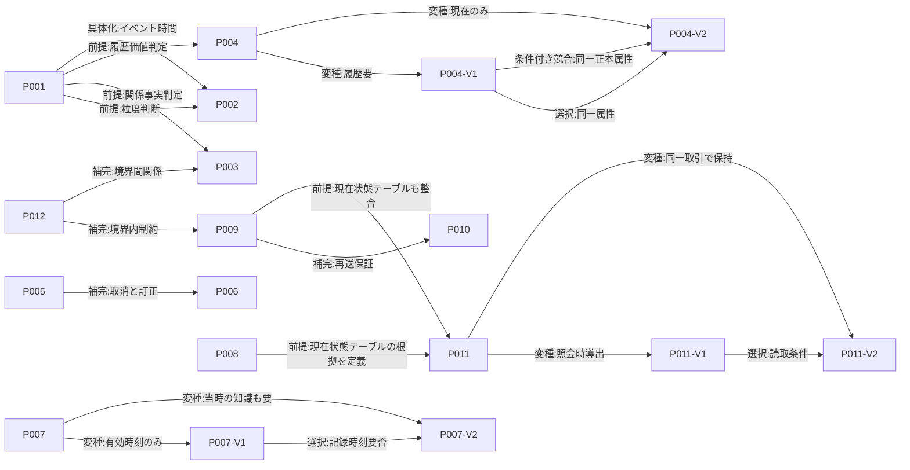
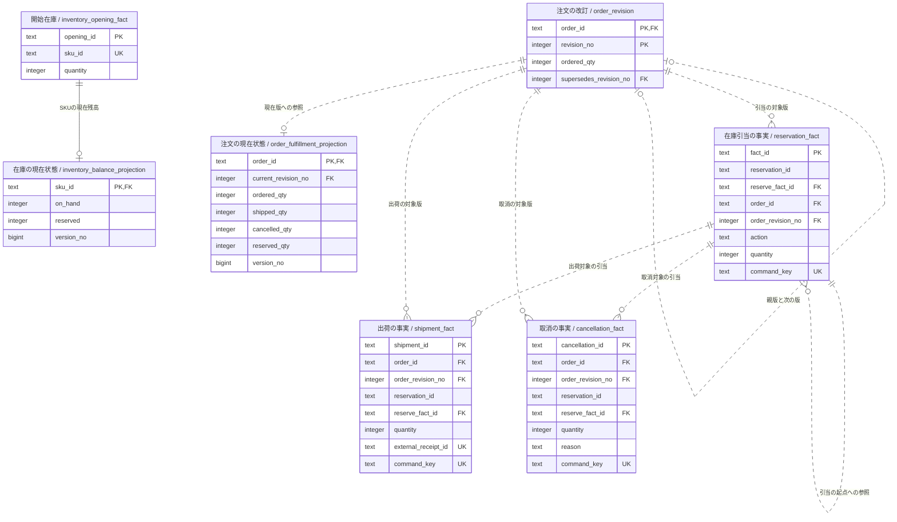
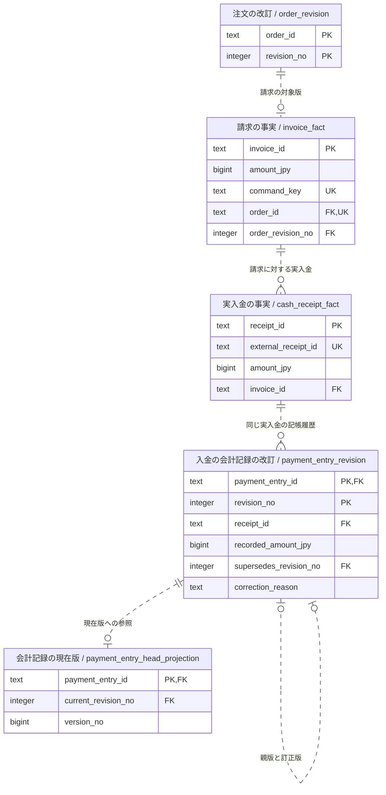

# 業務データモデリングのパターンランゲージ（詳細版）

事実・イベント・状態遷移を中心とする設計手法の比較と統合

概念・論理モデルから、単一RDBMSでの整合性検証までを扱います。調査日：2026-11-06。改訂日：2026-11-07。

背景、判断理由、具体例と代替案まで説明する詳細版です。 [簡潔版はこちら](report-concise.md)。二つの版は同じ業務モデル・出典・実証結果に基づいています。

[第1章](#ch1) · [第2章](#ch2) · [第3章](#ch3) · [第4章](#ch4) · [第5章](#ch5) · [第6章](#ch6) · [第7章](#ch7) · [第8章](#ch8) · [第9章](#ch9)

## 第1章 目的と適用範囲

### この文書が扱う設計課題

この文書は、業務上成立した事実の意味と根拠を保ちながら、日々の照会と更新を通常のリレーショナルデータベースで実用的に扱う設計方法をまとめます。中心となる設計事項は、「何を一回の業務事実として記録するか」「その結果として現在状態をどう計算するか」「競合や再送のある書込みをどこで確定するか」の三つです。これらは関連しますが、同じ設計判断ではありません。概念上は事実を訂正せず残す方針でも、保存装置が物理的に追記専用である必要はありません。逆に、テーブルをINSERT中心にしても、不変条件や二重処理を自動的に守れるわけではありません。

本稿が提案するのは、業務事実を正本として意味づけ、値の変更が過去の業務上の合意を消してしまう場面では履歴を記録し、頻繁に読む現在値は正本と区別して保持できる設計です。訂正、業務上の取消、返金を別の意味として扱い、制約・一意性・ロック・トランザクションを使って競合を処理します。どの表にも一律に履歴を持たせるのではなく、履歴が必要な属性と、通常の更新で足りる属性を選びます。

### 読者と前提

主な読者は、受発注、在庫、請求、決済など、複数の利用者や処理が同じ業務データを更新するOLTPシステムの設計者です。想定する実装は、単一のRDBを共有するモジュラーモノリスです。業務上の境界は定めますが、境界ごとにデータベースやデプロイ単位を分割するとは限りません。画面やバッチは業務操作を要求し、サーバーは確定した結果を返します。オフラインで複数端末が長期間独立更新する協調編集は、本稿の検討対象ではありません。

ここでいう「同一トランザクション」は、同じRDBMSの一つのローカルトランザクション内で、事実、必須の現在状態テーブル、冪等性記録をまとめて確定できる状況を指します。外部決済サービス、別データベース、メール送信などの外部副作用まで、このトランザクションに含まれるとは想定しません。それらを組み合わせるときは、コミット後の配信、再試行、補償の設計が別途必要です。

### 扱うことと扱わないこと

概念・論理モデルの事実分類から、時間と履歴、派生データ、現在状態テーブル、不変条件、同時実行、冪等性、所有境界までを扱います。比較には共通の業務ケースを使い、PostgreSQLでの検証には、そのケースのテストデータと操作を用意したテストフィクスチャを使います。特定ORMやプログラミング言語の採用、画面構成、一般的な性能ランキングは示しません。TPC-C等のベンチマーク結果を、本ケースの性能根拠へ読み替えることもしません。

共通ケースは一つのSKUと一つの注文行です。在庫10個、注文数量10個を履行前に8個へ改訂し、8個を引き当て、3個を出荷し、残り5個を顧客都合で取り消します。請求と実際の入金はそれぞれ3,000円です。入金記録は誤って3,300円と入力され、訂正版を3,000円として追記します。実際に受け取った金額は最初から3,000円で、300円の返金はありません。

複数SKU、返品、再受注、税・値引き、部分請求、チャージバック、個人情報の法的保存期間、完全な二時制履歴、複数地域にまたがる分散取引は、このテストフィクスチャの範囲外です。これらを扱う際は、本稿の例をそのまま本番仕様とみなさず、追加の業務規則と検証を設計してください。

### 読み進め方

第2章は、事実抽出、会計概念、イベント設計、時間履歴、整合性、モデル境界という異なる水準の研究を比較します。第3章ではその比較から本研究が採用する四原則を明示します。第4章は12のパターンと20の関係を索引化し、複数の適用経路を示します。第5章は個々のパターンを詳述します。第6章でCRUD中心、追記中心、実用ハイブリッドを比較し、第7章はケースを論理モデルとSQL実証へ落とします。第8章でアンチパターン、削除・保持、未実証範囲を扱い、第9章で新規設計・段階的移行・試験・運用の実務手順を示します。

## 第2章 関連研究と設計思想の比較

### 比較の前提

「イベントを記録する」という語は、概念モデル上のイベント発見、会計上の経済事象、ソフトウェアの状態変更ログ、分散処理のメッセージ、物理テーブルへの追記を指すことがあります。これらは同じ対象ではありません。本章では、各資料が扱う設計事項の層を分けます。概念モデルがイベントの候補を見つけても、保存形式やロック方式まで決まるわけではありません。状態変更をイベントとして保存する製品やアーキテクチャがあっても、どの出来事が業務上重要かを自動で決めるわけではありません。

原典の明示的な主張には資料IDと位置を添えます。そこから通常のRDBに適用する部分は、本研究の統合・設計判断として記します。引用箇所が限定資料や草稿の場合は、本文全体を確認したかのようには扱いません。

### 手法ごとの対象水準

| 手法 | 対象水準と明示的な貢献 | 読み替えない点 |
|---|---|---|
| 川島「イミュータブルデータモデル」 | 概念・論理モデルでリソースとイベントを分類し、日時をイベント抽出の手掛かりにします。イベントを一つの業務日時単位に分け、長期活動の詳細イベントと更新可能な親状態を併用する例もあります。[R01-S01](<https://scrapbox.io/kawasima/イミュータブルデータモデル>)（「Step 2」「Step 3」「Step 4」「発展」） | 全属性・全テーブルの物理的な追記専用の保存方式を要求するとは読めません。また二時制や一般的な訂正プロトコルを提示する資料ではありません。確認できたのは公開解説・講演資料で、Vol.130の誌面本文は未確認です。[R01-S04](<https://gihyo.jp/dp/ebook/2022/978-4-297-13001-5>) |
| 増田のINSERT中心設計 | 業務上の事実を分けて記録し、現在状態は集計・キャッシュ・ビュー等で扱う実践的な設計提案です。[R02-S01](<https://speakerdeck.com/masuda220/she-ji-falsekao-efang-toyarifang>)（slides 23–27） | 講演資料の推奨であり、比較実験に基づく性能保証ではありません。容量や競合に関する経験上の説明を一般法則へ拡張しません。[R02-S02](<https://tech.asken.inc/entry/2022/08/26/090657>) |
| REA | Resource、Event、Agentを中心に、経済的事象、資源の増減、経済主体間の関係を会計情報として表現します。stock-flowやdualityは経済現象を整理する概念です。[R03-S01](<https://home.business.utah.edu/actme/7410/McCarthy-82.pdf>)（pp.562–565） | あらゆるソフトウェアの状態変更をイベント化する一般規則ではありません。原著自身が完全なイベント記録を現実には実用的でないとし、利用者と費用便益に応じた集約を認めます（pp.562, 572–573）。 |
| EREN | 組織の非取引イベントも対象に含める概念モデリング技法です。イベント網と要素テンプレートを使い、要求の不足を検討する手順を提案しています。[R04-S02](<https://doi.org/10.4018/jdm.2012100103>)（pp.52–58, 68–70） | イベント網はRDBの格納方式、追記専用ログ、UPDATE禁止、同時実行プロトコルを定義しません。 |
| Event Modeling | Commands、Events、Views等を時系列に配置する設計図で、入力から読取までの情報流を議論します。[R05-S01](<https://eventmodeling.org/posts/what-is-event-modeling/>)（“The Model That Works”, “Commands”） | Event Modelingは実装・保存方式そのものではありません。通常のテーブルへ直接保存し、イベントを永続化しない構成も示されます。[R05-S02](<https://eventmodeling.org/posts/event-modeling-traditional-systems/>)（“Events”, “Tables”）Event Sourcingと同一視しません。 |
| Datomic | 時点ごとの不変database value、時間付きdatom、追加・撤回、as-of/historyの製品モデルを提供します。[R06-S01](<https://docs.datomic.com/transactions/model.html>)（“It’s All About Information”, “Integrity and Composition”）[R06-S03](<https://docs.datomic.com/reference/filters.html>)（“as-of”, “history”） | 製品固有の履歴・撤回機能です。通常のRDBにそのまま適用できる一般的な物理格納規則や、業務上有効な時間の完全モデルとは区別します。 |
| 時間履歴・Anchor | happening、changing、recording timeや、業務有効時間とシステム記録時間を区別する考え方を提示します。[R07-S01](<https://martinfowler.com/articles/bitemporal-history.html>)（“The Two Dimensions”）[R07-S02](<https://www.anchormodeling.com/wp-content/uploads/2010/08/Three_Concepts_of_Time_in_Anchor_Models.pdf>)（pp.4–6） | 二つの日時列を持つだけでは二時制になりません。必要な履歴軸と照会意味を定義する必要があります。[R07-S03](<https://www.anchormodeling.com/wp-content/uploads/2012/05/Bitemporal-Anchor-Modeling.pdf>)（slides 15, 28–29） |
| FowlerのEvent SourcingとCQRS | Event Sourcingは状態変更をイベント列として記録し、現在状態を再構成する方式です。[R08-S05](<https://martinfowler.com/eaaDev/EventSourcing.html>)（“How it Works”）CQRSはクエリ／コマンドのモデルを分け、リードモデルとライトモデルを別に設計する選択です。[R08-S06](<https://martinfowler.com/bliki/CQRS.html>)（“CQRS”, “When to use it”） | CQRSは履歴保存を意味しません。イベント履歴を持たずにCQRSを使うことも、追記事実を保持して単一の読み書きモデルを使うことも可能です。Fowlerは適用の複雑さを警告し、多くのシステムでは不適切になりうると述べています。[R08-S06](<https://martinfowler.com/bliki/CQRS.html>) |
| PostgreSQLの整合性資料 | CHECK、UNIQUE、外部キー、条件更新、ロック、分離レベル等により、RDBで制約を守る具体的な技法を示します。[R08-S01](<https://www.postgresql.org/docs/18/ddl-constraints.html>)（§5.5）[R08-S02](<https://www.postgresql.org/docs/18/transaction-iso.html>)（§13.2）[R08-S03](<https://www.postgresql.org/docs/18/explicit-locking.html>)（§13.3） | 概念モデルの説明ではなく、個別制約をどこでどう実装するかの根拠です。表へのINSERTだけで複数行の上限条件が守られるとは限りません。 |

この区分から、イベントを細かく考えることと、イベントごとに別の物理表を作ることは別判断だと分かります。業務の意味を損なわない正本と、実際の読み書きに適した格納構造を明示すれば、派生データや更新可能な現在状態テーブルを併用できます。[R03-S01](<https://home.business.utah.edu/actme/7410/McCarthy-82.pdf>)（p.572）[R11-S01](<https://curtclifton.net/papers/MoseleyMarks06a.pdf>)（§§7.1–7.3）

### REAが示す資源・イベント・参加者の関係

REAのResource、Event、Agentは、テーブル名の分類だけではなく、経済現象の意味を結ぶための概念です。経済資源は希少性と効用があり企業の支配下にある対象、経済イベントは生産・交換・消費・分配などによって資源を変化させる現象として説明されます。Agentはイベントへ参加する経済主体であり、アプリケーションの認証ユーザーと同じ分類ではありません。[R03-S01](<https://home.business.utah.edu/actme/7410/McCarthy-82.pdf>)（pp.562–565）

stock-flow関係は、イベントと、それによって増減する資源を結びます。duality関係は、資源の増加イベントと、それに対応する減少イベントを結びます。原著では購買による在庫流入と、現金支払による現金流出を分け、それらをpays-forという関係で対応付けています。[R03-S01](<https://home.business.utah.edu/actme/7410/McCarthy-82.pdf>)（pp.565–567, Fig.6）この構造を参照すると、何が増減したのか、誰が参加したのか、どの経済イベントと対応するのかを別々に確認できます。ただし、dualityを任意のイベント間の一般的な因果関係と読み替えることはできません。

本研究で採るのは、資源の現在数量だけでなく、その数量を説明する出来事と関係をモデルへ表す観点です。たとえば在庫7という値だけでは、3個を出荷したのか、棚卸差異を反映したのかは分かりません。一方、過去の出来事をすべて永久に保持するか、どの状態を別途保存するかは異なる判断です。原著も状態の物質化や用途に応じた集約を論じています。[R03-S01](<https://home.business.utah.edu/actme/7410/McCarthy-82.pdf>)（pp.568, 572–573）したがって、REAを参照することから、一般OLTPの全テーブルの更新禁止や、本稿の行ロック方式が導かれるわけではありません。

### ERENの全文確認と設計上の含意

ERENはREAの取引モデルだけでは扱いにくいtweetや備品貸出などの非取引業務イベントを含めるため、認知意味論に基づくEntity-Relationship Event Networkを提案します。論文は、既知の要求を図へ写すだけでなく、不完全な要求を検討する手段が必要だと問題設定しています。[R04-S02](<https://doi.org/10.4018/jdm.2012100103>)（誌面pp.52–54）

著者のData Eventは、関心対象の現象が特定時点または期間に起こり、1つ以上のThingの状態を変え、記録する意図があるものです。したがって、動詞や処理が見つかるたびにイベント実体を作る方法ではありません。たとえば社員と鍵の割当について、過去の担当者を問う要件がなければ、割当日を関係属性として持ち、独立したイベントエンティティを作らない選択肢も示されています。履歴が必要なら、割当をイベントとして記録する方が適切となりえます。[R04-S02](<https://doi.org/10.4018/jdm.2012100103>)（p.58）これは本稿のパターンP001・P003に関わる選択であり、機械的な「動詞ならイベント」という規則を避ける根拠です。

EREN（Entity-Relationship Event Network）のテンプレートはEventを中心に、Thing、Location、Time、Manner等を検討します。ThingはAgent、Subject、Resourceに分けられ、ResourceはProduct、Serviceを含みます。LocationはPlace、Directionに分けられます。テンプレートの図には独立したObjectノードを置きません。[R04-S02](<https://doi.org/10.4018/jdm.2012100103>)（誌面pp.60–65, Fig.5）これらは要求を見落とさないための概念上の観点であり、各属性を必ず別の物理表にする指示ではありません。著者は分類を細かくすることが初心者の認知負荷を上げる可能性を認め、適用はヒューリスティックと文脈に依存すると留保しています（p.65）。

ERENはTransaction、Activity、Occurrence、Historyを区別します。TransactionはREAの取引を含み、Activityは継続する活動、Occurrenceは文脈上これ以上分割しない瞬間的または短時間の出来事、HistoryはThingの履歴を明示的に表すイベントです。Activityは開始と終了を持ち、両方の時刻を同じActivityエンティティに置く例があります。[R04-S02](<https://doi.org/10.4018/jdm.2012100103>)（pp.61–68）この点は川島のイベントを一業務日時単位に分ける指針と異なります。[R01-S01](<https://scrapbox.io/kawasima/イミュータブルデータモデル>)（「Step 3」）期間活動自体を一つの対象として照会するのか、開始・終了の各業務出来事を独立して参照するのかによって選び、理論差を一つの時間モデルへ押しつぶしません。

ERENの手順は、明瞭な主要イベントから始め、暫定イベント網を作り、後続・従属イベントを加え、テンプレートで要素を詳しくし、網を整理・統合し、利用者に質問する流れです。医療施設の例ではAppointmentとVisitを起点として、処方、支払、取消等を追加します。イベント網を利用者に示し、予約医と診療医が同一人物か、予約と取消をどう結ぶか、receiptはイベントかイベントの報告か、といった不確定点を質問します。[R04-S02](<https://doi.org/10.4018/jdm.2012100103>)（pp.68–70, Figs.12–15）この反復は要求発見の手順として応用できますが、網を作っただけでデータ整合性や本番設計が完成するわけではありません。

論文中の25人の学生による備品貸出課題では、多くがcheckoutを一つのイベントエンティティとして表現できませんでした。[R04-S02](<https://doi.org/10.4018/jdm.2012100103>)（pp.54–56）これはイベントの見落としやすさを示す事前課題であり、ERENの有効性を対照群と比較した実験結果ではありません。著者自身、初心者・実務者における技法の実証評価や従来の論理設計法との比較を今後の課題にしています（p.71）。論文本文は履歴からThingの状態を導出できると述べますが、物理的な追記専用の保存方式、UPDATE禁止、訂正・取消の一般方式、SQLの同時実行制御は主張していません。[R04-S02](<https://doi.org/10.4018/jdm.2012100103>)（“History as Event”）

### 時間、訂正、履歴の範囲

川島の日時は、予定日や有効期限ではなく、業務活動が行われた時刻をイベント分類の手掛かりにします。イベントに複数の業務日時を詰めると、それぞれの属性を別々に変える規則が必要になり、モデルから読めない更新条件が画面・バッチへ散るという問題意識です。[R01-S01](<https://scrapbox.io/kawasima/イミュータブルデータモデル>)（「Step 2」「Step 3」）ただし長期の業務的まとまりは親として残し、詳細活動を追記しながら親の現在ステータスを更新する例もあります（「発展」）。

時間モデルの資料は、異なる時間の意味を見分けるために有効です。Fowlerはactual historyとrecord historyを区別し、Anchor資料はhappening、changing、recording timeを扱います。[R07-S01](<https://martinfowler.com/articles/bitemporal-history.html>)（“The Two Dimensions”）[R07-S02](<https://www.anchormodeling.com/wp-content/uploads/2010/08/Three_Concepts_of_Time_in_Anchor_Models.pdf>)（pp.4–6）この比較から、本稿では「いつ起きたか」「業務上いつ有効か」「システムがいつ知ったか」を必要に応じて分けます。`occurred_at`と`recorded_at`だけを置いても、業務有効期間の開始・終了や、過去時点に認識されていた値を再現できるとは限らず、それだけで二時制とは呼びません。

業務上成立した取引の取消と、誤記録の訂正も区別します。Ledger資料は訂正に置換、反対記入、差額調整など複数の形があることを論じますが、草稿の分析であり、すべての業務に適用すべき会計規則ではありません。[R07-S04](<https://martinfowler.com/eaaDev/AccountingNarrative.html>)（“Making Adjustments”）Datomicのretractionと履歴消去であるexcisionも異なる操作です。[R06-S04](<https://docs.datomic.com/operation/excision.html>)（“Motivation”, “Implementation”）ここから一般化できるのは、履歴を残す訂正と、記録を消去する目的を混同しないことです。誤って3,300円と記録した値を3,000円へ訂正することは、実際に成立した3,300円の取引を3,000円へ取り消すことでも、300円を返金することでもありません。

### DatomicのFactと業務事実を混同しない

Datomicのfactは、その時点で真として扱う情報です。entity、attribute、valueとトランザクションを含むdatomにより、値の追加や撤回を記録します。後続のトランザクションは以前のdatabase valueを書き換えるのではなく、新しいdatabase valueを作ります。[R06-S01](<https://docs.datomic.com/transactions/model.html>)（“It’s All About Information”, “Integrity and Composition”）この製品上の不変性と、現実の出来事について記録が正しかったかどうかは別です。

本研究の入金例では、実際に3,000円を受け取ったことと、会計記録へ3,300円と入力したことを分けます。訂正版を追加しても、実際の受領額は変わりません。同様にDatomicの撤回も、業務上の変化を表す場合と、以前の記録の訂正に使う場合があります。撤回は現在有効な情報を変える操作であり、それだけで履歴を消去する操作ではありません。[R06-S01](<https://docs.datomic.com/transactions/model.html>)（“It’s All About Information”）[R06-S03](<https://docs.datomic.com/reference/filters.html>)（“history”）

この区別は、履歴を残せば自動的に業務上の正しい状態が得られる、という誤解を防ぎます。どの記録が何を表し、訂正後にどの版を選ぶかはモデルで決めます。またDatomicのトランザクション時間は、その情報を記録した順序の時間であり、現実の業務でいつ有効だったかを自動的に表しません。[R06-S03](<https://docs.datomic.com/reference/filters.html>)（“as-of”, “history”）本稿のRDBモデルでも、改訂系列と業務上の時間の意味を別々に定義します。

### 状態導出と物理保持

REAでは経済事象を記録し資源状態を説明しますが、完全な個別イベントを永久に残すことは実務上の費用から難しい場合があると指摘し、どの程度を残すかは利用者と用途、費用便益で判断します。[R03-S01](<https://home.business.utah.edu/actme/7410/McCarthy-82.pdf>)（pp.562, 572–573）増田も事実を分ける設計と、頻繁に使う状態のキャッシュやビューを併記します。[R02-S01](<https://speakerdeck.com/masuda220/she-ji-falsekao-efang-toyarifang>)（slides 23–27）川島の長期活動の例も、詳細イベントと現在状態の更新を同時に許容します。[R01-S01](<https://scrapbox.io/kawasima/イミュータブルデータモデル>)（「発展」）これらは、業務事実を正本としながら、読みやすさ・更新責任を明確にした派生データを物理的に保持できることを支えます。

CQRSはクエリ／コマンドを分け、リードモデルとライトモデルを異なる要件に合わせるアーキテクチャです。[R08-S06](<https://martinfowler.com/bliki/CQRS.html>)（“CQRS”）本稿では、プロジェクションをイベントやライトモデルからリードモデルを組み立てる処理・仕組みとして説明し、その成果物であるリードモデルと区別します。CQRSを採用しても、履歴を保存するとは限らず、イベント履歴を保存してもCQRSを採用するとは限りません。FowlerはCQRSが有効な場面を限定し、多くのシステムにとって不要な複雑さを加えうると警告します（“When to use it”）。

Event Sourcingは状態変更の列を保存して状態を再構成する保存方式です。[R08-S05](<https://martinfowler.com/eaaDev/EventSourcing.html>)（“How it Works”）これは業務モデルのイベント抽出と別の選択です。イベント履歴から数量を算出する式、順序、取消・訂正の処理が定義されなければ、再生だけで正しい状態は得られません。逆に通常のRDBで事実表を追記し、現在状態テーブルを同じ取引で更新する方法も、Event SourcingやCQRSを全面採用せずに実現できます。[R08-S04](<https://www.postgresql.org/docs/18/tutorial-transactions.html>)（§3.4）[R11-S01](<https://curtclifton.net/papers/MoseleyMarks06a.pdf>)（§§7.1–7.3）

### 境界、整合性、統合の位置

ORMは業務のelementary fact typeと制約を専門家と確認し、論理スキーマへ変換する概念化です。[R12-S01](<https://orm.net/pdf/dppd.pdf>)（“What is ORM?”, “Schema Transforms”）その事実型が必ず一物理行に対応するという意味ではありません。Data Vaultは履歴統合を重視する分析基盤の考え方であり、OLTPの書込み規則と同じ層には置きません。[R12-S03](<https://datavaultalliance.com/engineering/data-vault-2-0-an-introduction/>)

EvansのBounded Contextは特定モデルが定義・適用される境界で、Context Mapはモデル間の翻訳、共有、隔離や影響を記述します。[R09-S01](<https://www.domainlanguage.com/wp-content/uploads/2016/05/DDD_Reference_2015-03.pdf>)（pp.1–3, 28–37）これは業務知識と語彙を一貫させる根拠になりますが、表所有権や物理DB分割を自動的に指定しません。Evansはaggregate内を同期、aggregate境界を越える更新を結果整合的に扱う推奨を記します。[R09-S01](<https://www.domainlanguage.com/wp-content/uploads/2016/05/DDD_Reference_2015-03.pdf>)（p.16）本稿のケースは単一DB・即時整合性を要する複数所有者操作を一つの取引に置くため、この推奨をそのまま採用しない条件付き判断です。分散環境でも同じ実装を選ぶ、という主張ではありません。

### 本研究が統合する設計事項

以上の研究は、イベント発見、履歴の時間意味、会計上の資源変動、状態の読取、トランザクション整合性、モデル境界という別々の設計課題を扱います。本研究はこれらを一つのパターン言語へ編成しますが、個々の原典がこの統合形を提示したと主張しません。統合した主な判断は、(1)業務上の意味がある事実と技術的ログを分ける、(2)時間粒度を照会要件で選ぶ、(3)正本事実と派生データを分ける、(4)必要な現在状態テーブルを再構築規則とともに保持する、(5)所有者が原子的遷移で不変条件を守る、(6)境界とDB・取引の物理構成を同一視しない、の六点です。

FRPはFunctional Relational Programming（関数型リレーショナルプログラミング）を指し、Functional Reactive Programmingではありません。FRPの状態と派生データを分ける見方は整理に有用ですが、RDBの書込み規則として確立した証拠ではなく、提案として扱います。[R11-S01](<https://curtclifton.net/papers/MoseleyMarks06a.pdf>)（§§7.1–7.3, 9）

これらは次章の四原則へ整理します。ケースで観測される数量・金額と競合結果は第7章に示し、研究上の主張や設計判断を実測結果として混同しないようにします。

## 第3章 統合された設計原則

本章の四原則は、前章の複数の研究を通常のRDBを使う業務システムへ応用する本研究の統合提案です。原典が共通して述べる普遍原則ではなく、性能や品質を保証する定理でもありません。設計レビューで何を確認するかを明らかにし、どの条件なら原則を弱めるかまで示します。

### 用語の定義と使い分け

業務事実は、組織が記録し、後から説明・判断する業務上の成立事象です。イベントはその事実のうち時間と状態変化を持つものを指します。関係の成立も独立して識別し、再成立や終了を追う必要があれば関係事実として扱います。データベースの監査ログ、画面閲覧、ジョブ実行の記録は、業務上の意味を持つ場合を除き業務事実とは別です。

本稿では、正本事実を意味上の根拠として扱い、**派生データ**をそこから計算できる値の総称とします。頻繁な照会や同時実行時の条件検査のために、派生データを保存する表を**現在状態テーブル**と呼びます。CQRSを説明するときは、ライトモデル、リードモデル、クエリ／コマンド、プロジェクションを用います。プロジェクションはリードモデルを生成・維持する処理であり、リードモデルと同じものではありません。

「論理的不変性」は、成立した事実の意味を過去に遡って上書きしない方針です。「物理的な追記専用の保存方式」はストレージへの書込みを追記だけに限定する実装上の性質です。前者は後者を必須にしません。現在状態テーブルをUPDATEしても、元事実を保ち再構築できれば、業務上の根拠を残せます。

関連する用語も区別します。次の表は本稿での使い分けであり、すべての原典が同じ定義を採用しているという意味ではありません。

| 用語 | 本稿での意味と区別 |
|---|---|
| 業務イベント | 出荷や入金のように、業務上意味を持つ出来事を指します。HTTP要求の受信やDB行の更新とは一対一に対応しません。 |
| ドメインイベント | ドメインモデルで重要な出来事として明示する概念です。出来事をモデル化することと、メッセージを外部配信することは別の判断です。[R09-S01](<https://www.domainlanguage.com/wp-content/uploads/2016/05/DDD_Reference_2015-03.pdf>)（p.13） |
| イベントエンティティ | 一回の出来事を識別し、参加者・対象・時刻・数量などを関連付ける概念モデルの要素です。イベントエンティティを抽出しても、物理表や保存期間は別途決めます。[R04-S02](<https://doi.org/10.4018/jdm.2012100103>)（pp.58–65） |
| 状態遷移 | 操作の前後で確定状態が変わることを指します。一つの状態遷移で複数の業務事実と現在状態テーブルをまとめて更新する場合があります。 |
| 変更履歴 | 値がどのように変わったかの記録です。変更理由や成立した業務行為まで記録しているとは限りません。 |
| リソース | 同一性を保って扱う対象です。業務日時による川島氏の分類と、希少性・効用・支配を伴うREAの経済資源では、対象範囲が異なります。[R01-S01](<https://scrapbox.io/kawasima/イミュータブルデータモデル>)（「Step 2」）[R03-S01](<https://home.business.utah.edu/actme/7410/McCarthy-82.pdf>)（p.562） |
| 同一性（Identity） | 状態が変わっても同じ対象として扱う基準です。同額の入金が二つあっても、値の一致だけで同じ入金とは判断しません。 |
| 状態（State）と値（Value） | 状態は対象をある時点で捉えた値のまとまりです。対象の同一性を継続して扱うことと、各時点の値を変更せず残すことを分けます。この区別はDatomicの不変なdatabase valueを参照した、本研究での整理です。[R06-S02](<https://www.datomic.com/rationale.html>)（“Immutable database values”） |

例えば注文O-1は数量10から8へ改訂されても同じ注文です。一方で、数量10を合意した版と数量8を合意した版は異なる値として残せます。現在の注文数量が8だと分かることと、かつて10で合意したことを説明できることも別です。同じ注文ID、個々の改訂の識別、現在版の選択規則を分けると、この三つを混同せずにモデル化できます。これは本研究のRDBモデルへの応用であり、Datomic固有のIDや履歴APIを移植する提案ではありません。

### 原則1 業務上の意味から事実を分類する

**問題：** 更新日時、差分、動詞、API要求だけを見ると、リソースの属性変更、独立した業務上の出来事、関係の成立、技術的な追跡情報が混ざります。例えば「顧客住所が更新された」というDB行の差分は、住所訂正なのか、転居届の受理なのか、移行バッチの再書込みなのかを単独では説明しません。

**原則：** 利用者が記録・照会・判断に使う内容を確認し、資源、業務イベント、関係の成立、派生値に分けます。日時、関与者、対象、数量、状態変化、記録意図はイベント候補を見つける手掛かりです。ERENも、状態変化と記録意図を持つ現象をData Eventとしつつ、動詞を機械的にイベント化せず、履歴が不要なら関係属性で足りる場合を示します。[R04-S02](<https://doi.org/10.4018/jdm.2012100103>)（p.58）川島も業務日時を分類手掛かりとします。[R01-S01](<https://scrapbox.io/kawasima/イミュータブルデータモデル>)（「Step 2」）

**理由と範囲：** 意味から分類すると、何を一回の事実として識別するか、どの対象が関与するか、どの値が成立時点の根拠かをモデルで説明できます。対象は概念・論理モデルの抽出です。物理表を分割するか、イベント行をどの期間保持するかは別途選びます。

**徹底しない条件：** 過去の成立や変更理由を照会せず、単なる作業中の設定値で足りるなら、独立事実を作らず現在属性として更新できます。短命な画面状態、デバッグ用ログ、定期処理の再実行記録も、業務判断に使わない限り本原則の業務事実には含めません。後から履歴要件が判明した場合は、その意味と保持可能性を改めて分析します。

### 原則2 履歴の粒度と時間の意味を要件に合わせる

**問題：** 単一のtimestampへ発生時刻、期間、有効期間、記録・認識時刻を押し込むと、必要な時点照会を満たせないことがあります。一方、すべての値に多重な期間列を加えると、更新・重複・境界条件の規則が増えます。

**原則：** 記録対象が点イベントか期間活動かを選び、業務上いつ有効だったか、システムがいつ知ったかを別々の設計事項として扱います。開始と終了を一つのActivityに置くERENのモデルと、一業務日時の単位にイベントを分ける川島のモデルは異なる前提を持ちます。[R04-S02](<https://doi.org/10.4018/jdm.2012100103>)（pp.61–68）[R01-S01](<https://scrapbox.io/kawasima/イミュータブルデータモデル>)（「Step 3」）期間そのものを参照するならActivity、独立して参照する必要のある開始・終了事実なら別イベントが候補です。

**理由と範囲：** 時間軸と粒度が明確なら、遡及訂正後に「その日に業務上有効だった値」と「その日、システムが認識していた値」のどちらを求めているか区別できます。対象はイベント、属性履歴、訂正履歴の時間意味です。`occurred_at`と`recorded_at`を追加しただけで有効期間を表せるとは限りません。[R07-S01](<https://martinfowler.com/articles/bitemporal-history.html>)（“The Two Dimensions”）[R07-S02](<https://www.anchormodeling.com/wp-content/uploads/2010/08/Three_Concepts_of_Time_in_Anchor_Models.pdf>)（pp.4–6）

**徹底しない条件：** 遡及訂正も履歴照会もなく現在値で要件が満たせるなら、二時制や全履歴を導入しません。時間軸の定義が業務担当者と合意できないまま、名前だけの`valid_from`、`recorded_at`を増やすことも避けます。履歴保持を採用する場合も、対象属性、開始・終了境界、重複期間、未来値の扱いを決められる範囲から始めます。

### 原則3 業務事実と派生データを分け、必要な現在状態テーブルは保持する

**問題：** 現在残高や現在の改訂番号だけを正本とすると、成立根拠を失い、過去の状態を説明できなくなります。反対に、あらゆる読取を全履歴の再集計にすると、式の複雑さや照会負荷が増します。

**原則：** 正本事実、導出規則、現在状態テーブルを別責務として定義します。現在状態テーブルには、正本から計算する式、更新と正本の原子性、照合・再構築方法を与えます。イベントから状態を導出できるという考えは、すべてのデータ照会で毎回再生する義務を意味しません。REAは用途・費用に応じた集約を認め、派生値や現在状態テーブルの物理保持も実用的な選択肢です。[R03-S01](<https://home.business.utah.edu/actme/7410/McCarthy-82.pdf>)（pp.572–573）[R11-S01](<https://curtclifton.net/papers/MoseleyMarks06a.pdf>)（§§7.1–7.3）

**理由と範囲：** この分離により、更新可能な値を使いつつ、元の業務事実との対応を維持できます。在庫残高、引当数量、注文ヘッド、入金の会計記録の現行版は適用例です。現在状態テーブルを保存するかどうかは読取の頻度・鮮度・再集計可能性で選びます。

**徹底しない条件：** 履歴価値が低いプロフィール、設定、作業途中の下書きなどは通常CRUDで構いません。再計算が十分簡単で、読取要件を満たし、運用の単純さが勝るなら現在状態テーブルを保存しない選択もできます。再構築が高価でも保存は可能ですが、その場合は正本との照合や更新漏れ検出を設計します。

### 原則4 正本の所有者が不変条件を原子的に守り、他境界には契約で公開する

**問題：** INSERTだけに限定しても、二つの処理が同じ残数を読み、どちらも成立して上限を超える競合は防げません。複数の業務領域が同じ表を直接更新すると、制約・用語・修正責任も曖昧になります。

**原則：** 各正本事実と不変条件の所有者を定め、DB制約、条件付き更新、行ロックなどで、検査と事実追加、必要な現在状態テーブルの更新を一つのローカルトランザクションで確定します。他境界にはデータ照会・コマンド等の明示的契約を公開し、内部テーブルを無制限に書かせません。Evansの境界・Context Mapはモデルの適用範囲と関係を可視化する助けになります。[R09-S01](<https://www.domainlanguage.com/wp-content/uploads/2016/05/DDD_Reference_2015-03.pdf>)（pp.1–3, 28–37）DBのCHECKやUNIQUE、ロックの選択はPostgreSQLの整合性手段に基づきます。[R08-S01](<https://www.postgresql.org/docs/18/ddl-constraints.html>)（§5.5）[R08-S02](<https://www.postgresql.org/docs/18/transaction-iso.html>)（§13.2）

**理由と範囲：** 所有者が書込み判断を一元化すると、どの条件がどこで保証されるかを追跡しやすくなります。対象は、一意性、残数量、二重処理、関係の成立・終了、事実と現在状態テーブルの同期です。境界はコード、DBスキーマ、テーブル、トランザクションのいずれとも一対一である必要はありません。

**徹底しない条件：** 小さな共有表や直接参照の費用が低く、責任と書込み範囲を明示できる場合は、契約で隔離する利益と比較して許容できます。即時整合性が不要、外部システムと結ぶ、負荷分散や可用性の要件がある場合は、別取引・非同期プロジェクションも候補です。Evansはaggregate境界をまたぐ更新に非同期・結果整合性を推奨しますが、本稿の単一DBケースでは同じ取引を使う判断を、即時整合性を必要とする条件に限定します。[R09-S01](<https://www.domainlanguage.com/wp-content/uploads/2016/05/DDD_Reference_2015-03.pdf>)（p.16）

### 原則同士の関係と使用上の注意

四原則は、意味の分類から時間・履歴、導出と現在状態テーブル、整合性と所有者へ話題を広げる構成です。しかし固定順ではありません。例えば競合の調査で在庫の意味が曖昧と分かれば原則1へ戻り、監査要件が判明すれば原則2の時間軸を見直します。各原則を機械的なチェックリストにして全表へ同じ履歴列やロックを追加するのではなく、適用対象と、適用しない理由を記録してください。

本章は原典を統合した設計提案であり、SQLの競合挙動を実測した結果ではありません。固定ケースで確認した制約・ロールバック・競合の範囲は第7章、未実証範囲は第8章に分けて記します。

## 第4章 パターンランゲージ全体像

### 使い方と関係の読み方

この章は、後続の個別パターンを探し、ある判断から次の判断へ進むための索引です。パターンは固定手順ではなく、条件に応じて選ぶ設計案です。パターン間の関係も本研究がカタログを読むために付した編集上の分類で、先行研究に共通する標準語彙ではありません。[R10-S01](<https://www.patternlanguage.com/archive/timeless.html>)（Part II §§1–3, lines 132–158）[R10-S03](<https://www.patternlanguage.com/archive/ieee.html>)（Part 1, lines 104–120）

| 関係 | 意味 | 読むときの注意 |
|---|---|---|
| 前提 | 対象パターンの前に成立させる判断や構造 | 時系列の実行順を強制するとは限りません。 |
| 具体化 | より広い問題を特定の判断へ絞る | 元の問題領域の一部を詳しくします。 |
| 変種 | 同じ問題を異なる条件で解く形 | 条件を満たすものを選びます。 |
| 補完 | 別の問題を扱う案を併用し、保証を補う | 併用しても二つが同じ責務とは限りません。 |
| 選択 | 同じ責務について条件に応じて選ぶ代案 | 同一対象に必ず両方適用する意味ではありません。 |
| 条件付き競合 | 同じ対象へ同時に適用すると要件が両立しない場合 | 無条件に相互排他的と読むべきではありません。 |

Alexanderは、パターンを文脈・問題・解決の関係として扱い、パターン同士のネットワークと適用順が全体の一貫性に関わると論じます。[R10-S01](<https://www.patternlanguage.com/archive/timeless.html>)（Part II §§1–3）本稿の六分類はこの考えをカタログへ適用するために整理したものです。関係の線があるからといって、特定の物理構成や品質が保証されるわけではありません。

### パターン索引

| ID | パターン | 主な設計課題 |
|---|---|---|
| P001 | 業務事実を分類する | 資源・イベント・関係・派生値を識別します。 |
| P002 | 点イベントと期間活動を分けて表す | 時間粒度とActivityの扱いを選びます。 |
| P003 | 交差エンティティで関係の履歴を記録する | 反復する関係の一回ごとの成立を識別します。 |
| P004 | 必要な資源属性だけを版管理する | 履歴が要る属性と現在値だけでよい属性を分けます。 |
| P005 | 業務上の取消を新しい事実として表す | 成立済み業務を後から取り消す意味を記録します。 |
| P006 | 誤記録を実取引と区別して訂正する | 誤った記録の訂正と、実際に起きた反対取引を分けます。 |
| P007 | 発生・有効・記録の時間軸を分ける | 要件に必要な時間軸だけを定義します。 |
| P008 | 事実から状態を導出する | 正本事実から状態を再現する式と順序を定義します。 |
| P009 | 不変条件を原子的な遷移で守る | 同時実行下でも成立条件を保ちます。 |
| P010 | 再送可能なコマンドを冪等化する | 同じ要求の再送と、業務上の重複を分けます。 |
| P011 | 現在状態テーブルを同一トランザクションで更新する | 必要な現在状態を正本事実と原子的に保ちます。 |
| P012 | 事実の所有者と境界間の公開契約を定める | 書込み責任と他モデルとの連携を明示します。 |

### 関係図

図はカタログに記録された20辺を示します。P004-V1とP004-V2は別々の属性には併存できます。同一の正本属性について過去値の再現が必要なのに、履歴を消す上書きだけで記録する場合に限って競合します。P007-V1とV2、P011-V1とV2も、同一の履歴責務・読取要件で一方を選ぶ関係です。システム内の別属性や別の読み取り経路なら併用が可能です。

### 適用経路1: 要求から事実と時間へ

まずP001で、画面項目や業務用語が資源、成立事実、関係、派生値のどれかを分類します。独立した反復関係が後から照会されるならP003を検討し、単に現在の担当先を知ればよいだけなら関係属性や現在値で足りるか比較します。イベント候補はP002で点か期間かを選びます。P004では資源のどの属性に過去値が必要かを属性ごとに調べます。ここでイベント一覧を作ること自体を目的にせず、どの記録を誰がどの判断に使うかを確認します。

### 適用経路2: 変更、取消、訂正、時間

業務が実際に成立した後で反対の業務が起きた場合はP005、起きていない内容を誤記録した場合はP006を起点にします。例えば顧客が注文残数を取り消したなら取消事実を記録しますが、受領額を誤入力していただけなら元の入金額を変更する訂正履歴を記録し、返金を作りません。P007では発生時刻、業務上の有効期間、システムが記録した時刻のうち、必要なデータ照会に対応する時間軸だけを採用します。時間情報の欠落が判明したらP001やP004へ戻り、そもそも履歴対象が何かを再確認します。

### 適用経路3: 状態、競合、境界

現在状態を読む画面・帳票の要求から始めるなら、P008で正本と再計算式を定義し、P011で照会時導出か、現在状態テーブルの保持かを選びます。現在状態テーブルを保持する場合は、P009で事実と現在状態テーブルの原子性、ロック対象行または条件付き更新、再試行を設計します。通信再送がある場合はP010も併用します。異なる業務責任が同じ事実へ書き込むなら、P012で所有者と公開契約を定め、境界内の不変条件はP009へ接続し、境界間の関係事実はP003を見直します。

### 経路は往復する

上の三経路は、初期の要求整理で使いやすい順に並べた例です。固定工程ではありません。P011の現在状態テーブルに必要な履歴量が大きいと分かればP004へ戻り、そもそも過去の再現が必要か確認します。P009の競合条件が一つの所有者に収まらないと分かればP012の境界を再検討します。Alexanderが述べるように、パターン言語は個別案の一覧ではなく、実際の文脈で選び直す判断の網です。[R10-S01](<https://www.patternlanguage.com/archive/timeless.html>)（Part II §§2–3）ただしこの網自体が完成度や性能を実証するものではなく、具体的なケースと試験で検討します。

## 第5章 個別パターン

### P001 / 業務事実を分類する（本研究の作業名）

#### Intent

業務上の記録対象を、リソース、イベント、関係、派生状態へ分類します。

#### Context

画面項目や更新ログをそのまま表にすると、業務上の意味が分かりにくくなります。ケースでは注文版、出荷、取消、受領、記帳訂正が説明・照合に必要です。

#### Problem

変更をすべてイベントにすると過剰に細分化し、現在値だけでは成立した事実と関係を失います。

#### Forces

履歴は説明可能性を高める一方、設計や保存の負担も増します。過去に何を問うかを確認し、現在値で足りる範囲を見極めます。

#### Solution

利用者に「何が起きたか」「誰・何が関与したか」「いつの事実か」「後から照会するか」を確認します。継続する対象はリソース、記録意図のある業務上の出来事はイベント、独立して問う成立は関係事実、規則から得る値は派生データとします。ERENでは主要イベントを挙げて暫定ネットワークを作り、後続・従属イベントを加え、参加Thing・場所・時間・方法をテンプレートで詳細化します。多重度を検討し利用者へ質問します。これは概念モデルを抽出する手順です。不変性や追記中心の格納方式をERENの主張として扱いません。[R04-S02](<https://doi.org/10.4018/jdm.2012100103>)（誌面pp.64–70, Fig.5, 12–15）

#### Structure

一回の出来事に識別子を与え、参加者・時刻・数量を関連付けます。正本事実と現在値・集計派生データは別責務とします。ERENのEvent—Thing—Location等は検討用テンプレートで、固定スキーマではありません。

#### Example

版1から版2への変更は注文数量の合意改訂です。出荷3個と取消5個は、注文の履行に関する別々の事実です。実受領3,000円と誤記帳3,300円は別責務であり、草稿編集やAPI再試行ログは業務イベントにしません。

#### Consequences

事実の関係や照合の根拠を説明しやすくなりますが、分類を誤ると履歴の不足や過剰な記録を招きます。粒度、版、取消・訂正は後続で扱います。

#### Applicability

監査や顧客への説明に使う事実の抽出に適用します。過去照会のない草稿や技術診断情報は可変状態・運用ログでよいです。動詞として表せるかどうかだけで判断しません。[R04-S02](<https://doi.org/10.4018/jdm.2012100103>)（誌面pp.61–63, 71）[R01-S01](<https://scrapbox.io/kawasima/イミュータブルデータモデル>)（§Step2, lines 94–113; §Step4, lines 164–194）

**説明責任の境界**

技術的に記録できる情報を全て業務履歴へ取り込む必要はありません。API要求の相関IDや障害診断ログは調査に有用ですが、業務上成立した事実の根拠として扱うと、再送一回ごとに業務イベントが増える誤りになります。運用ログの保持期間・アクセス制御と、取引証跡の保持要件は別に設計します。

#### Resulting Context

分類結果を履歴・時間設計へ渡します。

#### 判断の進め方

最初に画面項目を列挙するのではなく、利用者が後日説明したい判断を聞きます。たとえば「今いくつ残っているか」だけなら現在状態で足りますが、「いつ誰が何個を受け取り、残数をなぜ減らしたか」まで問うなら、その変化を生んだ業務上の成立事実が必要です。さらに「なぜ残数がゼロか」は、出荷と取消の双方を区別しなければ説明できません。この違いは、同じ数値カラムを作るかどうかではなく、どの事実を正本として保存するかの違いです。

この分類は、更新を機械的にイベントへ変換する規則ではありません。利用者が編集した草稿、画面を開いた記録、再試行されたHTTP要求は、運用上有用でも業務成立とは限りません。一方、受領、請求、合意した注文変更は、数量や金額の表示だけに潰すと説明責任を失います。各候補について「独立して識別して照会するか」「他の事実に対する根拠となるか」「値が規則から導けるか」を確かめ、該当しないものは無理に独立事実にしません。

#### 共通ケースへの適用

この研究のS03-C01はSKU-1一つ、注文O-1の一明細、円建ての受領一件に限定されています。初期在庫10、注文版1の数量10、引当・履行前の版2の数量8、引当8、出荷3、残りの取消5という順序を保つと、在庫は10−3=7、引当は8−3−5=0、出荷済み3、取消済み5です。したがって「在庫7」という派生値のみでは、引当済み数量や注文の履行経緯を説明できません。事実の分類時点で、在庫開始、注文版、引当、出荷、取消の役割が違うことを示しておく必要があります。

金額側も同じです。請求3,000円と実入金3,000円は経済上の事実であり、記帳額3,300円から3,000円への変更は帳簿入力の訂正です。訂正差300円を返金という別の経済事実に分類すると、実際にはない資金移動を作ってしまいます。この区別はケースのデータと本研究の判断に基づくもので、ERENや他の原典がこの業務ルールを指定しているわけではありません。

#### 適用後に決めること

分類が済んだら、各事実の一回性をどう識別するか、対象が瞬間か期間か、過去版・取消・訂正が必要かを後続パターンで決めます。ここで結論を急いで「全表を追記専用にする」と決めると、現在属性や派生値まで履歴化する過剰設計になります。反対に「状態さえ分かればよい」として正本事実を落とすと、後から導出式や監査ログで意味を復元できません。まず分類と照会要件を合意し、次に必要な履歴の粒度を決めます。

#### Related Patterns

[P002](#p002) [P003](#p003) [P004](#p004) [P008](#p008)

#### Sources

R01-S01、R03-S01、R04-S02、R12-S01

### P002 / 点イベントと期間活動を分けて表す（本研究の作業名）

#### Intent

時点の出来事と期間活動を分けます。

#### Context

業務で問う時間粒度に合わせ、日時列の意味を決めます。

#### Problem

期間活動を点イベントへ分割する場合、活動全体の期間をどのように表すかも決める必要があります。独立事実を一行にまとめると理由や再発が見えません。

#### Forces

川島はイベントを一つの業務日時で分割します（[R01-S01](<https://scrapbox.io/kawasima/イミュータブルデータモデル>) §Step3）。ERENはActivityを持続活動として扱い、同一Activityに開始・終了を置きます（[R04-S02](<https://doi.org/10.4018/jdm.2012100103>) pp.61–65, 67）。

**判断の詳説**

設計時には、利用者が知りたいものが「発生した瞬間」なのか、「進行中を含む期間そのもの」なのかを聞き分けます。出荷は通常、成立時点を示す事実です。審査や修理のように開始後もしばらく継続し、進行中か、どれほど続いたかを照会する仕事は、Activityとして一つの対象にまとめる理由があります。開始・終了を持つ一行は、活動が一つの同一性を保つという前提を含みます。各遷移自体に監査上の意味があるなら、一行上書きだけでは足りません。

粒度を細かくする場合にも、何を独立して識別したいかが基準です。開始と完了を別事実にすれば、完了を誰がいつ記録したかは残せますが、現在状態を求める順序・許される遷移・二重完了の拒否を別に定義する必要があります。期間行なら期間照会が簡単になる一方、未完了行の一意性や終了時刻の妥当性が必要です。二つの日時列があるだけで二時制になるわけではありません。業務上の有効期間と、システムがその情報を認識していた期間は、別の照会要件だからです。[R07-S01](<https://martinfowler.com/articles/bitemporal-history.html>)（“The Two Dimensions”）

#### Solution

所要時間や進行中の活動を照会するなら、Activityに開始・終了を持たせる案が候補です。独立した発生・取消は点イベントとします。後から確定する終了時刻は完了時に更新できます。

#### Structure

点イベントはID・対象FK・数量・occurred_atを持ちます。Activityは識別子`activity_id`、対象への外部キー、開始時刻`started_at`、終了時刻`ended_at`を持ちます。終了時刻を記録する場合は、終了が開始以降であることをCHECK制約で表します。開始・完了自体が独立事実なら遷移行と状態遷移の条件検査を使います。

#### Example

出荷3・取消5は対象版と時刻を持つ点事実で、数量上限は所有者操作が検査します。補助例`approval_activity(activity_id PK, subject_id FK, started_at, ended_at NULL, CHECK ended_at IS NULL OR ended_at>=started_at)`は完了時に同一行を更新します。完了履歴を問うなら遷移行を使います。

**共通ケースと境界**

S03-C01の出荷3と取消5は、それぞれ数量と対象注文版を伴う個別の成立時点で表します。注文数量10から8への変更は合意改訂であり、開始・終了を持つ期間活動ではありません。引当8、出荷3、解放5も引当系列を識別したうえで個別の作用として扱います。必要な順序は時刻の大小だけでなく、どの注文版と引当根に対する操作かによって決まるため、発生時刻を識別子や系譜の代用にはしません。

ERENはActivityに開始・終了を同一モデル要素上で関連づける選択肢を示します。[R04-S02](<https://doi.org/10.4018/jdm.2012100103>)（誌面pp.61–65, 67）。川島の手順は日時一つのイベントへ分ける設計を強調しますが、長期業務の親状態更新も認めます。[R01-S01](<https://scrapbox.io/kawasima/イミュータブルデータモデル>)（「Step3」「発展」）。これは用語を一つに統一すべき差ではなく、照会粒度と記録意図に応じる差です。活動の所要期間と開始・完了の各行為の両方が必要なら、Activityと関連イベントを併存させます。

採用後は、終了未確定をどう表すか、同一対象に複数活動を許すか、終了時刻の訂正を履歴として残すか、完了後の再開を新規活動とするかを決めます。期間方式で遷移履歴の要件が生じた場合は、遷移事実を加えます。逆に、操作ログしか必要ない短いUI状態まで業務Activityに昇格させる必要はありません。

#### Consequences

期間を照会しやすくなりますが、完了更新には状態遷移の条件検査が、遷移履歴には集約規則が必要です。技術ログは業務イベントにしません。川島も長期イベントの親状態更新を許しています（[R01-S01](<https://scrapbox.io/kawasima/イミュータブルデータモデル>) §発展）。

#### Applicability

期間そのものが対象ならActivity、各発生と理由が対象なら点イベントにします。両方を問う場合は関連づけます。

**反例**

バッチ処理の開始と終了時刻があるだけで業務Activityになるわけではありません。利用者がその期間を照会せず、処理の診断が目的なら運用監視の記録です。逆に、審査の開始・完了が顧客との約束やSLA判定に使われるなら、業務上の記録対象として検討します。

#### Variants

- 活動一行: 開始時に活動の同一性が定まり、終了だけ後から確定します。
- 遷移行: 各時点を監査または反復して照会する場合に選びます。activity_idと順序、状態遷移の条件検査を追加します。

#### Resulting Context

イベントとして記録する粒度が定まります。開始・終了列だけで二時制や不変台帳にはなりません。

#### Related Patterns

[P001](#p001)で業務事実を分類した後に適用します。[P007](#p007)は発生・有効・記録時刻を区別します。

#### Sources

R01-S01、R04-S02

### P003 / 交差エンティティで関係の履歴を記録する（本研究の作業名）

#### Intent

同じ資源間で関係が何度も成立・終了する場合、一回ごとの関係事実と現在関係を必要に応じて分けます。

#### Context

外部キーは現在の参照先を示しますが、成立時期や再成立は表しません。全ての参照に履歴が必要なわけではありません。

#### Problem

同じ当事者の組が再び成立する場合、当事者の組合せを一意にした一行では二回目を表せません。反復しない参照まで履歴化すると過剰です。

#### Forces

関係の成立一回ごとに識別するキー、関係の開始・終了、現在状態を区別する必要があります。時刻だけをキーにすると、時刻精度や同時刻の発生、時計の訂正に左右されます。

**設計時の確認事項**

交差エンティティを導入する前に、業務上の成立一回をどう識別するか、成立後の終了や再開を問うか、後続記録がどの成立回を参照するかを確認します。関係を現在属性としてしか使わない場合に履歴を先取りすると、終了判定や重複防止の責務が増えます。反対に、反復する成立を一組の当事者だけで表すと、各回の期間や根拠を再構成できません。テーブル数ではなく、業務で一回と数える単位を利用者と合意します。

#### Solution

関係の成立が業務上意味を持ち、その反復や期間を問う場合は、成立一回ごとに識別子（`episode_id`）を付けます。両当事者の外部キー、成立時刻、必要な終了事実も記録します。現在関係は成立回の記録から導出するか、現在状態テーブルに保持します。履歴要件がない単純参照は通常の外部キーで表します。

**成立一回を識別する**

同じ二者の組合せが常に一度だけ成立するとは限りません。職員と備品の組は返却後に再び貸出関係を持てます。当事者二つを主キーにすると二回目を表せず、一行を更新すると前の期間が消えます。成立回ごとにIDを付ければ、再成立を別の関係事実として参照できます。このIDは時刻精度や同時刻の発生に依存しません。川島は独立した資源間に後から成立する関係を交差エンティティで表す方法を示しています。[R01-S01](<https://scrapbox.io/kawasima/イミュータブルデータモデル>)（「Step5」）。本研究ではこの考え方を、単なる多対多の中間表ではなく、関係成立一回を記録する設計として適用します。

本研究の主ケースでは`reservation_id`が引当系列を示し、`fact_id`はRESERVE、CONSUME、RELEASE各一回を識別します。`reserve_fact_id`は根のRESERVEを指します。外部キーは参照先の存在だけを保証し、その行の`action`がRESERVEか、同じ注文・版・引当IDかまでは保証しません。所有者が条件を検査します。引当8に対して消費3、解放5という経緯を保存し、残量0は別の集計として導きます。

#### Structure

概念上は当事者、成立回の識別子、成立・終了事実を分けます。`episode_id`を主キー、当事者を外部キーとします。一回の終了だけを認める場合は、終了表の`episode_id`をUNIQUEにします。重複して有効な関係を禁ずる条件は[P009](#p009)、現在関係の保持は[P011](#p011)で扱います。

#### Example

職員と備品の組だけを主キーにすると、再貸出を表せません。補助例ではcheckout IDごとに貸出と返却を結びます。ERENも反復活動を個別コードで識別します。[R04-S02](<https://doi.org/10.4018/jdm.2012100103>)（pp.55–59）。本研究の主ケースでは`reservation_id`が引当系列を識別し、`fact_id`がRESERVE・CONSUME・RELEASE各事実を識別します。

#### Consequences

再成立を記録できますが、終了条件や重複して有効な関係を禁ずる条件が必要です。現在関係は成立記録から導出するか、正本と同期する現在状態テーブルに保持します。

#### Applicability

会員資格、担当割当、貸出のように、同じ当事者間の関係が終結後に再開し、各回を説明・検索する要件で使います。単発の請求と受領の関係まで一律に成立回ごとに記録しません。

**制約と選択**

同じ組の再成立、期間・理由の後日照会、下流事実からの参照が必要なときに使います。履歴価値のない単純な参照は通常の外部キーで十分です。二重有効関係を禁ずる条件や消費・解放の合計が引当を超えない条件は、関係IDだけでは守れません。集約と競合制御は[P009](#p009)、現在関係は[P011](#p011)、複数境界の責任分担は[P012](#p012)で決めます。必要な履歴がなくなれば単純関係へ戻す選択もあります。

**反例**

請求が一度だけ発行され、受領が請求に紐づく単純な外部キーで表せるなら、成立回ごとの関係事実は必ずしも必要ありません。外部キーの履歴や、請求先変更・分割受領の照会が必要かを確認し、関係成立一回の識別が必要になった場合に構造を加えます。
成立の識別子を設けるなら、後続事実が当事者組だけでなく、このIDを参照するようにします。これで同じ二者間の過去回と今回の回を取り違えにくくなります。
参照関係の一意性と有効期間の重複禁止は別条件です。成立回を識別しても、同時に有効な件数が業務上許容されるかは所有者が検査します。

#### Variants

成立・終了を別事実にする方法のほか、期間を一行で表す方法や、履歴と現在状態テーブルを併用する方法があります。履歴が不要なら通常の関係UPDATE/DELETEで足ります。

#### Resulting Context

関係成立一回ごとの識別・終了・所有者が確定します。

#### Related Patterns

[P001](#p001) [P009](#p009) [P011](#p011) [P012](#p012)

#### Sources

R01-S01、R04-S02、R12-S01

### P004 / 必要な資源属性だけを版管理する（本研究の作業名）

#### Intent

過去値に業務価値がある属性だけ版を残します。

#### Context

属性変更を全履歴化するか、現在値を上書きするか選びます。

#### Problem

全属性に一律に履歴を持たせると、維持する制約が増えます。上書きだけでは必要な過去値や当時の合意を再現できません。

#### Forces

注文数量10から8への改訂履歴は合意内容の説明に役立ちます。過去照会が不要な表示名は現在値で足ります。Anchorも属性・関係の履歴を必須とはしていません（[R07-S03](<https://www.anchormodeling.com/wp-content/uploads/2012/05/Bitemporal-Anchor-Modeling.pdf>) slide 15）。記録当時の知識を問うかどうかは別の要件です（[R07-S01](<https://martinfowler.com/articles/bitemporal-history.html>) §Using Bitemporality）。

**属性単位で履歴価値を判定する**

版管理は資源全体へ一括適用せず、業務上の質問ごとに属性を選びます。注文数量は「当初いくつで、どの合意で変わったか」を説明する根拠です。一覧画面の短い表示文言は過去値の照会が不要なら現在値で足ります。同じ注文の一属性に履歴があることを理由に、連絡先や内部メモまで版履歴へ複製すると、検索・保存・更新規則が増えます。反対に、請求や取消がどの数量合意を根拠にしたかを問う場合、現行値だけでは不足します。

S03-C01では版1数量10を版2数量8が置き換え、後続の引当・出荷・取消が版2を参照します。親版参照と一意な子制約で枝分かれを防ぎ、子版番号を親より一つ増やします。現行版は最大番号や最新時刻でなく、承認された非分岐系譜の唯一の末端です。現在状態テーブルに保持した現在版への参照は効率のためのキャッシュです。履行後の数量改訂を許すかは別規則で、このケースは履行前に限定しています。

#### Solution

属性ごとに過去・将来値の照会、説明責任、遡及変更を確認します。履歴が必要な値だけを版管理し、不要な属性には通常のUPDATEを使います。全属性を追記専用にする設計へ一般化しません。

#### Structure

`order_revision`はPK(order_id,revision_no)、ordered_qty>0、親版FKを持ちます。親となる改訂ごとに子は一つだけとし、子の版番号は親の版番号に1を加えた値とします。唯一の系譜の末端から現行値を再構築します。改訂は引当・履行前に限定し、派生データのみで正本版を選びません。

**改訂手順**

改訂を受理するコマンドは、対象資源の所有者が現在の系譜末端を確認し、その版を親として次版を追加します。分岐を許す業務なら「現行版」を単一値にできず、承認状態や選択規則を追加しなければなりません。本ケースは一つの線形系列を前提とします。改訂後の値を読み取る全ての処理が版選択規則を共有し、注文行のコピー値だけを別々に更新しないようにします。これにより、引当・出荷が参照した合意値を後から照合できます。

#### Example

注文O-1では数量10の版1と数量8の版2を記録し、版2から版1を参照します。以降8を現行値とします。共通ケースでは改訂後に8個を引き当て、3個を出荷し、残り5個を取り消します。履行後改訂や遡及有効日付は別規則なしに許可しません。

#### Consequences

過去合意を説明できるが、版参照・履歴保持が必要です。通常属性まで複製すると複雑化します。

#### Applicability

過去値を照会・監査・訂正に使う属性へ適用します。更新日時だけでは版管理要件にならありません。

**反例**

更新日時列を全表に足しても、変更前の注文数量や当時の合意は再現できません。反対に、過去値を一度も照会しない表示名に改訂番号を足しても意味は増えません。変更監査が必要なのか、業務版が必要なのかを区別し、技術ログを版履歴の代用にしないようにします。
ただし、後続業務が過去版を参照する目的がないなら、版参照自体を増やす必要はありません。履歴の照会先を先に確認します。
下流事実が版を固定参照する場合は、親資源の現在版変更後もその取引の根拠をたどれることを確認します。

#### Variants

- [P004-V1](#p004-v1) 過去値を必要とする属性の版履歴: 対象と変更条件を限定します。
- [P004-V2](#p004-v2) 現在値のみのリソース属性: 過去照会が不要ならCRUDを使います。
同じ属性で履歴の再現を必須としながら、その履歴を失う上書きを採用することはできません。他属性なら併用できます。

**変種と時間**

[P004-V1](#p004-v1)は過去・将来値を再現する必要がある属性に限定し、[P004-V2](#p004-v2)は現在値のみでよい属性を通常更新します。同じ正本属性で過去値が必須なのに履歴を捨てる上書きを選ぶことは両立しません。後から有効になった値と当時のシステム知識の両方を問うなら、版番号だけでなく[P007](#p007)の時間軸を検討します。版は改訂の系譜、二時制は業務有効期間と記録知識を表します。[R07-S03](<https://www.anchormodeling.com/wp-content/uploads/2012/05/Bitemporal-Anchor-Modeling.pdf>)（slides 15, 28–29）は履歴視点を選択可能とします。対象属性の限定は今回の統合判断です。

#### Resulting Context

履歴を保持する属性と、現在値だけを保持する属性が明確になります。版管理だけでは二時制にならありません。

#### Related Patterns

[P001](#p001)で分類後に選びます。[P007](#p007)は時間軸の意味を決めます。

#### Sources

R01-S01、R07-S01、R07-S03

### P005 / 業務上の取消を新しい事実として表す（本研究の作業名）

#### Intent

成立した業務を後から取り消すとき、元事実を消さず取消の対象・理由・数量を記録します。

#### Context

顧客が有効な注文を取り消すことは、誤入力された注文の訂正とは別の業務です。取消後も元注文が成立した経緯は説明対象になります。

#### Problem

注文や履行の行を削除・上書きすると、取消の時点・理由・数量や先行処理との関係が失われます。取消を記録するだけでは在庫引当や残数を誤って残すこともあります。

#### Forces

取消の記録を保ちつつ、注文上限・出荷・引当との整合を守ります。すでに出荷した数量や別の訂正を取り消しと混同できません。

**競合時の判断**

出荷と取消が残数を争う際、双方の画面で「残り5」と表示されたことは、両方を成立させる根拠になりません。確定処理ではロック対象行を確保し、所有者の最新状態を検査して、成功した操作後に他方を拒否または再判定します。失敗時には取消事実だけを残す、引当解放だけを行うといった部分確定を許しません。失敗結果は業務理由を伝え、クライアントが修正して新しいコマンドを送れるようにします。

#### Solution

本研究では、新しい取消事実にID、対象の注文版、対象の引当、取消数量、理由、発生時刻を持たせます。所有者の原子的遷移で、出荷済み数量を除いた残数以内か確認し、対応する引当数量をRELEASEします。会計記録の補正と実際の取消・返金も意味を分けます。[R07-S04](<https://martinfowler.com/eaaDev/AccountingNarrative.html>)（“Making Adjustments”からの応用）

**業務取消を成立事実として残す**

取消は、実際に成立した取引の後からの業務判断です。行削除では、いつ、何を、なぜ取り消したかが失われ、残数や下流処理への影響も説明できません。取消記録を追加するだけでも在庫や引当が自動的に戻るわけではありません。取消の証跡と、数量・在庫に対する効果を別々に定義し、所有者の遷移で一緒に確定させます。ここでの新規取消事実は、過去に起きなかった誤記を修正する[P006](#p006)とは異なります。

固定ケースでは、版2の数量8から3を出荷した後、残る5を顧客理由で取消します。取消事実は元引当根と注文版を参照し、同量のRELEASEを記録します。結果は出荷3、取消5、残数0、引当0です。返金事実は作りません。V04で残る5を出荷と取消が競う場合は、先に状態を読んだ側を無条件で通さず、残数を守るロック対象行のロックを取得したうえで一方だけを成立させます。記録された取消理由は数量制約の代替ではありません。

#### Structure

取消は元の成立事実を参照しますが、それを置換しません。残数と引当の集計式・同時実行時の条件検査はP009で保ちます。取消事実と引当解放事実はそれぞれの所有者に従い、必要なら同一ローカルトランザクションに置きます。

#### Example

版2の8個から3個を出荷後、取消事実が残5を記録し、引当の根を参照するRELEASE 5を追加します。出荷・取消の両事実を残し、返金は作りません。同じ5個を出荷と取消が競う補助V04では残数条件検査で一方だけを確定します。

#### Consequences

業務理由と元事実を追えるが、取消可能時点、部分取消、下流引当・請求への効果を明示する必要があります。取消記録だけで在庫等が自動的に戻るとは限りません。

#### Applicability

顧客撤回など、実際に成立した取引を業務ルールで後から無効化するときに使います。起きていない誤記録の補正は[P006](#p006)で扱います。取消後の返金も別イベントとして記録します。[R07-S04](<https://martinfowler.com/eaaDev/AccountingNarrative.html>)（“Making Adjustments”）

**適用後に決めること**

部分取消を許すか、既出荷分をどう扱うか、取消後に請求・返金が必要かを業務規則として確定します。実際に金銭を返した場合だけ別の返金事実を記録します。Fowlerの調整論は元記録の訂正と実際の調整を考える材料ですが、上記の注文規則は本研究の適用です。[R07-S04](<https://martinfowler.com/eaaDev/AccountingNarrative.html>)（“Making Adjustments”）。取消できない対象や理由を持たない業務には本パターンを一律に適用しません。

**反例**

注文数量の入力誤りを顧客が取消したように記録するのは誤りです。注文が実際に合意された後に顧客が撤回した場合に限って業務取消となります。どちらか不明なら取消コードを選ぶ前に、成立の有無を確認する手続きが必要です。
取消理由の分類値だけで説明が十分か、自由記述や証憑参照が要るかも、後日照会する利用者と決めます。
顧客への取消受理時刻と在庫への解放時刻が異なる業務なら、同一時点とみなさず必要な事実を分けて記録します。

#### Resulting Context

取消の意味と残数への効果が確定し、後続の訂正・派生データ・同時実行の設計へ引き継げます。

#### Related Patterns

[P006](#p006) [P009](#p009) [P011](#p011)

#### Sources

R01-S01、R04-S02、R05-S01、R07-S04

### P006 / 誤記録を実取引と区別して訂正する（本研究の作業名）

#### Intent

誤記の訂正と実際の取消・返金を区別します。

#### Context

履歴を保ちながら、誤記や誤分類を訂正します。

#### Problem

削除、逆記入、差額記入、実際の返金を全て「取消」と呼ぶと、業務上の意味が混ざります。

#### Forces

Fowlerは誤仕訳の置換・逆仕訳・差額調整を比較しています（[R07-S04](<https://martinfowler.com/eaaDev/AccountingNarrative.html>) §Making Adjustments）。Datomicのretractionは業務変化や誤り訂正に使われ得ますが、excisionは通常訂正の代替ではありません（[R06-S04](<https://docs.datomic.com/operation/excision.html>) §Motivation）。Event Sourcingは別の格納選択肢です（[R08-S05](<https://martinfowler.com/eaaDev/EventSourcing.html>) §How it Works）。

#### Solution

誤記は対象と理由を示す訂正版で直します。実際の返金だけを別の取引事実として記録します。保持要件に応じて置換等を選ぶ場合もあります。

**訂正と経済事実を分ける**

入力誤りは「起きた取引」ではなく記録内容の誤りです。元行を消すと訂正経緯が消え、反対仕訳を作ると実際にはない取引を表すことがあります。置換、逆仕訳、差額調整は保持要件によって選べますが、その意味を混ぜないことが先です。Datomic資料のretractionとexcisionの違い、Fowlerの帳簿調整の比較はこの区別の参考であり、特定の実装を全ケースへ強制するものではありません。[R06-S04](<https://docs.datomic.com/operation/excision.html>)（§Motivation）[R07-S04](<https://martinfowler.com/eaaDev/AccountingNarrative.html>)（“Making Adjustments”）。

ケースでは請求と実受領が各3,000円です。記帳版1の3,300円を版2の3,000円に訂正しても、実際の現金移動は変わらず、300円の返金はありません。版2は版1を置換する明示関係と訂正理由を持ち、同じ受領を参照します。現行値は親子系譜の唯一の末端で選び、headや時刻MAXを唯一の根拠にしません。請求と記帳額が一時的に異なることだけで受領事実を拒否もしません。

訂正版を追記する方法は監査・説明に適しますが、訂正権限、理由の必須性、系譜の非分岐、参照先固定が必要です。訂正履歴の要求がなく、規制・業務要件も許すなら通常更新が簡素です。金銭の返却が実際に発生したときは訂正とは別に返金取引を記録します。誤りの訂正後に何を照合するかを決め、画面表示には実受領額、現在の記帳額、訂正履歴を別の意味として提示します。

#### Structure

`payment_entry_revision`はPK(payment_entry_id,revision_no)、受領外部キー、親版自己FKを持ちます。実受領ごとに初版は一つだけとし、各親版から派生する子版も一つだけにします。子版の番号は親版に1を加えた値とし、訂正理由を必須にします。同一の受領IDを維持し、所有者がrootまたはheadをロックして検査します。headを保持する派生データは一意な未supersede版から再構築します。

#### Example

請求額と実受領額は各3,000円です。誤記帳版1は3,300円、訂正版2は3,000円です。300円は帳簿訂正差で、返金ではありません。請求との不一致だけで3,300円の記録を拒まず、照合後に訂正します。時刻MAXや派生データだけから現在版を決めません。

**表示と照合**

訂正後の記帳額だけを画面に出すと旧入力の理由が見えず、旧版だけを出すと現行額と誤解されます。利用者が必要とする場合、実受領額、現在の記帳額、訂正前の値、訂正理由を別の意味として示します。記帳額と請求額の差異は照合対象であり、ただちに受領額を書き換える理由ではありません。訂正履歴の照会要件がなければ、版系列を持つ費用と監査上の必要性を比較し、通常更新を採用できます。

#### Consequences

訂正根拠を追えるが、系譜・一意性・理由の維持が必要です。監査要件がなければ更新方式も選択肢となります。

#### Applicability

誤記と実際の業務取消・返金を照合上区別する記録に適用します。

**反例**

実際に3,000円を返金した後、その資金移動を誤記帳訂正だけで処理するのは不適切です。返金は実際の経済事実として識別し、帳簿の誤りは別途訂正します。記帳額が変わったことだけで返金が起きたと推論してはいけません。
訂正後の版を過去取引へ遡及適用するか、訂正後に発生する照会だけに用いるかも明示します。
訂正を受け付けた操作者や承認者も監査対象なら、その責務は認証・監査記録として別途設計します。

#### Resulting Context

記録訂正と経済上の変化が別の事実になります。

#### Related Patterns

[P005](#p005)は成立済みの行為の取消を扱います。[P010](#p010)はコマンド再送による重複を防ぎます。

#### Sources

R06-S04、R07-S04、R08-S05

### P007 / 発生・有効・記録の時間軸を分ける（本研究の作業名）

#### Intent

発生、有効期間、記録・認識期間を分けて時点照会します。

#### Context

Anchor資料はhappening/changing/recording timeを区別します。[R07-S02](<https://www.anchormodeling.com/wp-content/uploads/2010/08/Three_Concepts_of_Time_in_Anchor_Models.pdf>)（“Three Concepts of Time”）

#### Problem

二timestampだけでは有効期間や遡及訂正前の知識を再現できないことがあります。

#### Forces

複数の時間軸は遡及照会に役立つ一方、期間境界や重複を整合させる負担が増えます。

#### Solution

照会する時点を定め、「発生」「業務上の有効期間」「当時のシステム知識」をそれぞれの時間軸で照会します。発生時刻は有効時点（valid time）とは異なります。実履歴と知識履歴の両方が不要なら二時制を避けます。[R07-S01](<https://martinfowler.com/articles/bitemporal-history.html>)（“Bitemporal History”）

**質問から時間軸を選ぶ**

「いつ起きたか」「いつから業務上有効か」「その時点でシステムは何を知っていたか」は異なる時点についての確認事項です。発生時刻だけでは遡及訂正前の認識を示さず、recorded_atだけでは業務上の有効期間を示しません。二時制を導入するのは、過去の有効値と過去時点での知識の両方を照会する要件がある場合です。有効時点だけなら単一軸で足りる[P007-V1](#p007-v1)です。両方を持つ[P007-V2](#p007-v2)では期間境界・訂正時の閉鎖規則も必要です。[R07-S01](<https://martinfowler.com/articles/bitemporal-history.html>)（“The Two Dimensions”）

補助給与例で4月1日から有効な変更を5月10日に知った場合、4月20日時点の業務値と、その日にシステムが認識していた値は異なり得ます。両方を問うならvalid期間とrecord期間を区別します。半開区間の境界、重複有効期間、遡及訂正の系列を決めます。行単位CHECKで検査できる条件と複数行の期間重複条件を分けます。主ケースの注文改訂は版順序を持ちますが、二時制ではありません。発生時刻、版番号、記録期間を同じ意味に扱いません。

ERENのActivity期間と川島の点イベントの違いも時間モデルの選択に関わりますが、どちらも自動的に二時制を意味しません。[R04-S02](<https://doi.org/10.4018/jdm.2012100103>)（pp.61–67）[R01-S01](<https://scrapbox.io/kawasima/イミュータブルデータモデル>)（「Step3」）。履歴要件がないプロフィール属性にrecord_from/record_toを加えると、境界・重複・訂正の保守が増えるだけです。採用時は照会文を実際に作り、どの時点を引数にすれば必要な照会結果が得られるか確かめます。

#### Structure

補助モデル`SalaryAssertion(assertion_id PK, employee_id FK, amount, valid_from, valid_to, record_from, record_to)`で両期間を半開区間として表します。各行の開始が終了より前であることをCHECK制約で表します。同一従業員について、同じ記録時点で有効期間が重複しない条件は、所有者による条件検査などで守ります。これは本研究の論理化であり、時刻列を二つ持つだけではありません。[R07-S01](<https://martinfowler.com/articles/bitemporal-history.html>)（“The Two Dimensions”）

#### Example

補助の給与例では、4月1日から有効な変更を5月10日に知った場合を扱います。有効期間と記録期間の開始を分け、4月20日に有効だった値と、その日にシステムが認識していた値を別々に照会します。現在値一列だけでは、過去の認識を再現できません。主ケースのorder_revisionは二時制でありません。

**時点質問の具体化**

要件を「過去を見たい」とだけ書くと、必要な時間軸が決まりません。「2024年4月20日に有効だった値」「2024年4月20日に当時記録されていた値」「後から訂正された現在の理解」のどれを照会するのか、具体例で確認します。照会要件が異なる場合は、同じ列構成で必要な結果を取得できるか検証し、できなければ時間軸を分けます。問われない軸を追加しないのは、期間境界を保つ規則や不整合時の修復負担を抑えるためです。

#### Consequences

遡及回答が明確になるが、期間重複・訂正境界の規則が必要です。

#### Applicability

契約・給与など遡及変更を説明する要件に適用します。主ケースには二時制を追加しません。Anchorはlatest、point-in-time、intervalという時間視点を示しますが、全属性に履歴を必須化するものではありません。[R07-S03](<https://www.anchormodeling.com/wp-content/uploads/2012/05/Bitemporal-Anchor-Modeling.pdf>)（slides 15, 28–29）

**反例**

注文版番号が連続していることは、valid-time期間が連続していることを意味しません。版番号は合意改訂の順序であり、業務上の有効期間の境界は別規則です。日付を後から修正できる要件があれば、版履歴だけで二時制を代替できるか再評価します。

#### Variants

[P007-V1](#p007-v1) 有効時点だけを問うなら単一軸とします。[P007-V2](#p007-v2) 遡及訂正後も当時の知識を問う場合だけvalid/recording二時制にします。発生時刻は必要なら別に記録します。

#### Resulting Context

必要な時間軸が明確になります。

#### Related Patterns

[P004](#p004) [P006](#p006) [P008](#p008)

#### Sources

R04-S02、R07-S01、R07-S02、R07-S03

### P008 / 事実から状態を導出する（本研究の作業名）

#### Intent

正本事実と明示規則から現在値を再現します。

#### Context

履歴を保ちながら、在庫・進捗・残額などの現在状態を照会したい場面で使います。

#### Problem

事実が並んでいるだけでは現在状態は一意に決まりません。順序、訂正、取消、対象版の規則が欠ければ集計も誤ります。

#### Forces

REAはイベントから資源数量を導く一方、スナップショットの物質化や整合度も認めています（[R03-S01](<https://home.business.utah.edu/actme/7410/McCarthy-82.pdf>) pp.562–563, 568）。Datomicのas-ofは製品固有の一時点ビューであり、履歴上の時点と業務上の有効時刻は別です（[R06-S03](<https://docs.datomic.com/reference/filters.html>) §§as-of, history）。

#### Solution

各派生データについて入力事実、選択順序、集計式、訂正・取消の意味を定義します。派生データは読取・条件検査用に保持してよいが、保持する正本系譜から再構築可能にします。順序が重要なら版番号・明示参照を使い、時刻最大値で選びません。

**再構築可能な状態規則**

事実を保存しただけでは、現在状態は一意に決まりません。どの事実を対象にするか、版をどう選ぶか、取消・訂正をどう扱うか、数量符号や集計順をどうするかを明示します。イベントから状態を導く考えはREA等にありますが、スナップショットの物質化や整合性を認めるため、全照会を履歴集計で実行する必要はありません。[R03-S01](<https://home.business.utah.edu/actme/7410/McCarthy-82.pdf>)（pp.562–563, 568）。本研究では正本と規則から再構築できることを保ちつつ、必要な派生データを持てるようにします。

ケースの式は在庫10−出荷3=7、引当8−消費3−解放5=0、注文版2残8−出荷3−取消5=0です。記帳額は訂正系譜の末端から3,000円、実受領は受領事実から3,000円です。3,300円は旧記帳版として残り、現行値へ足したり返金と見なしたりしません。これらは異なる意味の量なので、同じ「残高」列や単一イベント合計に混ぜないでください。結果はこの固定ケースの数値であり、税・割引・複数SKUの一般式を証明するものではありません。

導出式を変えると過去の再計算結果も変わり得ます。業務規則の版、対象となる正本範囲、系譜の選択、丸め方を管理し、派生データを消失させても復元できる経路を確保します。日付の最大値を現行版の根拠にしないのは、時計や遅延到着が合意順序を表さないためです。Datomicのas-ofも製品固有の履歴ビューで、業務有効時刻そのものではありません。[R06-S03](<https://docs.datomic.com/reference/filters.html>)（§§as-of, history）。

#### Structure

例: `inventory_balance_projection(sku_id PK, on_hand, reserved, version_no)`は開始在庫・出荷・引当・消費・解放から更新します。`order_fulfillment_projection.current_revision_no`は注文改訂の未置換の唯一の末端をキャッシュします。集約制約と更新は所有者がロック対象行のロックを取得したうえで原子的に保ちます。

#### Example

在庫は`10−3=7`、引当残は`8−3−5=0`、注文版2の未履行数量は`8−3−5=0`と計算します。事実の種類ごとの集計と明示的な改訂関係を使い、日時の最大値だけで現在の状態を選びません。派生データを同じ取引で更新し、正本から照合・再構築します。

#### Consequences

読取規則を共有できるが、式の版・取消の意味・再構築範囲の維持が必要です。高頻度集計を毎回実行する費用が大きければ派生データを保ちます。

#### Applicability

由来事実と解釈順序を定義できる数量・残高・進捗に適用します。履歴を残すだけでは正しい導出規則の代用にならありません。

**検算と再構築**

再構築手順を設計したら、通常更新とは別に派生データを空にして同じ正本から再計算し、期待値と比較する運用を決めます。この作業は本研究が既存SQLを今回実行したという意味ではなく、将来の照合方針を示します。更新式だけでなく、旧版・取消・遅延到着など対象データが増えたときも同じ規則を適用できるか確認します。修復時に異なる値が出た場合、派生データを正本へ逆流させず、系譜と集計規則のどこが違うか調査します。

**反例**

現在在庫を「過去の受注数の合計」として導くのは誤りです。入庫・出荷・棚卸調整のどれが在庫を変えるかを定義しなければ、数式に見えても業務状態を再現しません。テストフィクスチャは単一SKUの限定ケースなので、全倉庫・全調整理由の網羅を示していません。
差異を検知した時に誰が調査し、どの手順で再構築を承認するかは運用上の決定として残します。
数式をコードへ実装する際は、負数や単位不一致を検出できる型・制約と、業務規則のテスト例を併せて管理します。

#### Resulting Context

現在値の根拠と再構築規則が明確になります。

#### Related Patterns

[P011](#p011)では、必要な派生データを正本と原子的に更新する方法を扱います。[P009](#p009)は集約を守る遷移を扱います。

#### Sources

R03-S01、R06-S03、R11-S01

### P009 / 不変条件を原子的な遷移で守る（本研究の作業名）

#### Intent

業務制約を検査し、成立事実と必要な派生データ、コマンド実行結果の記録を一つの原子的な遷移として確定します。

#### Context

INSERTを中心にしても、同時実行や重複処理による過剰引当は防げません。RDBの一意性・参照制約、トランザクション、ロック、分離レベルを組み合わせます。[R08-S01](<https://www.postgresql.org/docs/18/ddl-constraints.html>)（§5.5）[R08-S04](<https://www.postgresql.org/docs/18/tutorial-transactions.html>)（§3.4）

#### Problem

読み取った後に別取引も同じ残数を使うと、個別には正しい二つの事実でも合計制約を破ることがあります。外部キーは参照先の存在を保証しますが、参照先のactionがRESERVEであることなどの業務条件までは表しません。

**集約制約を競合下で守る**

行CHECKは一行の値を検査しますが、引当合計や注文残数のような複数行集計は守れません。二つの実行が同時に在庫10を読み、それぞれ7個と6個を引き当てられると判断すれば、個々の行が妥当でも合計は13個になります。一般的な対策では、所有者がSKUに対応するロック対象行のロックを取得し、確定直前の値で条件を再検査します。条件付き更新や比較交換も設計候補ですが、このSQL実行結果はその方式の安全性を実証していません。[R08-S01](<https://www.postgresql.org/docs/18/ddl-constraints.html>)（§5.5）[R08-S02](<https://www.postgresql.org/docs/18/transaction-iso.html>)（§13.2）

主ケースの出荷と取消も同じ考え方です。出荷3と取消5の各事実を挿入するだけでなく、注文残数と引当残を同じ保護範囲で確認し、対応するCONSUMEまたはRELEASEを原子的に確定します。事実、派生データ、`command_receipt`のどれか一つが失敗すれば全体をロールバックします。DB一意制約・外部キー・行内CHECKは強力ですが、FKは参照先の存在を保証するだけで、actionや同一注文版の一致を保証しません。複数行制約をDB制約だけで十分と誤認しないようにします。

直列化可能分離レベル等を選ぶ場合は直列化失敗を含めてトランザクション全体を再試行し、複数ロックは一貫した順序で取ります。[R08-S03](<https://www.postgresql.org/docs/18/explicit-locking.html>)（§§13.3.2, 13.3.4）。失敗応答を成功として表示しないこと、同じ要求の再送を[P010](#p010)で扱うことも必要です。強いロックや直列化は競合しない読み取りまで一律に課すものではありません。保持すべき不変条件と実測負荷に基づき、競合対象ごとに条件検査を定めます。

#### Forces

不変条件を守りながら再試行できるようにし、競合で古くなった事前の読み取り結果をそのまま確定させないようにします。単純な行CHECKでは複数行集計を保証できません。[R08-S01](<https://www.postgresql.org/docs/18/ddl-constraints.html>)（§5.5）

#### Solution

書込み所有者がロック対象行のロックを取得するか条件付き更新を行い、競合後の値で条件を再検査します。必要なら直列化可能分離レベル失敗を取引全体で再試行します。複数ロックは一貫順序にします。[R08-S02](<https://www.postgresql.org/docs/18/transaction-iso.html>)（§13.2）[R08-S03](<https://www.postgresql.org/docs/18/explicit-locking.html>)（§13.3.2, §13.3.4）

#### Structure

一意性、参照先の存在、行内の数量条件はデータベース制約に置き、数量集計等はロック対象行のロックを取得したうえで所有者が検査します。失敗時は正本事実、派生データ、`command_receipt`を同時にロールバックします。データベース制約だけで全ての条件を保証できるとは限りません。

**制約の置き場**

一意性、参照の存在、数量の非負、引当数が在庫数以下といった行内条件はデータベース制約に置きます。消費と解放の合計が引当量以下、出荷・取消合計が注文量以下といった複数行条件は、所有者が対象を直列化して検査します。CHECK制約に集計サブクエリを期待せず、外部キーだけで参照先の業務種別まで保証されるとも考えません。制約の近くに責任主体と失敗時の処理を記録します。

#### Example

V02の不変条件は、在庫10に対する7個と6個の引当を同時に成立させて合計13個にしないことです。固定したSQL実行結果ではAの7個引当が成功し、Bの6個引当が拒否されました。これはその実行で観測した結果であり、常にAまたは7個側が成功する規則ではありません。既存引当を差し引いて条件を検査し、注文改訂は引当・履行前に限ります。現在版は派生データや時刻MAXではなく、非分岐系譜の唯一の末端から再構築します。

**反例**

一件ごとの数量が正でも、合計引当が在庫を超えることがあります。また外部キーがあるだけでは、参照先が同じ注文のRESERVE根だと保証できません。行単位の制約で集約整合性まで満たしたと説明しないでください。
ロック対象行の粒度はSKUや注文など、実際に競合する業務単位にそろえ、不要な競合を避けます。
何を一つの不変条件として扱うかが曖昧な場合は、まず失敗してはならない状態を例で書き、その成立操作を定めます。

#### Consequences

不正状態を防げるが、競合失敗・デッドロック・serialization retryの扱いが必要です。事実追記だけで制約が自動的に成立するわけではありません。

#### Applicability

数量・一意性・上限などの不変条件を守る書込みに使います。読み取り専用や競合しないデータに理由なく強い隔離を課しません。

#### Resulting Context

確定条件と失敗時の全体ロールバックが定義され、冪等性と派生データの保持を安全に組み合わせられます。

#### Related Patterns

[P008](#p008) [P010](#p010) [P011](#p011) [P012](#p012)

#### Sources

R03-S01、R08-S01、R08-S02、R08-S03、R08-S04

### P010 / 再送可能なコマンドを冪等化する（本研究の作業名）

#### Intent

再送によって同じ要求が二重に成立しないようにします。

#### Context

応答が失われると処理結果が分からず、呼出側は再送します。

#### Problem

コマンドキーの一意制約だけでは、要求内容の違いや、別のキーで送られた同一業務取引を判定できません（[R08-S01](<https://www.postgresql.org/docs/18/ddl-constraints.html>) §5.5.3）。

#### Forces

同じ要求には保存済みの結果を返し、同じキーで内容が異なる要求は拒否します。冪等記録を長期保存すると容量を使い、早期削除すると遅延再送を再実行するおそれがあります。

**失敗・保存期間**

同時到着した同一keyの要求では、一方が処理し他方は確定したコマンドの実行結果を取得します。途中失敗時に成功扱いのreceiptだけを残さないため、業務事実との同一トランザクションが重要です。receipt保持期限を短くすると、期限後の遅延再送が新規実行となるため、許容する再送期間と外部業務IDの保持期間を別々に定めます。`result_id`は受領そのものではなく、再送要求に返す処理結果の参照情報です。

#### Solution

所有者が操作名と業務引数から要求内容を正規化します。外部から渡されたダイジェストだけには依存しません。事実・派生データ・処理結果を`command_receipt`と同一トランザクションに置きます。[R08-S04](<https://www.postgresql.org/docs/18/tutorial-transactions.html>)（§3.4）。

**要求再送と業務重複の区別**

通信応答が失われたとき、呼出側には処理が成立したか分からず同じ要求を再送します。コマンドキーと内容ダイジェストの組で同一要求を識別し、同じkey・同じ内容なら保存済み結果を返し、同じkey・内容が異なる場合なら衝突として拒否します。digestだけを信頼せず、所有者が操作種別と業務引数の正規化を定めます。生成時刻など再試行のたびに変わる情報は同一性の要求内容に混ぜません。[R08-S01](<https://www.postgresql.org/docs/18/ddl-constraints.html>)（§5.5.3）

これだけでは、別keyを使って同じ経済事実を二度送るケースを防げません。V03では、同じ要求keyの再送は前の結果を返す一方、新しいkeyでも同じ外部受領IDなら二件目の受領を作りません。コマンドキーは要求配達の冪等性、`external_receipt_id`は業務上の重複防止です。両者は異なる寿命・スコープを持ちます。`command_receipt`の保持期間は再送窓を覆い、安定した外部IDの一意性は業務要件に従って保持します。

受領の事実、派生データ、結果IDを`command_receipt`と同じローカルトランザクションに置きます。[R08-S04](<https://www.postgresql.org/docs/18/tutorial-transactions.html>)（§3.4）。競合時に一意制約を先に取った側だけが処理し、敗者は確定結果を読み直して返します。副作用がトランザクション外にある場合は、この単純な保証を主張せず別途outbox等の設計を検討します。参照だけのクエリや要求重複が意味を持たない操作に一律のreceiptは不要です。

#### Structure

`command_receipt`はコマンドの実行結果を記録するテーブルです。`command_key`を主キーとし、`payload_digest`、`result_kind`、`result_id`を保持します。同じキーと同じ要求内容なら保存済みの実行結果を返し、同じキーで内容が異なる場合は競合として拒否します。業務証憑にも別途UNIQUEを置きます。このテーブルは入金事実ではありません。生成時刻等は要求内容から除きます。

#### Example

受領コマンドは`invoice_id`、`external_receipt_id`、`amount_jpy`、`currency`、`command_key`を受け取ります。同じキーと同じ内容の再送には保存済み`receipt_id`を返し、同じキーで内容が異なる場合は拒否します。別のキーを使っても外部受領IDの重複を防ぎます。

**反例**

同じ金額の受領が別の正当な請求に対して発生した場合、金額一致だけで重複と判定できません。逆に同じ外部受領IDの再送は金額が異なっても同一業務証憑として競合させます。重複判定キーは業務の証憑識別に基づきます。
同じ要求結果を返す契約では、利用者が再試行後も同じ結果IDを受け取ることを文書化します。
応答再送で同じ処理結果を返すことと、業務上の受領が本当に一回だけであることの双方を別々に確認します。

#### Consequences

キーの適用範囲、要求内容の正規化、保存期間、競合時の結果読戻しを定める必要があります。`command_receipt`は再送期間を覆い、外部受領IDは長期保持します。

#### Applicability

再試行や二重送信がある状態変更コマンドに適用します。参照だけの処理には不要です。

#### Resulting Context

要求識別と業務取引識別を別々に守ります。

#### Related Patterns

[P009](#p009)は成立条件と原子的遷移を扱います。

#### Sources

R05-S02、R08-S01、R08-S04

### P011 / 現在状態テーブルを同一トランザクションで更新する（本研究の作業名）

#### Intent

頻繁に読む残高・現在版を正本事実から導出可能にし、必要なら派生データを安全に保持します。

#### Context

履歴の全体を頻繁に集計すると、計算負荷が大きくなる場合があります。Out of the Tar Pitは、派生状態を本質的な状態から分けつつ、性能のために派生状態を保存する選択を認めています。[R11-S01](<https://curtclifton.net/papers/MoseleyMarks06a.pdf>)（§7）

#### Problem

派生データを正本と混同すると事実の根拠が不明瞭になります。非同期更新では遅延や再処理による不一致も起こり得ます。

#### Forces

照会速度と再構築可能性・原子性を両立します。派生値の保持は更新負荷を増します。

#### Solution

正本事実と導出式を定義し、読取量・許容遅延から導出か派生データ保持を選びます。保持するなら同じローカルトランザクションで事実と派生データを更新し、失敗時は一緒にロールバックします。[R08-S04](<https://www.postgresql.org/docs/18/tutorial-transactions.html>)（§3.4）

**導出と保持の選択**

現在値は正本事実と規則から導出できますが、頻繁な照会のたびに全履歴を集計する費用が要件内とは限りません。[P011-V1](#p011-v1)は量・頻度が許容範囲で、照会時の導出が簡明な場合に選びます。[P011-V2](#p011-v2)は低遅延や条件検査用途で現在値を保つ必要があり、正本事実と同じローカルトランザクションで更新できる場合です。CQRSでは、コマンドはライトモデルを変え、クエリはリードモデルから読むと説明できます。プロジェクションはそのリードモデルを作る処理・仕組みであり、一般的な現在状態テーブルと同義ではありません。

保持する派生データは正本ではなく、正本から導出した値です。正本と同じ取引で更新し、どちらかの書込みに失敗すれば両方ロールバックします。主ケースの`inventory_balance_projection`は在庫10と出荷3から在庫7を、引当の根8、消費3、解放5から引当0を示します。`order_fulfillment_projection`は数量8、出荷3、取消5から残数0を示します。実受領3,000円と会計記録3,000円は別々の意味として扱い、旧記帳3,300円も履歴に残します。現在値を画面に返す場合は、コミット後の確定値を返すか主データを再読込します。

#### Structure

正本と派生データの所有者を定めます。派生データに現在版への参照を保持すれば条件検査に使えます。派生データが失われても、完全な事実系譜と明示式から復元できます。再構築では、後続から置換されていない唯一の版を選びます。日時MAXや現在状態テーブルに保持した現在版への参照だけを正本選択の根拠にはしません。

**復元と適用限界**

派生データが消えた場合は完全な正本系譜と明示式から作り直します。注文版や訂正の現行値は枝分かれしない親子系譜の唯一の末端で決め、現在状態テーブルに保持した現在版への参照や日時MAXを唯一の根拠にしません。これによりキャッシュ破損を検出・修復できます。反面、更新規則と再構築処理の双方を保守する必要があります。[R11-S01](<https://curtclifton.net/papers/MoseleyMarks06a.pdf>)（§§7.1–7.3, 9.1.3）は性能のための派生状態を認め、FRPを仮説的枠組みと位置づけています。全面再計算が安価なら保持しない方が簡単です。非同期に更新する派生データを許せる要件なら遅延・再処理・二重適用への別の整合策を設計し、この同一トランザクション方式の保証と混同しません。

**現在状態テーブルの責務**

本編の「現在状態テーブル」は、正本から計算できる派生データを保持する、通常の更新可能な表です。PostgreSQLのCREATE MATERIALIZED VIEWと同じ意味ではありません。派生データの更新SQLは正本事実の確定と一体で行い、派生データを個別編集する管理画面を用意しません。リードモデルの定義と物理表は区別でき、別のCQRSプロジェクションを設ける場合は更新遅延と再処理条件を別途示します。保持による読取利得と更新・復旧の費用を比較します。

#### Example

現在の注文版は、系譜の末端を示す参照値として派生データに保持できます。受領額と会計記録額は別々に読みます。コミット後の確定値やversionを画面へ返すか、主データを再読込します。失敗した処理を成功と表示しません。

#### Consequences

読取を軽くできるが、更新式・再構築・照合が必要です。UPDATE可能な派生データも、論理的不変性と矛盾しません。[R07-S04](<https://martinfowler.com/eaaDev/AccountingNarrative.html>)（“Account Balances”）

#### Applicability

高頻度読取や条件検査用の現在値に使います。分散して更新する派生データの遅延が許容できる場合は別案となります。

**反例**

高頻度でも、派生データを元事実と非同期に更新し即時に一致するように見せるのは保証になりません。遅延を許容するなら利用者に鮮度を示し、再処理・重複適用を設計します。現在値の即時整合が必須なら、同一取引または同等の明示的な整合機構が必要です。
更新可能な派生表を用いる場合も、正本の論理的不変性と物理ストレージの更新可否を混同しません。

#### Variants

[P011-V1](#p011-v1) 量・頻度が許容範囲なら照会時に導出します。[P011-V2](#p011-v2) 低遅延・頻繁な照会や条件検査が必要なら同一取引で派生データを更新します。どちらも根拠は正本事実であり、派生データの独立編集は認めません。

#### Resulting Context

正本と派生データの責務が明確になります。

#### Related Patterns

[P008](#p008) [P009](#p009) [P010](#p010)

#### Sources

R03-S01、R07-S04、R08-S04、R11-S01

### P012 / 事実の所有者と境界間の公開契約を定める（本研究の作業名）

#### Intent

業務事実と不変条件の責任者、他境界の利用方法を明示します。

#### Context

複数領域が同じ語・表を更新し、意味や変更責任が曖昧になります。

#### Problem

共用テーブルへの直接DMLは、どのモデルが正本で、誰が整合性を守るかを不明瞭にします。

#### Forces

EvansのBounded Contextは、モデルと言語が定義・適用される範囲です。コードやDBスキーマなど物理的な実装も考慮します（[R09-S01](<https://www.domainlanguage.com/wp-content/uploads/2016/05/DDD_Reference_2015-03.pdf>) pp.1–3）。ModulesやAggregateは別の設計単位です（pp.15–16）。Context Mapはモデル間の依存や翻訳を可視化します（p.29）。

#### Solution

各事実・制約に所有者を割り当て、他者には意味の安定したコマンド・照会契約を公開します。境界は言語・規則・変更理由で決めます。境界、モジュール、テーブル、DBスキーマ、トランザクションを一対一にしません。

**所有者と契約を分けて設計する**

Bounded Contextはモデルと言語が意味を持つ範囲で、テーブルやDBスキーマと同義ではありません。[R09-S01](<https://www.domainlanguage.com/wp-content/uploads/2016/05/DDD_Reference_2015-03.pdf>)（pp.1–3）。本パターンはこの考えを、どの所有者が事実を確定し不変条件を守るかという今回の設計判断へ適用します。DDD原典が正本テーブル所有権の制度や特定API方式を規定するという意味ではありません。所有者は語彙、業務ライフサイクル、変更責任を理解して決め、他コンテキストには内部表への直接更新でなく安定したコマンド・照会契約を公開します。

固定ケースではOrderFulfillmentが注文版・出荷・取消上限、Inventoryが在庫・引当、Receivablesが請求・実受領・記帳訂正を所有します。出荷は注文残数と在庫引当の双方に関係するため、契約間で責務を調整します。単一RDBの前提なら必要な更新を一つのローカルトランザクションに置く判断が可能ですが、これはEvansが同期呼出しや同一取引を要求するという主張ではありません。[R08-S04](<https://www.postgresql.org/docs/18/tutorial-transactions.html>)（§3.4）。境界を越える非同期化や別DB化は別の整合性・運用要件で選びます。

Context、コードモジュール、DBスキーマ、Aggregate、トランザクション範囲は一対一対応しません。EvansはAggregateを不変条件とトランザクションの境界として別に説明し、Context Mapをモデル間の関係・翻訳・影響を可視化するものとして扱います。[R09-S01](<https://www.domainlanguage.com/wp-content/uploads/2016/05/DDD_Reference_2015-03.pdf>)（pp.15–16, 29）。小規模で同じ言語と規則を共有する責務を分割しすぎると、契約調整が利益を上回ります。その場合は所有者をまとめる選択もあります。反対に複数者が同じ内部表を直接更新すると、変更時の誰が制約を守るかが曖昧になります。

#### Structure

このケースはOrderFulfillment（受注版・出荷・取消上限）、Inventory（物理在庫・引当）、Receivables（請求・実受領・記帳訂正）に責務を分けます。内部表は所有者だけが更新し、他者は`reserve`等の契約を呼びます。

#### Example

出荷は注文残数と在庫を共に変えるため両所有者操作を呼び、単一RDBでは必要な更新を一取引に置けます。[R08-S04](<https://www.postgresql.org/docs/18/tutorial-transactions.html>)（§3.4）これは本前提での選択で、Evansが同期連携を要求するわけではありません。

**横断処理の選択**

出荷が注文残数と在庫引当を同時に変える場合、全てのデータ所有権を一つへ押し込むのではなく、各所有者の検査と確定手順を公開契約で調整します。単一DBかつ即時整合性が必要なら、横断処理を一つのローカルトランザクションで実施する判断があります。DB分割後に同じ不変条件を要求すれば、補償・引当・再試行を含む別設計が必要です。ここでのケースは前者を前提とし、分散トランザクションの有効性を実証していません。

#### Consequences

所有者が制約を集中管理することで、用語変更の影響を受ける箇所を追跡しやすくなります。一方、契約・横断操作の調整が必要です。非同期化やDB分割は境界の必然ではありません。

#### Applicability

業務言語、不変条件、変更責任が異なる場合に境界を明示します。分割の利点が小さければ一つの所有者にまとめます。

**反例**

部門名の違いだけで境界を分けると、データ移送や契約調整が増えてかえって責務が見えにくくなることがあります。語彙・規則・変更責任に実質的な違いがないなら、一つの所有者内に置くのが妥当です。物理DB分割は境界の定義そのものではありません。
契約の変更時は利用側への影響を確認し、内部表の列変更を外部契約へそのまま露出させないようにします。
照会契約は必要最小限の意味と鮮度を公開し、所有者内部のテーブル構成をそのまま依存先へ伝えない形にします。

#### Resulting Context

正本と更新APIが明確になり、共有内部表への依存が減ります。

**適用後の判断**

所有者ごとに公開する識別子、失敗結果、再送規則、横断取引の責任者を決めます。境界間の共有が不可避なら、Shared Kernel等の範囲や翻訳責任を明記します。[R09-S01](<https://www.domainlanguage.com/wp-content/uploads/2016/05/DDD_Reference_2015-03.pdf>)（pp.30–37）。契約を決めても自動的に分散サービスにはなりません。関係事実が境界をまたぐ場合は、どちらが成立を確定しどの公開IDを参照するかを定め、必要な即時不変条件が単一取引で守れるか検討します。実際のDB分割を選ぶ場合は、ここで扱わない分散整合性へ設計を広げる必要があります。

#### Related Patterns

[P009](#p009)は、所有者が不変条件を原子的な状態遷移で守る方法を扱います。[P010](#p010)は公開コマンドの再送を扱います。

#### Sources

R08-S04、R09-S01

## 第6章 基本形と変種の選択

### 三方式を同じ業務で比べる

格納方式の比較は、同じ要求と同じ不変条件に対して行います。単に「更新回数が少ない」かではなく、過去の根拠、現在値の読みやすさ、競合時の振る舞い、運用での照合を評価します。

| 判断軸 | CRUD中心 | 追記中心 | 実用ハイブリッド |
|---|---|---|---|
| 正本 | 現在行を正本とし、必要に応じ値を更新します。 | 業務事実・改訂を正本として追加します。 | 業務事実を正本とし、別責務の現在状態テーブルを持ちます。 |
| 過去の合意 | 旧値を残す仕組みがなければ上書きで失われます。 | 改訂の系譜として説明できます。 | 正本の履歴と現在値の両方を扱えます。 |
| 現在値の読取 | 現在行から簡潔に読めます。 | 履歴を集計・末端選択して再構成します。 | 現在状態テーブルから読め、再構築式も定義します。 |
| 同時実行 | 条件付き更新や制約を別途設計します。 | 追記だけでは上限競合を防げず、直列化が必要です。 | 正本と現在状態テーブルを同じ遷移で更新し、所有者が競合を制御します。 |
| 誤操作・訂正 | 操作ログを別に設けなければ変更理由が曖昧です。 | 訂正記録を残せますが、訂正意味と重複防止規則が必要です。 | 訂正事実と現在状態テーブルを原子的に更新できます。 |
| 運用 | 履歴要件がない場合は単純です。 | 保持量、再集計、順序、再生を管理します。 | 現在状態テーブルの照合・再構築、更新漏れの検出を運用します。 |

共通ケースをCRUD中心で実装するなら、注文数量を10から8へ、記帳額を誤った3,300円から3,000円へUPDATEします。現在値は単純ですが、10個の注文を受け付けた合意や誤入力の値・訂正理由を、別の監査記録なしに再現できません。現在値だけで業務が十分なら許容できる案です。

追記中心なら、注文改訂2、引当、出荷、残数取消、入金、入金の会計記録改訂2を正本事実として追加します。何が起きたかは明確ですが、在庫を読むたびに開始数量と入出庫・出荷を集計し、注文ごとの数量上限を履歴から検査します。集計条件・取消の意味・順序・重複防止を明示しなければ、追記性だけでは結果は安全になりません。

実用ハイブリッドは、これらの事実を正本にしつつ、在庫残高、注文の現行改訂・出荷済み・取消済み・引当済み数量、入金の会計記録の現行版を現在状態テーブルへ保持します。正本事実と同じトランザクションで更新し、正本から再構築できる規則を用意します。これは全面Event Sourcingでも、CQRSを必須とする設計でもありません。特定のデータ照会でクエリ／コマンドのモデルを分けるなら、リードモデルとライトモデル、プロジェクションの更新・遅延を別途設計します。[R08-S05](<https://martinfowler.com/eaaDev/EventSourcing.html>)（“How it Works”）[R08-S06](<https://martinfowler.com/bliki/CQRS.html>)（“CQRS”）

### 変種を要件単位で選ぶ

履歴を持つかどうかは表単位で一括決定せず、属性や読取要件ごとに決めます。

| パターンと変種 | 選ぶ条件 | 避ける条件 |
|---|---|---|
| P004-V1: 過去値を必要とする属性の版履歴 | 過去・将来の業務有効値、当時の価格、担当履歴などを再現する必要があります。期間境界、親子改訂、訂正の規則も決められます。 | 「将来必要かもしれない」だけで全属性に世代表を作ると、重複期間・参照先・削除の規則が増えます。 |
| P004-V2: 現在値のみのリソース属性 | 現在値だけを業務で使い、過去の値や変更理由を再現する要件がありません。 | 過去の判断根拠が重要な属性へ、履歴を失う上書きを適用すると要件と矛盾します。 |
| P007-V1: 単一の有効時刻軸 | 遡及変更後の当時のシステム認識ではなく、業務上の有効時点だけ分かれば足ります。 | 過去時点の業務上の値と、その時点に記録されていた知識の両方が必要なら不足します。 |
| P007-V2: 有効時刻と記録時刻の二時制 | 遡及訂正後も、いつ業務上有効だったかと、いつシステムがその値を知ったかを両方照会します。 | 境界・重複・訂正の意味を定義せず日時列を二つ置くだけなら、二時制の契約を満たしません。 |
| P011-V1: 照会時に状態を導出する | 履歴量と読取頻度が許容され、正本からの計算が簡明で、最新値を毎回計算しても要件に合います。 | 重い集計を多くの画面が繰り返す場合、計算費用や一貫性の確認が負担になります。 |
| P011-V2: トランザクション内で現在状態テーブルを更新する | 現在値の低遅延読取や、競合判定のためのカウンタが必要で、事実と同じローカルトランザクションへ置けます。 | 外部システムを含む分散操作まで単一DB取引で保証できると誤認する場合や、再構築式を維持できない場合は不向きです。 |

変種はすべての表で一つに統一する必要はありません。商品名には現在値だけを採用し、過去の価格だけを版管理することができます。同様に、報告書は照会時導出、画面の在庫可否は現在状態テーブルから読むという組み合わせも可能です。選択が競合するのは、同じ属性の正本について履歴再現を必須にしながら、値を上書きして履歴を捨てる場合です。[P004-V1](#p004-v1)[P004-V2](#p004-v2)

### 事実保持と読取方式を混同しない

イベント履歴を保存する選択とCQRSの採用は独立しています。履歴事実を保持しながら通常の一つのモデルから読み書きしてもよく、CQRSを採用しても更新履歴は保存せず、書込みテーブルから別のリードモデルを生成する構成もあります。[R08-S06](<https://martinfowler.com/bliki/CQRS.html>)（“When to use it”）

本稿では、ライトモデルの事実やイベントからリードモデルを更新する処理をプロジェクションとして説明します。リードモデルは読み取りに適した構造です。プロジェクションの処理を別プロセスで行えば遅延や再処理がありえます。同一DBの同一トランザクションで現在状態テーブルを更新するなら、その処理はCQRSの非同期プロジェクションとは限りません。通常のRDB表であるテーブルをPostgreSQLの`CREATE MATERIALIZED VIEW`と呼び替えません。

### DDDを補助軸として使う条件

CRUD中心、追記中心、実用ハイブリッドのどれも妥当で、複雑さ・履歴価値・実用性だけでは判断が拮抗するときに、戦略的DDDを補助軸にします。まず、用語と業務規則がどのモデルで一貫するか、変更がどのチームやモジュールへ波及するか、他モデルへの翻訳や共有の費用はいくらかを見ます。Bounded Contextはモデルの適用境界を定め、Context Mapはモデル間の関係を可視化します。[R09-S01](<https://www.domainlanguage.com/wp-content/uploads/2016/05/DDD_Reference_2015-03.pdf>)（pp.1–3, 28–37）サブドメイン、bounded context、コードモジュール、DBスキーマ、aggregate、ローカルトランザクションは同一概念ではなく、一対一対応を前提にしません。

Evansはaggregate内の一貫性を同期的に保ち、aggregate境界を越える更新は結果整合性・非同期にすることを推奨します。[R09-S01](<https://www.domainlanguage.com/wp-content/uploads/2016/05/DDD_Reference_2015-03.pdf>)（p.16）本ケースでは、在庫の引当と注文の履行枠を即時に守る必要があり、同じRDB内で所有者操作を一つの取引へ調整します。この選択はEvansの一般推奨とは異なる条件付き判断です。業務上の即時整合性、単一DBという前提、外部副作用を含まない範囲が揃う場合に限り、同一トランザクションの利点を取ります。境界分離の利点が明確で、遅延を許容できるなら非同期化や別取引も比較します。

境界を分けても同じDBの内部表をJOINできることはあります。内部表への直接依存が意味変更を波及させるなら、参照用の公開契約や参照用の派生データを検討します。境界の語彙が安定し、変更波及を減らす利益がAPI・変換・運用費用を上回る場合は契約が有効です。共有や統合の維持費が利益を上回るなら、境界自体を再考します。履歴の完全保持にも費用があるため、REAが述べるように、用途と費用便益に応じて保存量を決めます。[R03-S01](<https://home.business.utah.edu/actme/7410/McCarthy-82.pdf>)（pp.562, 572–573）

この比較は定性的判断です。各方式の一般性能順位を実証したものではなく、特定の本番負荷での応答時間や容量を予測しません。

## 第7章 統合された業務モデルの実例

### 業務上の数量・金額を定める

本例では個数を非負の整数、金額を整数円で表します。単価は1,000円、税と値引きはありません。発注数量、引当数量、物理的な出荷数量、取消数量は同じ意味の値ではありません。受注改訂は顧客と合意した数量、引当は在庫を確保した数量、出荷は実際に倉庫から出た数量、取消は未出荷枠の解放を意味します。取消は出荷済み商品の在庫を戻しません。

実際の入金と、その入金に関する会計記録を分けます。入金事実は外部の受領証憑と現金の動きを表します。会計記録の改訂は、その入金を帳簿へどう記録したかの訂正です。3,300円から3,000円への訂正は、最初の入力が誤りだったことを表し、300円の返金や差額受領を表しません。

在庫の開始事実・現在庫、引当、注文の履行状態、出荷、取消の関係は、次の受注・在庫・履行のER図で確認できます。図は`inventory_opening_fact`、`inventory_balance_projection`、`order_revision`、`order_fulfillment_projection`、`reservation_fact`、`shipment_fact`、`cancellation_fact`の7表と、実証SQLにある9本の外部キーを示します。

`order_revision`は履行と請求の双方で参照する同じ表です。範囲別の図は説明対象に合わせて属性と関係の一部だけを表示しており、別の表定義や新しい関係を加えた概念図ではありません。全属性と全外部キーは[業務モデル資料](business-model.md#full-er)を参照してください。

入金側では、請求、実際の受領、帳簿記録の改訂と明示的な現行版を、次の請求・実入金・記帳訂正のER図で確認できます。図は`order_revision`、`invoice_fact`、`cash_receipt_fact`、`payment_entry_revision`、`payment_entry_head_projection`の5表と、実証SQLにある5本の外部キーを示します。ここでも`order_revision`は説明対象との関係を示すために同じ表を再掲しています。注文改訂の自己参照の線は、この図では省略しています。

`command_receipt`はコマンド実行結果を記録しますが、上記の業務関係に対する外部キーを持たないため、範囲別ER図には含めません。コマンド実行結果、業務事実、現在状態テーブルは、操作の実装範囲に応じて同じトランザクションで確定します。実証の対象は[実証SQLの操作関数](../validation/harness/fixture.sql)であり、ここではSQLに実装した操作を扱い、未実装のサービス関数や外部連携は扱いません。表の所有者と12表全体の役割は[業務モデル資料](business-model.md#table-roles)にまとめています。

### 受注から入金訂正までの数量・金額推移

| 操作後 | 合意数量・履行 | 在庫実数 / 引当 | 請求・実受領 | 帳簿記録 |
|---|---|---:|---|---|
| 開始 | 注文なし | 10 / 0 | なし | なし |
| 注文改訂1 | 注文10 | 10 / 0 | なし | なし |
| 注文改訂2 | 受理数量10→8 | 10 / 0 | なし | なし |
| 引当 | 8個を引当、残り使用可能枠0 | 10 / 8 | なし | なし |
| 3個出荷 | 出荷済み3、引当残5 | 7 / 5 | なし | なし |
| 残り5個取消 | 出荷3、取消5、未履行枠0 | 7 / 0 | なし | なし |
| 請求 | 完了 | 7 / 0 | 請求3,000円 | なし |
| 入金と帳簿訂正 | 完了 | 7 / 0 | 実受領3,000円 | 版1=3,300円、版2=3,000円 |

数量の式は`on_hand = 10 - 3 = 7`、`reserved = 8 - 3 - 5 = 0`です。操作を受け付ける前の残り枠は、`ordered_qty - shipped_qty - cancelled_qty - reserved_qty`で計算します。引当済み数量も控除するため、他の引当と重なった受け入れを防ぎます。注文の履行条件は常に`shipped_qty + cancelled_qty + reserved_qty <= ordered_qty`です。最終状態では`3+5+0=8`となります。請求と受領は固定単価でそれぞれ3,000円です。訂正版3,000円は実受領額と一致しますが、版1の3,300円は誤記録として残し、300円返金は0円です。

取消は在庫引当を解放しますが、すでに出荷した3個は在庫へ戻しません。出荷は在庫実数を3減らし、引当を3減らします。取消は引当を5減らし、実数は変えません。この区別を一つの「在庫減少」イベントへまとめると、返品や取消の意味を後から判別できなくなります。

### 操作ごとの原子性・ロック・冪等性

注文改訂は、注文の現在状態テーブルの行ロックを保持した状態で現在の版と履行事実の有無を検査し、新しい版と注文の現在状態テーブルを一緒に確定します。改訂と引当・出荷が競合した場合にどちらを受け付けるかを明示し、履行開始後に数量を遡って変更しません。ルートから各子が一つだけになる制約により、枝分かれした複数の「現行版」を避けます。

引当は在庫SKUのロック対象行を取得して、現在庫、引当量、注文枠を検査してから`RESERVE`事実と在庫・注文の現在状態テーブルを更新します。PostgreSQLの行CHECKは、別行の集計条件を一般に保証しないため、複数行にまたがる上限は同時に走る所有者操作で再検査します。[R08-S01](<https://www.postgresql.org/docs/18/ddl-constraints.html>)（§5.5.1）ロック後に最新確定値を検査し、失敗すれば取引全体をロールバックします。

出荷・取消は同じ引当の残量を奪い合う操作です。注文枠とSKUの更新順序を揃えてロックし、引当根との対応、出荷・取消可能量、残高を再検査します。成功側は、出荷と`CONSUME`、または取消と`RELEASE`を一取引で確定します。相手が先に全5個を消費または解放した場合、後続操作は成立せず、失敗側の事実、現在状態テーブルの差分、`command_receipt`を残しません。ロック順序を複数SKUへ拡張する場合は、デッドロックを避ける順序や再試行方針が別途必要です。

入金登録では、要求の`command_key`とペイロードのハッシュ値で同一要求を識別し、外部受領IDの一意性で異なるキーから同じ実受領を二重作成することも防ぎます。これらは別の重複です。同じ要求キーの再送は既存のコマンド実行結果を返します。異なる要求キーでも同じ外部証憑IDなら業務的重複として拒否します。異なるキーが偶然同じ経済取引を表すが外部IDも異なる場合、その重複判定はこの二つだけでは解けず、業務の証憑規則を追加します。入金の会計記録の訂正は受領事実を増やさず、同じ`receipt_id`の改訂を追加します。

### 実証の範囲と結果

以下は、共通のテストデータと操作を用意したテストフィクスチャによる、PostgreSQL 18.6の実行結果です。仕様上の期待結果と実際の実行結果を区別します。この表と付属の`results.json`は保存済みの実証結果です。再実行すると新しい結果が生成されるため、保存済みの記録と区別します。

| ケース | 期待結果 | 実行結果 |
|---|---|---|
| V01 基本ケース・ロールバック・再構築 | 最終値は在庫7、引当0、出荷3、取消5、請求・入金・訂正版3,000円、返金0円です。意図的な失敗では事実・コマンド実行結果・現在状態テーブルに部分変更が残らず、現在状態テーブルを破棄しても正本から再構築できます。 | 5アサーションすべて合格。基本経路と正本再構築の一致、意図したSQLSTATE `22012`、ロールバック後の差分なし、古いキャッシュ済み版ヘッドを無視した再構築を確認しました。 |
| V02 在庫10から7と6を同時引当 | 片方だけ成立し、引当合計は13になりません。勝者が7なら敗者6は拒否され、在庫10・引当7となります。 | 5アサーションすべて合格。無保護のREAD COMMITTED対照では両者が在庫10を読み、引当13を作る結果を確認しました。保護操作ではBが実ロック待機後に`23514`で拒否され、A=7、在庫10、引当7となりました。 |
| V03 同一要求の再送と同じ外部受領ID | 同一キー・同一ハッシュ値は保存済み結果を返し、同一キー・異なるハッシュ値は競合します。別キーでも同じ外部受領IDは二重登録できません。 | 10アサーションすべて合格。同一キー再送は`REPLAY`、事実と受領は1件。変更ペイロードは`22000`、別キー同一外部IDは`23505`で拒否されました。同一キーの並行呼出しはtransactionidロック待機後に保存済み結果を返しました。 |
| V04 出荷5対取消5、または取消同士 | 先に確定した一操作だけが残り、`shipped+cancelled<=8`、引当が負にならず、勝者に応じて正本から現在状態テーブルを再構築できます。 | 88アサーションすべて合格。出荷勝ちは在庫2・出荷8・取消0、取消勝ちは在庫7・出荷3・取消5、取消同士も一件だけ成立しました。各競争でロック待機、敗者の`23514`、新しい接続での確定状態読取と再構築一致を確認しました。 |

V01〜V04の合計108アサーションはすべて合格しています（5+5+10+88）。アサーションは固定した期待と実行結果の照合であり、業務要件そのものの妥当性を自動で証明するものではありません。V04の新しい接続はPostgreSQLでコミット済み状態を読み取れることを示します。React等のUIが実装されていることや、画面が確定後に更新されることを検証した結果ではありません。

### この実証から言える範囲

本実証は単一SKU・一注文行・一つの受領記録という限定ケースで、指定された正本、現在状態テーブル、行ロック、冪等性の経路がPostgreSQL上で成立することを示します。事実と現在状態テーブルのロールバック、現在状態テーブルの正本再構築、指定競合での数量条件、同一コマンド再送を確認しました。

この結果は性能保証、本番権限モデルによる直接DML防止、ロック戦略の一般最適性、複数SKUや大量負荷での挙動、CASを使う再構築世代管理、履行途中改訂、完全な二時制SQL、外部システムとの分散取引を証明しません。表定義と操作関数は論理モデルを試す構成例であり、一般アプリケーションユーザーの権限設定まで実装したものではありません。新しい接続の結果は確定状態を読み直す技術的観測で、特定UIの実装証拠ではありません。

## 第8章 適用限界とアンチパターン

### 避けたい設計と代わりの判断

| アンチパターン | 問題 | 代わりに検討すること |
|---|---|---|
| 全属性変更を業務イベントにする | 更新差分やシステム再書込みを業務上の成立事実と混同します。 | 利用者が何を記録・照会するか確認し、履歴不要の属性は通常CRUDにします。[R04-S02](<https://doi.org/10.4018/jdm.2012100103>)（p.58）[P001](#p001) |
| 技術ログを業務の根拠にする | retry、画面閲覧、バッチ実行は業務の成立や承認を説明しない場合があります。 | 記録意図と業務上の状態変化を確認し、運用ログと正本事実を分けます。[R05-S01](<https://eventmodeling.org/posts/what-is-event-modeling/>)（“Commands”） |
| すべての関係を交差エンティティにする | 履歴を必要としない現在属性まで、独立ID・終了・再成立の規則で複雑にします。 | 関係成立そのものが後から意味を持つかを確認します。単純な現在参照なら外部キーで足りる場合があります。[P003](#p003) |
| すべての属性を版管理する | 過去照会のない値にも世代、期間境界、削除規則が増えます。 | 履歴価値のある属性だけ選び、他は現在値として扱います。[R07-S03](<https://www.anchormodeling.com/wp-content/uploads/2012/05/Bitemporal-Anchor-Modeling.pdf>)（slides 15, 28–29）[P004](#p004) |
| `occurred_at`と`recorded_at`だけで二時制とする | 有効期間の境界や、当時システムが認識した値の履歴を再現できるとは限りません。 | 有効時間と記録時間をそれぞれ定義し、過去時点の照会で試します。[R07-S01](<https://martinfowler.com/articles/bitemporal-history.html>)（“The Two Dimensions”）[P007](#p007) |
| 追記専用なら競合しないと思う | 二取引が同じ残数を読んで別々に追記すれば、上限超過が起きます。 | 一意性制約、ロック対象行、条件付き更新、必要に応じたSERIALIZABLEと取引全体の再試行を選びます。[R08-S01](<https://www.postgresql.org/docs/18/ddl-constraints.html>)（§5.5）[P009](#p009) |
| すべての読取で履歴を再生する | 利用するたびに集計・順序選択が必要になり、読取負荷や式の複雑さが増します。 | 正本と導出規則を定義し、頻繁な現在値は再構築可能な現在状態テーブルへ保持します。[R11-S01](<https://curtclifton.net/papers/MoseleyMarks06a.pdf>)（§§7.1–7.3）[P008](#p008)[P011](#p011) |
| 現在状態テーブルの値を正本と取り違える | ヘッド行や残高だけでは過去の根拠が残らず、破損時に再現できません。 | 正本事実と一意の再構築式を用意し、現在状態テーブルと照合します。[P008](#p008)[P011](#p011) |
| 純粋性を優先して実用的な現在状態テーブルを拒む | 高頻度の現在値を都度再計算し、利用者や運用へ不要な負担を移す場合があります。 | 必要な値を現在状態テーブルへ保持し、事実と同じ取引で更新できるか評価します。[R03-S01](<https://home.business.utah.edu/actme/7410/McCarthy-82.pdf>)（p.572）[R08-S04](<https://www.postgresql.org/docs/18/tutorial-transactions.html>)（§3.4） |
| 訂正を取消や返金と同じにする | 誤記録と実際に起きた反対取引が混同され、残高や監査説明が誤ります。 | 正本の誤りを訂正する改訂と、成立済み取引を取り消す新しい事実を区別します。[R07-S04](<https://martinfowler.com/eaaDev/AccountingNarrative.html>)（“Making Adjustments”）[P005](#p005)[P006](#p006) |
| 履歴要件を全面Event Sourcing/CQRSへ拡張する | 必要な業務履歴だけの要求から、再生基盤、読取分離、イベント配信の複雑さまで一括で持ち込みます。 | 正本事実、通常のRDB現在状態テーブル、必要なクエリ／コマンド分離を別々に選びます。[R05-S02](<https://eventmodeling.org/posts/event-modeling-traditional-systems/>)（“Events”, “Tables”）[R08-S05](<https://martinfowler.com/eaaDev/EventSourcing.html>)（“How it Works”）[R08-S06](<https://martinfowler.com/bliki/CQRS.html>)（“When to use it”） |
| すぐ別DB・非同期境界を作る | 同じローカル取引で即時整合性を守れる前提を検討せず、配信遅延や補償を先に増やします。 | 遅延許容、独立運用、負荷分離などの具体要件があるときに非同期化を比較します。[R08-S04](<https://www.postgresql.org/docs/18/tutorial-transactions.html>)（§3.4）[R09-S01](<https://www.domainlanguage.com/wp-content/uploads/2016/05/DDD_Reference_2015-03.pdf>)（p.16） |
| 全境界から内部表を直接更新させる | 用語・不変条件・変更責任が曖昧になり、どこで拒否・訂正するか追えません。 | 所有者を定め、公開契約や明示した共有範囲を通じて操作します。[R09-S01](<https://www.domainlanguage.com/wp-content/uploads/2016/05/DDD_Reference_2015-03.pdf>)（pp.1–3, 28–37）[P012](#p012) |

### 物理削除、保持、訂正の目的

「不変」を永久保存義務と読むべきではありません。保存期間、プライバシー、機微情報の削除、監査要件、再構築可能性をそれぞれ確認します。機微属性を業務事実から別表へ分離すれば、業務履歴の残存を保ちながら個人情報の削除範囲を限定できることがあります。ただし別表の識別子、複製・バックアップ・派生データが残る範囲も調べます。法域固有の保存義務を本稿から推定しません。

履歴価値のない下書きや未確定の一時行は物理DELETEが妥当なことがあります。派生した現在状態テーブルは正本事実を残したまま破棄し、再構築できます。成立した業務事実を消す場合は、過去照会、訂正理由、再構築の根拠が失われないかを確認します。保持期限後に細粒度事実を削除して基準残高へ縮約する案もありますが、そこから失われる履歴、残る識別情報、再計算できる範囲を明記する必要があります。

Datomicのretractionとexcisionは履歴を残す撤回と履歴自体の消去という目的の違いを考える参考になります。[R06-S04](<https://docs.datomic.com/operation/excision.html>)（“Motivation”, “Implementation”）しかし、製品機能を通常のRDBに備わる共通機能として扱ったり、プライバシー対応の十分条件としたりしません。物理削除、論理的な訂正、業務上の取消を別の操作として設計します。

### この文書と実証で未確認の範囲

共通ケースは単一SKU、一注文行、履行開始前の改訂、請求一件に限ります。複数SKUのロック順序、入庫・棚卸差異、返品、再受注、部分請求、税・値引き、返金、チャージバック、顧客情報の消去、完全な有効時間・記録時間の照会は実証していません。注文を履行開始後に改訂する規則も、このケースでは拒否する設計であり、一般的な変更方法を検証したものではありません。

V01〜V04の108アサーションはPostgreSQL 18.6上の固定操作と期待結果の照合です。性能、容量、レイテンシ、ロック方式の一般最適性、本番ユーザー権限による直接書込み防止、再構築世代のCAS、別DBや外部サービスを含む取引、アプリケーションUIの実装を証明しません。V04の新しい接続はデータベースのコミット済み状態を観測しただけで、React画面等のふるまいを実装・検査した結果ではありません。

パターン言語の関係分類自体も本研究の編集提案です。Alexanderの建築に関する考察やERENの概念モデルから、RDB設計全体の正しさ、特定のチーム構成、性能向上を保証することはできません。[R10-S01](<https://www.patternlanguage.com/archive/timeless.html>)（Part II §§1–3）[R04-S02](<https://doi.org/10.4018/jdm.2012100103>)（p.71）実際の業務規則、負荷、保持義務を用いた追加評価が必要です。

## 第9章 実務での利用方法

### 既存システムの変更点から始める

既存CRUDを全面置換する前に、変更要求、不具合、監査・説明要件から小さな業務領域を選びます。典型例は、同じ注文を二人が同時に編集する、入金記録を訂正した理由を後から確認できない、引当と出荷が重なって残高が合わない、といった具体的な事象です。何を変えたいかだけでなく、現在の値がどこで作られ、誰が書き、どの情報が失われて困るのかを記録します。

業務担当者と、過去の合意・成立・取消・訂正・遡及を照会する必要があるか確認します。次に、記録された値を業務判断に使うのか、技術的な診断に使うのかを分けます。全ての更新履歴を集める前に、過去の値と理由が役立つ具体的な読取場面を尋ねます。この時点で履歴要件がない属性は、現在値のままにできます。[P001](#p001)[P004](#p004)

### 事実と関係の概念モデルを作る

「誰が何を、いつ、何のために行い、その結果何が変わるか」を材料に、資源、点イベント、期間Activity、反復する関係、派生状態を挙げます。イベントの候補を並べるだけで終わらせず、それぞれの一回性、参加者、数量、証憑、再発、終了、訂正要否を確認します。関係が単なる現在担当なのか、成立・終了・再成立に個別IDや理由が必要な関係事実なのかも確認します。[P002](#p002)[P003](#p003)

要求が不完全な場合は、ERENに倣い、主要な業務イベントを置いた暫定ネットワークを作り、後続・従属する操作やThing、Location、Time、Mannerを追加して業務担当者に確認します。[R04-S02](<https://doi.org/10.4018/jdm.2012100103>)（pp.64–70）これは確認事項を組み立てる方法であり、全要素を物理表へ変換する作業ではありません。「このreceiptは実際の入金か、請求書の報告か」「取消は出荷の前か後か」といった意味の境界を確認します。イベントを一時点に分割するか、Activityに開始・終了を持たせるかは、必要なデータ照会の粒度で判断します。[R01-S01](<https://scrapbox.io/kawasima/イミュータブルデータモデル>)（「Step 3」）[R04-S02](<https://doi.org/10.4018/jdm.2012100103>)（pp.61–68）

### 論理制約と書込み責任を割り当てる

正本事実ごとに主キー、外部キー、一意制約、NOT NULL、行内CHECK、必要な集計不変条件を記します。各条件について、DB制約で保証するか、所有者のローカルトランザクションで検査するかを分けます。外部証憑IDの重複はUNIQUEで守れます。一方、事実を集計して求める引当残数量が実在庫数量を超えないという条件は、事実テーブルの行内CHECKだけでは保証できません。[R08-S01](<https://www.postgresql.org/docs/18/ddl-constraints.html>)（§5.5.1）同一行に残高を保持する現在状態テーブルなら値の上限をCHECKで表せますが、その値と正本の集計結果が一致するように更新する責任は残ります。

集計条件には、どのロック対象行を取得し、どの最新値を検査するか決めます。ロック対象が複数なら順序を揃え、衝突・デッドロック・直列化失敗時の取引全体の再試行条件も定義します。失敗時には正本、現在状態テーブル、コマンド実行結果をすべてロールバックし、部分的な成立を残さないようにします。[P009](#p009)

ネットワーク再送を受ける操作には、安定したコマンドキーと正規化ペイロードのハッシュ値を持たせます。同じキー・同じ内容なら保存したコマンド実行結果を返し、同じキー・異なる内容なら競合として扱います。加えて、同じコマンドキーでは識別できない業務的な重複には、外部領収書番号や出荷証憑IDなど別の一意な業務識別子を使います。両者を同じ「冪等性」にまとめないでください。[P010](#p010)

各事実と不変条件に責任を持つ業務所有者を定め、境界間の照会・コマンド契約を決めます。モジュール、schema、DB、取引境界は一対一でなくて構いません。別DBやメッセージングの導入は、即時整合性の要件、運用独立、外部連携などを比較した後に決めます。[P012](#p012)

### 導出式と現在状態テーブルを決める

画面や帳票ごとに、必要な値、鮮度、根拠、呼出頻度を記録します。正本から毎回導出する値と、現在状態テーブルへ保持する値を分けます。各保持値には、どの事実から再構築するか、どの親子連鎖や識別子を使うかを明文化します。時刻の最大値、古いキャッシュ済みヘッド、偶然のID順などを、業務上の正本選択規則にしません。[P007](#p007)[P008](#p008)

低遅延の読取や競合判定に現在値が必要で、正本と同じローカルトランザクションで保てるなら、現在状態テーブルを更新します。別プロセスでリードモデルを作るなら、CQRSのプロジェクションとして、配信遅延、重複処理、再生位置、失敗回復を扱います。プロジェクションとリードモデルを混同せず、通常の現在状態テーブルをPostgreSQLのマテリアライズドビューと誤記しません。[P011](#p011)

### 変更を段階的に移行する

移行では過去データに存在しない業務事実を推測して埋めません。まず、履歴価値の確認された属性と業務操作だけを対象にし、旧値の由来、基準時点、移行方法を記録します。過去の状態が部分的にしか分からないなら、その不確実性を明示し、確定した履歴と移行時スナップショットを区別します。

次に、新旧の読み取りを一定期間並行して比較し、件数、数量、金額、現在版、残高を照合します。並行書込みを行う場合は、二重作成の冪等性、失敗側のロールバック、再処理時の振る舞いを先に確認します。切替の基準、戻し方、現在状態テーブルの再構築時間・運用責任を決めてから、新しい所有者操作へ書込みを寄せます。比較差分が残る場合は値を強制修正する前に、正本の定義や旧システムの業務意味を調査します。

### 期待結果を試験可能にする

正常系だけでなく、境界値、直前・直後の数量、同一注文の同時操作、異なる要求キーによる同じ外部証憑、同一キーの異なるペイロード、トランザクション途中の失敗を試します。期待する業務結果と、SQLSTATEやロック待機などの実装上の観測を別々に記述します。操作前・操作中・コミット後に、どの事実・現在状態テーブル・コマンド実行結果が存在するかも確かめます。

この文書のV01は基本数量・金額、ロールバック、正本再構築を扱います。V02は在庫10に対する7と6の競合引当、V03は再送と重複証憑、V04は出荷5と取消5および取消同士の競合を扱います。これらのPostgreSQL 18.6実行結果は固定ケースの限定的な証拠であり、対象業務や本番負荷全体を代替しません。追加SKU、返品、外部決済、権限、性能などは別の操作シナリオと検査が必要です。[V01](../validation/cases/V01/results.json)[V02](../validation/cases/V02/results.json)[V03](../validation/cases/V03/results.json)[V04](../validation/cases/V04/results.json)

### 運用・継続的な見直し

定期的に正本から現在状態テーブルを再計算し、保存値と比較する方法を用意します。再構築を本番で行う場合は、同時更新との競合、世代切替、読み手への公開時点を別途設計します。アラートは単に件数を知らせるだけでなく、所有者がどの取引を再試行・調査できるか示します。

冪等性記録の保持期間は、通信再送や利用者再送が発生しうる期間を覆うよう決めます。コマンド結果を削除した後にも業務上の重複を検出できるよう、外部証憑の一意性を別に保持します。保持期限、個人情報削除、現在状態テーブルの再作成、障害時の修正手順を運用台帳へ追加し、業務規則や保存要件が変わったときは更新します。

一度導入したパターンを全システムへ拡張する必要はありません。履歴不要の草稿、プロフィール、設定はCRUDのままにし、履歴の価値や同時操作が確認された領域へ適用します。境界、時間軸、現在状態テーブルの方式は実際の利用と業務判断に照らして見直し、原則を守ること自体を目的にしません。

## 参考文献

本文で使用した出典を示します。各資料の読解範囲・個別主張・限界は本文中に記載しています。

- **R01-S01** 川島義隆 (年不詳). [イミュータブルデータモデル](<https://scrapbox.io/kawasima/イミュータブルデータモデル>). 本文確認。参照箇所は本文に併記しています。
- **R01-S04** 技術評論社 (2022). [WEB+DB PRESS Vol.130](<https://gihyo.jp/dp/ebook/2022/978-4-297-13001-5>). 書誌情報のみ。参照箇所は本文に併記しています。
- **R02-S01** 増田亨 (2022). [設計の考え方とやり方](<https://speakerdeck.com/masuda220/she-ji-falsekao-efang-toyarifang>). 部分確認。参照箇所は本文に併記しています。
- **R02-S02** 増田亨（講演者。AskENによる書き起こし） (2022). [増田亨さんによる「設計の考え方とやり方」勉強会 書き起こし5「質疑応答」](<https://tech.asken.inc/entry/2022/08/26/090657>). 本文確認。参照箇所は本文に併記しています。
- **R03-S01** William E. McCarthy (1982). [The REA Accounting Model: A Generalized Framework for Accounting Systems in a Shared Data Environment](<https://home.business.utah.edu/actme/7410/McCarthy-82.pdf>). 本文確認。参照箇所は本文に併記しています。
- **R04-S02** Dinesh Batra (2012). [An Event-Oriented Data Modeling Technique Based on the Cognitive Semantics Theory](<https://doi.org/10.4018/jdm.2012100103>). 本文確認。参照箇所は本文に併記しています。
- **R05-S01** Adam Dymitruk (2019). [Event Modeling: What is it?](<https://eventmodeling.org/posts/what-is-event-modeling/>). 本文確認。参照箇所は本文に併記しています。
- **R05-S02** Adam Dymitruk (2020). [Event Modeling Traditional Systems](<https://eventmodeling.org/posts/event-modeling-traditional-systems/>). 本文確認。参照箇所は本文に併記しています。
- **R06-S01** Rich Hickey / Cognitect, Inc. (Datomic documentation) (年不詳). [Transaction Model](<https://docs.datomic.com/transactions/model.html>). 本文確認。参照箇所は本文に併記しています。
- **R06-S02** Cognitect, Inc. (Datomic documentation) (年不詳). [Rationale](<https://www.datomic.com/rationale.html>). 本文確認。参照箇所は本文に併記しています。
- **R06-S03** Cognitect, Inc. (Datomic documentation) (年不詳). [Database Filters](<https://docs.datomic.com/reference/filters.html>). 本文確認。参照箇所は本文に併記しています。
- **R06-S04** Cognitect, Inc. (Datomic documentation) (年不詳). [Excision](<https://docs.datomic.com/operation/excision.html>). 本文確認。参照箇所は本文に併記しています。
- **R07-S01** Martin Fowler (2021). [Bitemporal History](<https://martinfowler.com/articles/bitemporal-history.html>). 本文確認。参照箇所は本文に併記しています。
- **R07-S02** Lars Rönnbäck (2009). [Three Concepts of Time in Anchor Models](<https://www.anchormodeling.com/wp-content/uploads/2010/08/Three_Concepts_of_Time_in_Anchor_Models.pdf>). 本文確認。参照箇所は本文に併記しています。
- **R07-S03** Lars Rönnbäck (年不詳). [Bitemporal Anchor Modeling](<https://www.anchormodeling.com/wp-content/uploads/2012/05/Bitemporal-Anchor-Modeling.pdf>). 部分確認。参照箇所は本文に併記しています。
- **R07-S04** Martin Fowler (2006). [Patterns for Accounting](<https://martinfowler.com/eaaDev/AccountingNarrative.html>). 本文確認。参照箇所は本文に併記しています。
- **R08-S01** The PostgreSQL Global Development Group (2026). [PostgreSQL 18 Documentation: 5.5 Constraints](<https://www.postgresql.org/docs/18/ddl-constraints.html>). 本文確認。参照箇所は本文に併記しています。
- **R08-S02** The PostgreSQL Global Development Group (2026). [PostgreSQL 18 Documentation: 13.2 Transaction Isolation](<https://www.postgresql.org/docs/18/transaction-iso.html>). 本文確認。参照箇所は本文に併記しています。
- **R08-S03** The PostgreSQL Global Development Group (2026). [PostgreSQL 18 Documentation: 13.3 Explicit Locking](<https://www.postgresql.org/docs/18/explicit-locking.html>). 本文確認。参照箇所は本文に併記しています。
- **R08-S04** The PostgreSQL Global Development Group (2026). [PostgreSQL 18 Documentation: 3.4 Transactions](<https://www.postgresql.org/docs/18/tutorial-transactions.html>). 本文確認。参照箇所は本文に併記しています。
- **R08-S05** Martin Fowler (2005). [Event Sourcing](<https://martinfowler.com/eaaDev/EventSourcing.html>). 本文確認。参照箇所は本文に併記しています。
- **R08-S06** Martin Fowler (2011). [CQRS](<https://martinfowler.com/bliki/CQRS.html>). 本文確認。参照箇所は本文に併記しています。
- **R09-S01** Eric Evans (2015). [Domain-Driven Design Reference: Definitions and Pattern Summaries](<https://www.domainlanguage.com/wp-content/uploads/2016/05/DDD_Reference_2015-03.pdf>). 本文確認。参照箇所は本文に併記しています。
- **R10-S01** Christopher Alexander (1970). [An Early Draft of The Timeless Way of Building](<https://www.patternlanguage.com/archive/timeless.html>). 部分確認。参照箇所は本文に併記しています。
- **R10-S03** Christopher Alexander (1996). [The Origins of Pattern Theory, the Future of the Theory, And the Generation of a Living World (1996 OOPSLA Keynote)](<https://www.patternlanguage.com/archive/ieee.html>). 本文確認。参照箇所は本文に併記しています。
- **R11-S01** Ben Moseley; Peter Marks (2006). [Out of the Tar Pit](<https://curtclifton.net/papers/MoseleyMarks06a.pdf>). 本文確認。参照箇所は本文に併記しています。
- **R12-S01** Terry Halpin (1996). [Business Rules and Object Role Modeling](<https://orm.net/pdf/dppd.pdf>). 本文確認。参照箇所は本文に併記しています。
- **R12-S03** Daniel Linstedt; Mark Budzinski (2022). [Your Data Vault 2.0 Introduction: A Grounded Perspective](<https://datavaultalliance.com/engineering/data-vault-2-0-an-introduction/>). 本文確認。参照箇所は本文に併記しています。
